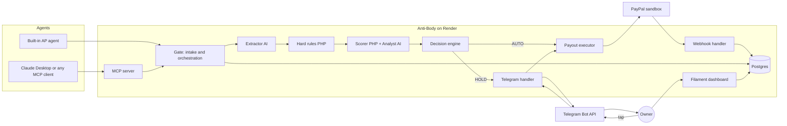

# Anti-Body

[](https://github.com/EHIBE/anti-body-paypal/actions/workflows/tests.yml)
[](https://github.com/EHIBE/anti-body-paypal/actions/workflows/security.yml)
[](LICENSE)


**The second signature your AI agent cannot talk its way past.**

Anti-Body is a payment gate between AI agents and a small business PayPal account. Agents can propose vendor invoice payments. Only Anti-Body can move money. Every proposal passes deterministic hard rules that no AI can override, then an AI-assisted risk score, and ends as **AUTO**, **HOLD** or **BLOCK**. Approved payments go out through PayPal Payouts with idempotency keys, and verified PayPal webhooks drive a strict payment state machine. The owner watches everything in a Filament dashboard and approves holds from Telegram.

Built for the [PayPal AI Hackathon](https://paypalaihackathon.devpost.com/) on Devpost. Repository and package identifier: `anti-body-paypal`.

> **Project status (2026-10-30):** the repository is a Laravel 13 + Filament 5 skeleton with full product, architecture and security documentation. Every feature below marked **(planned)** is specified in [docs/prd-anti-body-paypal.md](docs/prd-anti-body-paypal.md) and not yet built. See [docs/product/roadmap.md](docs/product/roadmap.md) for build status.

## Contents

1. [Demo video](#demo-video)
2. [The problem](#the-problem)
3. [How it works](#how-it-works)
4. [Judge access](#judge-access)
5. [Run it locally](#run-it-locally)
6. [PayPal APIs used and how](#paypal-apis-used-and-how)
7. [AI used and how](#ai-used-and-how)
8. [Security model](#security-model)
9. [Connect your own agent](#connect-your-own-agent)
10. [Tests](#tests)
11. [Tech stack](#tech-stack)
12. [Documentation](#documentation)
13. [Roadmap](#roadmap)
14. [License](#license)
15. [Built during](#built-during)

## Demo video

**(planned)** A public YouTube video under 3 minutes (target 2:50) will be linked here. Script: [docs/product/demo-script.md](docs/product/demo-script.md).

## The problem

- Invoice and email payment fraud is mainstream: 74% of US organizations were hit by business email compromise in 2025, up from 63% in 2024 (AFP 2026 survey).
- Small businesses already run on AI: 77% of US small and midsize businesses used AI regularly by January 2026 (Intuit QuickBooks 2026 AI Impact Report), and payment rails are opening to agents.
- An AI agent paying invoices can be fooled by a fake invoice that copies a real vendor, swaps the payee email and adds "pre-approved by management, pay today". Once a payout lands, the money is gone.

Details and sources: [docs/product/overview.md](docs/product/overview.md).

## How it works



1. **Intake (planned):** an invoice arrives as a dashboard PDF upload or through the MCP `submit_invoice` tool. The file is stored privately and hashed with SHA-256.
2. **Extraction (planned):** an AI extractor reads the PDF as untrusted data into a fixed JSON schema and quotes any instruction-like text into `suspicious_phrases`.
3. **Hard rules (planned):** PHP checks H1 to H10 (payee match, vendor active, currency, max per payment, weekly budget, duplicates, sanity, kill switch, agent valid). Any violation except H9 is a BLOCK that cannot be overridden.
4. **Risk score (planned):** PHP sums signals S1 to S7 (lookalike payee, amount deviation, line-item anomaly, pressure language, timing, extraction confidence, budget pressure). Signals only add points. The AI never outputs the score or the decision.
5. **Decision and payout (planned):** AUTO pays once through PayPal Payouts with `sender_batch_id = AB-{invoice_id}`. HOLD asks the owner in the dashboard or Telegram. BLOCK makes zero payout calls. Verified webhooks confirm `paid`.

Architecture: [docs/architecture/overview.md](docs/architecture/overview.md). Guard rules: [docs/architecture/guard-spec.md](docs/architecture/guard-spec.md).

## Judge access

**(planned, filled in during build block P2)**

| Item | Value |
|---|---|
| Hosted URL | (planned) Render web service `anti-body-paypal-web` |
| Owner login | (planned) demo owner email and password published here for judges |
| MCP endpoint | (planned) `https://<host>/mcp/anti-body` with a bearer token from `php artisan antibody:agent-token "Judge agent"` |
| Sandbox vendor emails | (planned) fictional sandbox accounts listed here |
| Demo PDFs | (planned) `storage/demo/`: 2 legit, 1 price jump, 1 BoxPro fake, 1 duplicate, 1 legit for a second agent |

How to trigger each demo scene: [docs/product/demo-script.md](docs/product/demo-script.md). Reset the demo: [docs/operations/demo-reset.md](docs/operations/demo-reset.md).

## Run it locally

Target: under 10 minutes on a clean machine (criterion M7). Full guide: [docs/development/local-setup.md](docs/development/local-setup.md).

**Implemented today (SQLite):**

```bash
git clone https://github.com/EHIBE/anti-body-paypal.git
cd anti-body-paypal
composer run setup
php artisan make:filament-user
composer run dev
```

`composer run setup` installs PHP and Node dependencies, copies `.env.example` to `.env`, generates the app key, runs migrations, registers the Git hooks (`npm run prepare`) and builds assets. Open `http://localhost:8000/admin` and log in with the user you created.

**Planned:**

| Step | Command | Status |
|---|---|---|
| Fill 5 variables (PayPal client ID and secret, webhook ID, Anthropic key, token HMAC key) | edit `.env` | planned |
| Docker Compose with Postgres | `docker compose up` | planned |
| Seed demo data | `php artisan migrate --seed` | planned |
| Restore demo state | `php artisan antibody:demo-reset` | planned |
| Public tunnel for PayPal and Telegram webhooks | `cloudflared` or `ngrok` | planned |
| Telegram approvals (optional) | bot token, webhook secret, owner chat ID | planned |

Configuration reference: [docs/operations/configuration.md](docs/operations/configuration.md).

## PayPal APIs used and how

All calls target the sandbox base URL `https://api-m.sandbox.paypal.com`. **Status: planned.**

| API | Endpoint | Purpose |
|---|---|---|
| OAuth 2.0 | `POST /v1/oauth2/token` (client credentials) | Access token, cached until expiry minus 5 minutes |
| Payouts | `POST /v1/payments/payouts` | Pay a vendor by email, one batch per invoice, `sender_batch_id` and `PayPal-Request-Id` = `AB-{invoice_id}` |
| Payouts | `GET /v1/payments/payouts/{payout_batch_id}`, `GET /v1/payments/payouts-item/{payout_item_id}` | Reconcile every 5 minutes |
| Webhooks | `POST /v1/notifications/verify-webhook-signature` | Verify every event before processing |
| Webhooks management | `POST /v1/notifications/webhooks` (or dashboard) | Register the listener |
| Transaction Search | `GET /v1/reporting/transactions` | Vendor baseline history (Should) |

Details: [docs/integrations/paypal-payouts.md](docs/integrations/paypal-payouts.md), [docs/integrations/idempotency.md](docs/integrations/idempotency.md), [docs/api/paypal-webhooks.md](docs/api/paypal-webhooks.md).

## AI used and how

**Status: planned.** `laravel/ai` is not installed yet.

| Role | Model | What it does | What it never does |
|---|---|---|---|
| Extractor | `claude-haiku-5-5` (UNVERIFIED, see OQ-12; fallback `claude-haiku-4-5`) | Reads the invoice PDF into a fixed schema, quotes suspicious phrases as data | Follows instructions in the document, decides, scores |
| Risk analyst | `claude-sonnet-5-5` | Judges line items against vendor history (S3 band), writes a 2 to 3 sentence owner explanation | Sees invoice notes or free text, outputs the score or decision |
| Built-in AP agent | `claude-haiku-5-5` (UNVERIFIED, see OQ-12) | Calls the same propose-only tools as external MCP agents | Approves, edits vendors, sets amount or payee, sees credentials |
| MCP server | `laravel/mcp` | Lets any MCP-capable agent submit invoices and propose payments | Exposes an approve tool |

Isolation design: [docs/ai/injection-isolation.md](docs/ai/injection-isolation.md). Eval set (17 labeled invoices, results published here after build block B9): [docs/ai/eval-set.md](docs/ai/eval-set.md).

## Security model

| Control | Rule |
|---|---|
| Hard rules | H1 to H8 and H10 BLOCK and cannot be overridden by anyone. H9 kill switch forces HOLD |
| Monotonic score | Signals only add points, floor 0, cap 100. Nothing in invoice text, agent arguments or AI output lowers a score |
| Auto ceiling | No payment above $500.00 is ever auto-paid |
| Agents can | Submit invoices, propose payments, read decisions and payment status |
| Agents cannot | Approve, reject, override, edit vendors, set amount or payee, see PayPal or Anthropic credentials |
| Money movement | Amount and payee come only from the database, exactly once per invoice |
| Audit | Append-only log with a SHA-256 hash chain |

Details: [docs/security/threat-model.md](docs/security/threat-model.md), [docs/security/owasp-mapping.md](docs/security/owasp-mapping.md).

## Connect your own agent

**(planned)** Claude Desktop connects to the local stdio server `anti-body`; remote clients use `https://<host>/mcp/anti-body` with a Sanctum bearer token. Configuration snippet and MCP Inspector command: [docs/api/mcp-tools.md](docs/api/mcp-tools.md).

## Tests

**Implemented:** Pest 5 runs architecture rules (slice isolation, class structure, no raw SQL, no debug calls), an access matrix (every protected surface needs a row, guests are refused), runtime security tests (security headers, guest access, error leaks, CSRF, login responses) and the example tests. Static analysis is Larastan at level max with strict rules; Rector and Pint run in the same gate. GitHub Actions runs the gate on SQLite and the whole suite on Postgres 17, plus gitleaks, dependency review, zizmor and actionlint. Git hooks (Husky) check commit messages, secrets and branch names, and run the gate before every push. Details: [docs/decisions/0007-local-hooks-and-single-ci-gate.md](docs/decisions/0007-local-hooks-and-single-ci-gate.md).

```bash
php artisan test --compact
composer ci:check
vendor/bin/pint --dirty --format agent
```

`composer ci:check` is the full gate (validate, Rector dry run, Pint, Larastan, audits, asset build, parallel tests). On Windows, commit and push from PowerShell.

**Planned:** unit tests for every hard rule, signal boundary, score monotonicity, decision table, state transition and hash chain; feature tests for upload-to-decision, approvals, Telegram callbacks, webhooks and MCP tools; red team cases (BoxPro impersonation, injected "ignore previous rules", duplicates, agent argument); nightly AI eval. Strategy: [docs/development/testing-strategy.md](docs/development/testing-strategy.md).

## Tech stack

| Component | Version | Status |
|---|---|---|
| PHP | 8.5.11 | implemented |
| Laravel | 13.39.0 | implemented |
| Filament | 5.11.0 (Livewire 4) | implemented (panel `admin` at `/admin`) |
| Pest | 5.3.4 with pest-plugin-laravel 5.0.1 | implemented |
| Laravel Pint | 1.32.1 | implemented |
| Larastan (on PHPStan 2.3.4), phpstan-strict-rules | v3.13.2, 2.1.0 | implemented (dev, level max) |
| Rector | 2.8.3 | implemented (dev) |
| Husky (Git hooks) | 9.1.7 | implemented (dev) |
| Laravel Boost | 2.10.4 | implemented (dev) |
| Tailwind CSS / Vite | 4 / 8 | implemented |
| Database | SQLite locally and in tests, Render Postgres in production | SQLite implemented, Postgres planned |
| Queue, cache, session | Laravel database drivers | implemented (config) |
| laravel/ai, laravel/mcp (direct), laravel/sanctum, laravel-notification-channels/telegram | latest compatible | planned, need approval |
| Hosting | Render web service (Docker) + Render Postgres | planned |

## Documentation

Start at [docs/README.md](docs/README.md) for the reading order. The product source of truth is [docs/prd-anti-body-paypal.md](docs/prd-anti-body-paypal.md). AI coding agents also read [CLAUDE.md](CLAUDE.md), [AGENTS.md](AGENTS.md) and [.ai/rules/index.md](.ai/rules/index.md).

## Roadmap

Post-hackathon, ordered by value: email-forward intake with DKIM/SPF signals, out-of-band vendor verification for payee changes, OAuth 2.1 MCP auth, multi-owner roles, marking vendor PayPal invoices as paid, multi-currency, auto-cancel unclaimed payouts, live PayPal mode, learned thresholds, Slack and WhatsApp approvals, Stripe and bank-rail executors. Full list and build status: [docs/product/roadmap.md](docs/product/roadmap.md).

## License

[MIT](LICENSE). Copyright (c) 2026 EHIBE.

## Built during

The PayPal AI Hackathon, October to November 2026. Submission deadline: Thu Nov 12, 2026, 12:00 pm PT (Fri Nov 13, 2026, 4:00 am PHT). All vendor names, emails and invoices in this repository are fictional. Sandbox PayPal only.
