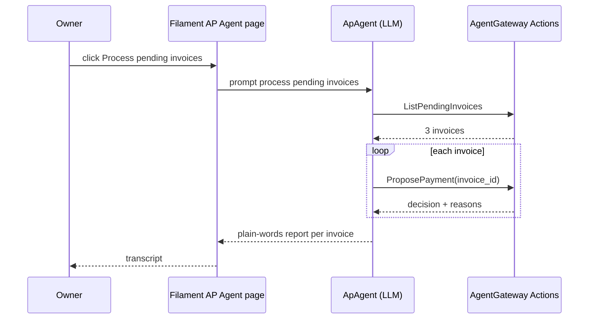

# Built-in AP Agent

> **TL;DR**
> - **Status: planned.** It will live in the AgentGateway slice (`app/Features/AgentGateway/Ai/ApAgent.php`), with a Filament page "AP Agent" (FR-34).
> - It has 3 tools: `ListPendingInvoices`, `ProposePayment`, `GetDecision`. Each calls the same AgentGateway Actions as the MCP tools (FR-33).
> - It has the same powers as an external MCP agent: submit, propose, read. It cannot approve, reject, override, edit vendors, or set an amount or payee (PRD 9.4).
> - It never sees PayPal or Anthropic credentials (US-06).
> - laravel/ai human tool approval is **not** used for payments. Approval belongs to the owner, out of band.

## 1. Model and settings

| Setting | Value |
|---|---|
| Model | `claude-haiku-5-5` per PRD 17.1 (UNVERIFIED, OQ-12). Fallback `claude-haiku-4-5` |
| Role | Orchestrates tool calls only |
| Max steps | 12 |
| Scaffold | `php artisan make:agent ApAgent` (laravel/ai, planned, approval needed) |
| Agent identity | A seeded `agents` row "Built-in AP agent". H10 applies like any other agent |
| Conversation storage | laravel/ai tables `agent_conversations`, `agent_conversation_messages` |

## 2. Tools

| Tool class | Calls | Input | Output |
|---|---|---|---|
| `ListPendingInvoices` | same Action as MCP `list_pending_invoices` | `limit` | invoice list |
| `ProposePayment` | `ProposePaymentAction` | `invoice_id`, optional `note` | decision, reasons, score, payment status |
| `GetDecision` | same Action as MCP `get_decision` | `invoice_id` | decision plus owner explanation |

No tool takes an amount or payee. Tool outputs are the same safe summaries the MCP tools return (see [MCP tools](../api/mcp-tools.md)).

## 3. Flow (US-06)

## 4. Safety rules

| Rule | Why |
|---|---|
| Agent output is shown as escaped text in the transcript | Model output is untrusted (LLM05) |
| Agent never receives raw invoice text, notes or file contents | Injection isolation (PRD 9.5) |
| A decision the agent dislikes cannot be changed by calling again | `ProposePaymentAction` is idempotent (US-08) |
| Agent tokens and keys stay server-side | Credential isolation (PRD 12.6) |
| Running the agent requires the owner session | Filament page authorization |

## 5. Tests (planned)

Use laravel/ai fakes to script tool calls. Assert: one `propose_payment` per pending invoice, decisions match the Guard result, no payout call for HOLD or BLOCK, and no tool exists that approves.
