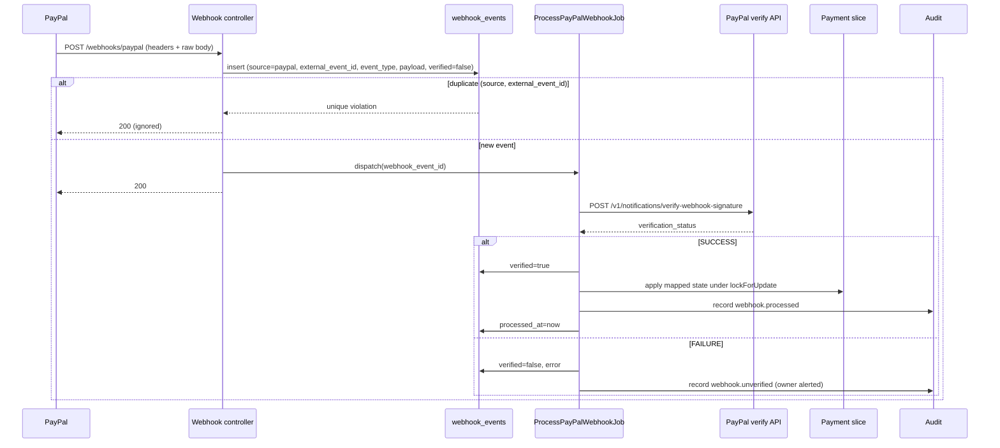

# PayPal Webhooks

> **TL;DR**
> - **Status: planned.** Endpoint `POST /webhooks/paypal` in the Webhook slice.
> - Every event is verified by posting it back to `POST /v1/notifications/verify-webhook-signature`. Only `verification_status = SUCCESS` is processed.
> - Events are stored in `webhook_events` with unique `(source, external_event_id)`, so a duplicate is ignored.
> - The endpoint answers 200 fast and processes in a queued job (`ProcessPayPalWebhookJob`).
> - Item events decide payment state. Batch `SUCCESS` changes nothing.

## 1. Subscribed events and mapping (PRD 10.1)

| PayPal webhook event | Payment state | Owner notified |
|---|---|---|
| `PAYMENT.PAYOUTSBATCH.PROCESSING` | `submitted` | no |
| `PAYMENT.PAYOUTS-ITEM.SUCCEEDED` | `paid` | yes, Telegram "Paid" |
| `PAYMENT.PAYOUTS-ITEM.UNCLAIMED` | `unclaimed` | yes |
| `PAYMENT.PAYOUTS-ITEM.HELD` | `paypal_held` | yes |
| `PAYMENT.PAYOUTS-ITEM.FAILED`, `PAYMENT.PAYOUTS-ITEM.DENIED`, `PAYMENT.PAYOUTS-ITEM.BLOCKED` | `failed` | yes |
| `PAYMENT.PAYOUTS-ITEM.RETURNED`, `PAYMENT.PAYOUTS-ITEM.REFUNDED`, `PAYMENT.PAYOUTS-ITEM.CANCELED` | `reversed` | yes |
| `PAYMENT.PAYOUTSBATCH.DENIED` | `failed` | yes |
| `PAYMENT.PAYOUTSBATCH.SUCCESS` | no change (batch events carry no item data, item events decide) | no |

Invoice states follow the payment state: `paid` -> invoice `paid`; `failed` or `reversed` -> invoice `payment_failed`; `unclaimed` or `paypal_held` -> invoice `paypal_attention` (see [state machines](../architecture/state-machines.md)). A transition that is not legal in PRD 14.3 throws, is audited, and leaves the row unchanged.

## 2. Processing flow

## 3. Verification request

| Field sent to `verify-webhook-signature` | Source |
|---|---|
| `auth_algo` | Header `PAYPAL-AUTH-ALGO` |
| `cert_url` | Header `PAYPAL-CERT-URL` |
| `transmission_id` | Header `PAYPAL-TRANSMISSION-ID` |
| `transmission_sig` | Header `PAYPAL-TRANSMISSION-SIG` |
| `transmission_time` | Header `PAYPAL-TRANSMISSION-TIME` |
| `webhook_id` | Config `PAYPAL_WEBHOOK_ID` (never from the request) |
| `webhook_event` | The raw JSON body, decoded to an array |

Rules:
- The call uses the cached OAuth token and a timeout (see [PayPal OAuth](../integrations/paypal-oauth.md)).
- Anti-Body never downloads `cert_url` itself. PayPal does the check (avoids SSRF, A01).
- The Webhooks Simulator sends mock events that fail verification. Test with real sandbox payouts (PRD 16.4).

## 4. Edge cases (PRD 10.2)

| Case | Detection | Behaviour |
|---|---|---|
| Duplicate webhook | Same PayPal event ID | Unique index `(source, external_event_id)` rejects the insert. Respond 200, do nothing |
| Unverified webhook | `verification_status = FAILURE` | Stored with `verified = false`, not processed, owner alerted, audit entry |
| Webhook race (item event before batch response saved) | Event references an unknown `payout_batch_id` | Look up the payment by `sender_batch_id` from the event resource (`AB-{invoice_uuid}`), attach the batch ID, re-process |
| Out-of-order events | For example `SUCCEEDED` after `PROCESSING` arrived late | State machine accepts only legal forward transitions. An event that would move backwards is stored, audited and skipped |
| Late webhook | Payment in `submitted` longer than 2 min | Reconcile job resolves it (see [reconcile](../integrations/reconcile.md)) |
| Partial failure (paid at PayPal but DB write failed) | Reconcile finds PayPal `SUCCESS` for a non-paid row | Apply `paid`, audit `reconciled` |
| Verification API timeout | HTTP timeout or 5xx | Job fails and retries with a limit. Event stays unprocessed. Fail closed: never process an unverified event |

## 5. Storage

Table `webhook_events` (see [data model](../architecture/data-model.md)): `id` uuid, `source` enum `paypal`/`telegram`, `external_event_id` (unique per source), `event_type`, `verified`, `payload` jsonb, `processed_at`, `error`.

The payload is decoded with `json_decode(..., true)` into an array. It is never unserialized into objects (A08). Payloads contain recipient emails, so they are never logged in full (A09).

## 6. Setup

Register the listener URL `https://{tunnel or render host}/webhooks/paypal` in the PayPal developer dashboard and subscribe to all events in section 1. Copy the webhook ID into `PAYPAL_WEBHOOK_ID`. Full steps: [PayPal sandbox setup](../integrations/paypal-sandbox-setup.md).
