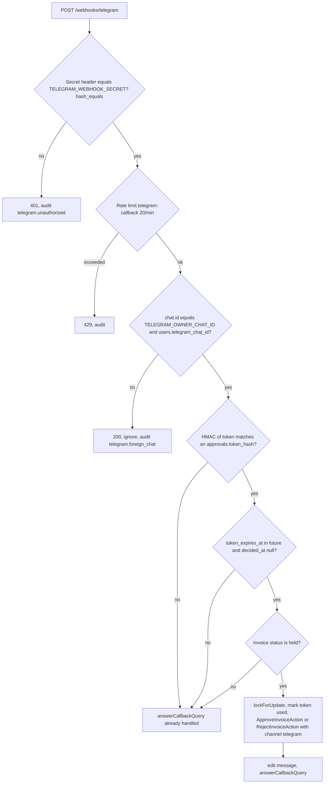

# Telegram Webhook and Callbacks

> **TL;DR**
> - **Status: planned.** Endpoint `POST /webhooks/telegram` in the Telegram slice. `laravel-notification-channels/telegram` is not installed (needs approval).
> - Telegram can only **approve or reject a HOLD**. It cannot override any BLOCK, edit vendors or change policy (PRD 9.4).
> - A callback is accepted only when all four checks pass: secret header, allowlisted chat ID, valid single-use HMAC token, not expired (15 min).
> - A replayed or expired tap is rejected and answered "already handled".
> - The secret header name `X-Telegram-Bot-Api-Secret-Token` is UNVERIFIED until OQ-05 is closed.

## 1. Messages

### 1.1 HOLD approval request (PRD 19.3, illustrative)

```
⚠️ Anti-Body: approval needed
PrintHub · INV-2207 · $640.00
Risk 35 · HOLD
• 45% above usual amount
• Above auto-approve limit ($500)
[ Approve ]  [ Reject ]
Expires in 15 min
```

| Field | Source |
|---|---|
| Vendor, invoice number, amount | Database (`vendors.name`, `invoices.invoice_number`, `invoices.amount_minor` formatted) |
| Risk score and decision | `risk_assessments` |
| Top reasons | Top 3 reasons by points, plain-word labels (never raw invoice text) |
| Buttons | Inline keyboard with `callback_data` (section 2) |

After a tap the message is edited to `✅ Approved by you · paying`, then to `Paid` when the PayPal webhook confirms (`paid` state only, never earlier).

### 1.2 BLOCK alert (no buttons)

```
🛑 Anti-Body blocked a payment
"BoxPro Supplies" · $680.00
Payee does not match BoxPro's verified email
Lookalike domain · pressure language
$680 protected. Review in dashboard.
```

### 1.3 Other notices

| Event | Message |
|---|---|
| Payment paid | Edit approval message to "Paid", or send "Paid" for AUTO payments |
| Payment `failed`, `unclaimed`, `paypal_held`, `reversed` | Alert with reason and "What to do" line |
| HOLD expired after 72 h (policy `hold_expiry_hours`) | "Auto-rejected after 72 h" notice |
| Unverified PayPal webhook | Owner alert |

## 2. Callback data format

| Button | `callback_data` |
|---|---|
| Approve | `approve:<token>` |
| Reject | `reject:<token>` |

| Item | Rule |
|---|---|
| `<token>` | Random token from `Str::random(40)` (fits Telegram's 64-byte `callback_data` limit together with the prefix) |
| Storage | Only `token_hash = hash_hmac('sha256', token, ANTIBODY_TOKEN_HMAC_KEY)` in `approvals.token_hash` (unique), with `token_expires_at = now + 15 min`. The plaintext token exists only inside the Telegram message |
| Binding | The approval row binds the token to one invoice and one action. The callback never carries an invoice ID or amount |

## 3. Callback checks (FR-27, in order, fail closed)



| Check | Detail |
|---|---|
| Secret header | Telegram sends the `secret_token` given to `setWebhook` in header `X-Telegram-Bot-Api-Secret-Token` (UNVERIFIED, OQ-05). Compared with `hash_equals()` |
| Chat allowlist | `callback_query.message.chat.id` must equal the owner's allowlisted chat ID |
| Token | Look up by HMAC hash. Mark used in the same transaction as the approval (`decided_at` set), under `lockForUpdate()` |
| Expiry | 15 minutes from message send |
| Invoice state | Must still be `held`. Telegram never acts on a BLOCK |
| Replay | A used or expired token returns "already handled" and changes nothing (PRD 10.2) |

The raw update is stored in `webhook_events` with `source = telegram` and `external_event_id = update_id` (unique per source), so duplicate deliveries are ignored.

## 4. Token expiry vs HOLD expiry (OQ-15)

| Clock | Length | After it runs out |
|---|---|---|
| Telegram token | 15 min | Buttons stop working. Approval is dashboard-only (contract decision D12) |
| HOLD | 72 h (`policies.hold_expiry_hours`) | Invoice auto-rejected with a Telegram notice |

## 5. Configuration

| Env var | Use |
|---|---|
| `TELEGRAM_BOT_TOKEN` | Bot API calls |
| `TELEGRAM_WEBHOOK_SECRET` | `secret_token` for `setWebhook`, checked on every update |
| `TELEGRAM_OWNER_CHAT_ID` | Allowlisted chat |
| `ANTIBODY_TOKEN_HMAC_KEY` | HMAC key for approval tokens |

All are read through `config/services.php` (planned keys), never `env()` outside `config/`. None are logged. See [Telegram integration](../integrations/telegram.md) for bot setup and `setWebhook`.

## 6. Tests (planned, PRD section 22)

| Case | Expected |
|---|---|
| Valid approve | Invoice `approved`, one payment `queued`, token used, message edited |
| Expired token | "already handled", no state change |
| Replayed token | "already handled", no second payment |
| Wrong chat | Ignored, audit entry |
| Missing or wrong secret | 401 |
| Tap on a BLOCK invoice | No state change |
