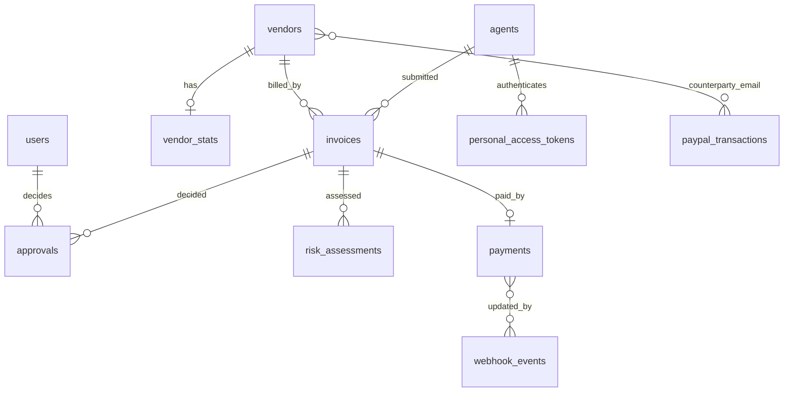

# Data Model

> **TL;DR**
> - **Implemented today:** Laravel default tables only: `users`, `password_reset_tokens`, `sessions`, `cache`, `cache_locks`, `jobs`, `job_batches`, `failed_jobs`.
> - **Planned:** 11 domain tables (`vendors`, `vendor_stats`, `invoices`, `risk_assessments`, `approvals`, `payments`, `webhook_events`, `agents`, `policies`, `paypal_transactions`, `audit_logs`) plus `personal_access_tokens` (Sanctum) and `agent_conversations`, `agent_conversation_messages` (laravel/ai).
> - Money is integer minor units (`*_minor`, cents). Currency is ISO 4217 `char(3)`. Times are UTC.
> - Domain IDs are UUIDv7 via `HasUuids`, except `users`, `agents` (Sanctum tokenable) and `audit_logs` which stay bigint.
> - Every migration must run on SQLite (local, tests) and Postgres (Render). New migrations only; never edit an applied one.

## 1. Entity relationship diagram



`audit_logs` references any row through `subject_type` + `subject_id` (polymorphic, no foreign key). `policies` is a single row. `webhook_events` reaches payments through payload ids, not a foreign key.

## 2. Tables

Column types follow PRD 14.1. "Owner" is the slice that writes the table (see [slice-catalog.md](./slice-catalog.md)).

### 2.1 users (implemented default + planned fields)

Owner: framework, extended by AgentGateway/Telegram setup.

| Column | Type | Null | Notes | Status |
|---|---|---|---|---|
| id | bigint | no | PK | Implemented |
| name, email, password | standard | no | email unique | Implemented |
| email_verified_at, remember_token, timestamps | standard | yes | Laravel default | Implemented |
| telegram_chat_id | varchar(64) | yes | Allowlisted chat for approvals | Planned |
| is_owner | bool | no | default true for seeded owner | Planned |

### 2.2 vendors (planned, Vendor slice)

| Column | Type | Null | Notes |
|---|---|---|---|
| id | uuid | no | PK, UUIDv7 |
| name | varchar(160) | no | |
| paypal_email | varchar(254) | no | **unique**, stored lowercased and trimmed |
| domain | varchar(253) | yes | from email or website |
| currency | char(3) | no | default `USD` |
| status | varchar (enum `active`, `suspended`) | no | index |
| verified_at | timestamp | yes | |
| verification_note | text | yes | required when email changes (FR-02) |
| typical_amount_minor_override | bigint | yes | owner override (FR-39) |
| typical_interval_days_override | int | yes | owner override (FR-39) |
| timestamps | | | |

### 2.3 vendor_stats (planned, Baseline slice)

| Column | Type | Null | Notes |
|---|---|---|---|
| vendor_id | uuid | no | PK, FK vendors |
| sample_size | int | no | |
| median_amount_minor | bigint | yes | |
| mad_amount_minor | bigint | yes | median absolute deviation |
| median_interval_days | numeric(6,2) | yes | |
| last_paid_at | timestamp | yes | |
| typical_items | jsonb | yes | `[{name, median_qty, median_unit_price_minor}]` |
| refreshed_at | timestamp | no | |

### 2.4 invoices (planned, Invoice slice; extracted fields written by Extraction through Invoice Actions)

| Column | Type | Null | Notes |
|---|---|---|---|
| id | uuid | no | PK, UUIDv7 |
| vendor_id | uuid | yes | FK vendors, null if no match |
| source | varchar (enum `dashboard_upload`, `mcp_submit`, `seed`) | no | |
| submitted_by_agent_id | bigint | yes | FK agents |
| file_path | varchar | yes | private disk, generated name |
| file_sha256 | char(64) | no | **unique** (H7) |
| invoice_number | varchar(64) | yes | |
| claimed_vendor_name | varchar(160) | yes | |
| claimed_payee_email | varchar(254) | yes | copied exactly as extracted |
| currency | char(3) | yes | |
| amount_minor | bigint | yes | |
| issue_date, due_date | date | yes | |
| line_items | jsonb | yes | `[{description, qty, unit_price_minor, total_minor}]` |
| instruction_like_text | bool | no | default false |
| suspicious_phrases | jsonb | no | `[{text, category}]`, default `[]` |
| extraction_confidence | numeric(3,2) | yes | |
| status | varchar (enum, see [state-machines.md](./state-machines.md)) | no | index |
| approved_amount_minor | bigint | yes | locked at approval |
| timestamps | | | |

### 2.5 risk_assessments (planned, Guard slice)

| Column | Type | Null | Notes |
|---|---|---|---|
| id | uuid | no | PK |
| invoice_id | uuid | no | FK invoices, index |
| hard_rule_violations | jsonb | no | `["H1", ...]` |
| signals | jsonb | no | `[{id, points, detail}]` |
| score | smallint | no | 0 to 100 |
| decision | varchar (enum `auto`, `hold`, `block`) | no | |
| block_type | varchar (enum `hard`, `score`) | yes | |
| owner_explanation | text | yes | from Analyst |
| extractor_model, analyst_model | varchar | yes | |
| prompt_version | varchar(16) | no | |
| created_at | timestamp | no | |

### 2.6 approvals (planned, Approval slice)

| Column | Type | Null | Notes |
|---|---|---|---|
| id | uuid | no | PK |
| invoice_id | uuid | no | FK, index |
| action | varchar (enum `approve`, `reject`, `override_block`) | no | |
| channel | varchar (enum `dashboard`, `telegram`) | no | |
| user_id | bigint | no | FK users |
| reason | text | yes | |
| token_hash | char(64) | yes | Telegram single-use token hash, **unique** |
| token_expires_at | timestamp | yes | issued + 15 min |
| decided_at | timestamp | yes | null while the Telegram token is outstanding |

### 2.7 payments (planned, Payment slice)

| Column | Type | Null | Notes |
|---|---|---|---|
| id | uuid | no | PK |
| invoice_id | uuid | no | **unique**, FK |
| sender_batch_id | varchar(64) | no | **unique**, `AB-{invoice_id}` |
| paypal_request_id | varchar(64) | no | same value as `sender_batch_id` |
| payout_batch_id | varchar(64) | yes | index |
| payout_item_id | varchar(64) | yes | index |
| payee_email | varchar(254) | no | copied from registry at submit |
| amount_minor | bigint | no | equals `invoices.approved_amount_minor` |
| currency | char(3) | no | |
| status | varchar (enum, see [state-machines.md](./state-machines.md)) | no | index |
| attempts | smallint | no | default 0 |
| last_error | text | yes | safe summary, no secrets |
| submitted_at, paid_at | timestamp | yes | |
| timestamps | | | |

### 2.8 webhook_events (planned, Webhook slice)

| Column | Type | Null | Notes |
|---|---|---|---|
| id | uuid | no | PK |
| source | varchar (enum `paypal`, `telegram`) | no | |
| external_event_id | varchar(128) | no | **unique per source** |
| event_type | varchar(96) | no | |
| verified | bool | no | unverified events are stored, never processed |
| payload | jsonb | no | |
| processed_at | timestamp | yes | |
| error | text | yes | |

PRD 14.1 lists no timestamps here; add `created_at` for ordering and retention (planned, confirm in B3).

### 2.9 agents (planned, AgentGateway slice)

| Column | Type | Null | Notes |
|---|---|---|---|
| id | bigint | no | PK, Sanctum tokenable (decision D9) |
| name | varchar(80) | no | "Built-in AP agent", "Claude Desktop" |
| active | bool | no | H10 |
| last_seen_at | timestamp | yes | |

### 2.10 policies (planned, Policy slice, single row)

| Column | Type | Null | Notes |
|---|---|---|---|
| id | smallint | no | PK = 1 (check constraint `id = 1`) |
| auto_ceiling_minor | bigint | no | default 50000; check `<= 50000` (absolute $500.00 ceiling) |
| max_per_payment_minor | bigint | no | default 150000 |
| weekly_budget_minor | bigint | no | default 300000 |
| allowed_currencies | jsonb | no | `["USD"]` |
| paused | bool | no | H9 |
| hold_expiry_hours | int | no | 72 |
| updated_by, updated_at | | | `updated_by` FK users |

### 2.11 paypal_transactions (planned, Baseline slice)

| Column | Type | Null | Notes |
|---|---|---|---|
| transaction_id | varchar(32) | no | composite PK part |
| event_code | varchar(8) | no | composite PK part |
| counterparty_email | varchar(254) | yes | index |
| amount_minor | bigint | no | |
| currency | char(3) | no | |
| transaction_initiation_date | timestamp | no | composite PK part |
| raw | jsonb | no | |

PK = (`transaction_id`, `event_code`, `transaction_initiation_date`) because `transaction_id` is not unique in PayPal reporting.

### 2.12 audit_logs (planned, Audit slice, append-only)

| Column | Type | Null | Notes |
|---|---|---|---|
| id | bigint | no | PK (decision D9) |
| actor_type | varchar (enum `owner`, `agent`, `system`, `paypal`, `telegram`) | no | |
| actor_id | varchar(64) | yes | |
| action | varchar(64) | no | e.g. `decision.made`, `payout.submitted` |
| subject_type, subject_id | varchar | yes | |
| data | jsonb | no | never secrets or tokens |
| prev_hash | char(64) | yes | null on the first row |
| hash | char(64) | no | `sha256(prev_hash . canonical_json(row))`, see [../security/audit-hash-chain.md](../security/audit-hash-chain.md) |
| created_at | timestamp | no | |

### 2.13 Framework tables

| Table | Package | Status |
|---|---|---|
| `users`, `password_reset_tokens`, `sessions` | laravel/framework | Implemented |
| `cache`, `cache_locks` | laravel/framework | Implemented |
| `jobs`, `job_batches`, `failed_jobs` | laravel/framework | Implemented |
| `personal_access_tokens` | laravel/sanctum | Planned (package not installed) |
| `agent_conversations`, `agent_conversation_messages` | laravel/ai | Planned (package not installed) |

## 3. Constraints and indexes (PRD 14.2, amended)

| Constraint | Backs rule | Migration form |
|---|---|---|
| `vendors.paypal_email` unique | H1 registry integrity | `$table->string('paypal_email', 254)->unique()` |
| `invoices.file_sha256` unique | H7 | `->unique()` |
| `invoices (vendor_id, invoice_number)` unique partial **where status not in (`rejected`, `blocked`)** | H6 | Raw statement, see 4.2 |
| `payments.invoice_id` unique | One payment per invoice | `->unique()` |
| `payments.sender_batch_id` unique | Idempotency | `->unique()` |
| `webhook_events (source, external_event_id)` unique | Webhook dedupe | `$table->unique(['source', 'external_event_id'])` |
| `approvals.token_hash` unique | Single-use Telegram token | `->unique()` |
| `policies.id = 1`, `auto_ceiling_minor <= 50000` | Single row, absolute ceiling | Check constraint (Laravel 13 schema builder or raw statement) |
| App DB role has no UPDATE or DELETE on `audit_logs` (Should, Postgres only) | Audit immutability | Postgres trigger or grants, see PRD 18 |
| Indexes on `vendors.status`, `invoices.status`, `invoices.vendor_id`, `risk_assessments.invoice_id`, `approvals.invoice_id`, `payments.status`, `payments.payout_batch_id`, `payments.payout_item_id`, `paypal_transactions.counterparty_email` | Lookups, joins, sorting | `->index()` |

**Why the H6 index also excludes `blocked` (decision D4):** the PRD index (`status <> 'rejected'`) would make it impossible to store a conflicting revision as `blocked`, which US-09 needs for the side-by-side diff. With the amended predicate, the original invoice and its blocked duplicate can coexist. H6 is checked in PHP first under a row lock; a unique violation during a race is converted into an H6 BLOCK.

**H7 behavior:** a second upload with the same bytes creates no row. The caller receives `duplicate_file` with the original invoice id and an audit entry is written.

## 4. Portability: SQLite and Postgres

### 4.1 Type mapping

| Concept | Migration call | Postgres | SQLite |
|---|---|---|---|
| UUIDv7 primary key | `$table->uuid('id')->primary()` + model `HasUuids` (Laravel 13 generates UUIDv7) | `uuid` | `varchar` |
| JSON | `$table->jsonb('...')` | `jsonb` | `text` with JSON functions |
| Enum | `$table->string('status', 32)` + PHP backed enum cast | `varchar` | `varchar` |
| Money | `$table->bigInteger('amount_minor')` | `bigint` | `integer` |
| Decimal stats | `$table->decimal('median_interval_days', 6, 2)` | `numeric(6,2)` | `numeric` |
| Timestamps | `$table->timestampTz()` is not required; store UTC with `timestamp` | `timestamp` | `datetime` |
| Boolean | `$table->boolean()` | `boolean` | `integer` 0/1 |

Rules:

| Rule | Reason |
|---|---|
| Use string columns + PHP enums, never database `enum` types | Database enum types are not portable and are painful to alter |
| Avoid `jsonb` operators in queries; filter JSON in PHP or with Laravel JSON where-clauses that both drivers support | SQLite has no `jsonb` operators |
| Write partial indexes and check constraints with `DB::statement()` using SQL that both drivers accept | Schema builder has no portable partial index |
| Run the test suite on SQLite `:memory:`, and the CI suite on Postgres (planned, PRD 22) | Catch driver differences |
| Every migration has a working `down()` | Reversible migrations |

### 4.2 Partial unique index (illustrative, planned)

```php
DB::statement(
    "CREATE UNIQUE INDEX invoices_vendor_number_unique ON invoices (vendor_id, invoice_number) WHERE status NOT IN ('rejected', 'blocked')"
);
```

`down()` runs `DROP INDEX invoices_vendor_number_unique`. Both SQLite (3.8+) and Postgres support this syntax. Rows with null `vendor_id` or null `invoice_number` are not constrained, which matches H8 (missing invoice number is a separate BLOCK).

## 5. Data rules

| Rule | Source |
|---|---|
| Money only as integer minor units; never floats in arithmetic | PRD 14 |
| `paypal_email` and `claimed_payee_email` compared lowercased and trimmed | H1 |
| Payout amount = `approved_amount_minor`, payout email = registry `paypal_email` copied at submit | FR-19 |
| `audit_logs` written only through `RecordAuditEntryAction` | FR-35 |
| No real names, real emails or real invoices in seeders or demo PDFs | PRD 18 |
| Raw PDFs deleted after 90 days | Roadmap (PRD 18) |
