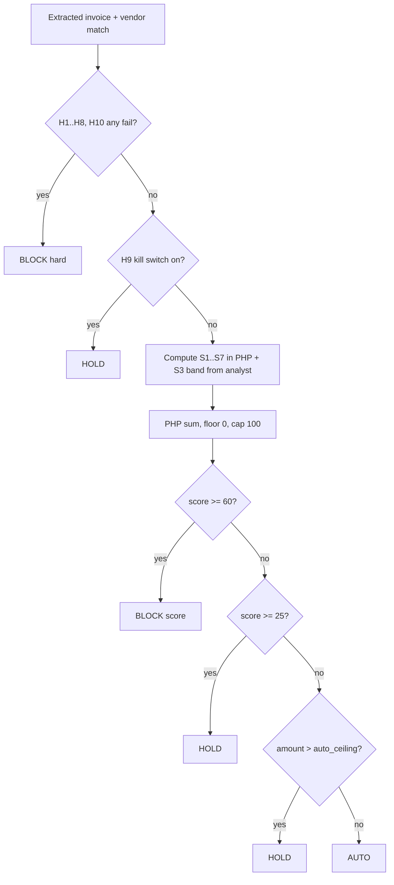

# Guard Specification

> **TL;DR**
> - Hard rules H1 to H10 run in PHP with no AI. H1 to H8 and H10 produce BLOCK that nobody can override. H9 (kill switch) produces HOLD.
> - Signals S1 to S7 only add points (monotonic). PHP sums them, floor 0, cap 100. AI never outputs the score or the decision.
> - Decision order: hard BLOCK, then H9 HOLD, then score at least 60 BLOCK, score 25 to 59 HOLD, amount above `auto_ceiling` HOLD, else AUTO.
> - `auto_ceiling` default and absolute maximum is $500.00. No score, rule or agent can auto-pay above it.
> - **Status: planned.** All rules, signals and thresholds live only in `app/Features/Guard/` (DRY). The eval set in [../ai/eval-set.md](../ai/eval-set.md) is the acceptance test.

## 1. Pipeline

Signals are still computed after a hard BLOCK so the decision card and the analyst explanation can show every reason (PRD 11.1 step 5). They never change a hard BLOCK.

## 2. Hard rules (PRD 9.1)

PHP only, no AI, no override.

| ID | Rule | Fails when | Catches | Outcome | Planned class |
|---|---|---|---|---|---|
| H1 | Payee match | Extracted payee email is not exactly equal (case-insensitive, trimmed) to an Active vendor's registered PayPal email | Changed payee, impersonation | BLOCK | `PayeeMatchRule` |
| H2 | Vendor active | Matched vendor status is not `active` | Suspended vendor | BLOCK | `VendorActiveRule` |
| H3 | Currency | Invoice currency not equal to vendor currency, or not in allowed list (`USD`) | Currency swap | BLOCK | `CurrencyRule` |
| H4 | Max per payment | Amount greater than `max_per_payment` | Single big overspend | BLOCK | `MaxPerPaymentRule` |
| H5 | Weekly budget | Sum of `approved + submitting + submitted + paid` this ISO week + amount greater than `weekly_budget` | Overspend over time | BLOCK | `WeeklyBudgetRule` |
| H6 | Unique invoice number | Same vendor + invoice number already exists (any state except `rejected` by owner) | Duplicate or conflicting revision | BLOCK | `UniqueInvoiceNumberRule` |
| H7 | Unique file | Same SHA-256 already received | Same PDF forwarded twice | BLOCK | `UniqueFileRule` (checked at intake) |
| H8 | Sanity | Amount less than or equal to 0, or due date more than 365 days away, or missing invoice number | Garbage or malformed input | BLOCK | `SanityRule` |
| H9 | Kill switch | Global pause is on | Owner emergency stop | HOLD (not BLOCK) | `KillSwitchRule` |
| H10 | Agent valid | Calling agent token revoked or agent disabled | Stolen or retired agent | BLOCK | `AgentValidRule` (also enforced by MCP middleware) |

Implementation notes:

| Note | Detail |
|---|---|
| H1 vendor match | Match by registered email first. If the claimed vendor name matches a vendor but the email does not, H1 fails and S1 (same display name, different email) fires |
| H5 week | ISO week computed in UTC (decision D7, OQ-14). "approved" means invoices in `auto_approved` or `approved` with no payment yet, plus payments in `queued` |
| H5 vs S7 | Above 100% of budget is H5 BLOCK. Above 80% and at most 100% is S7 +5 |
| H6 storage | The blocked duplicate is stored; the partial unique index excludes `rejected` and `blocked` (see [data-model.md](./data-model.md)) |
| H7 placement | Checked by `ReceiveInvoiceAction` at intake; returns `duplicate_file` with the original invoice id, no new row |
| H10 placement | Checked by `EnsureAgentIsActive` middleware on every MCP call and again in `ProposePaymentAction` |
| Missing vendor | No vendor match means H1 fails (no Active vendor email equals the payee) |
| Fixing a hard BLOCK | The owner fixes the underlying data (for example verifies a new payee email out of band and updates the registry), then re-submits |

## 3. Risk signals (PRD 9.2)

Score 0 to 100, monotonic, additive, capped.

| ID | Signal | Computed by | Points | Planned class |
|---|---|---|---|---|
| S1 | Lookalike payee or domain | PHP: normalized Levenshtein similarity at least 0.75 to any registered vendor email or domain, or same display name with different email, or homoglyph map match | +45 | `LookalikePayeeSignal` |
| S2 | Amount deviation | PHP: modified z-score = (amount minus vendor median) / (1.4826 x MAD). z 2 to 3 = +10, z over 3 or over 50% above median = +25. New vendor with no history = +0 (S5 covers it) | +10 or +25 | `AmountDeviationSignal` |
| S3 | Line-item anomaly | AI over structured line items vs vendor typical items: `normal`, `unusual`, `implausible` | +0, +8, +15 | `LineItemAnomalySignal` |
| S4 | Pressure or instruction language | Extractor flag `instruction_like_text` or at least 1 `suspicious_phrases` item in categories urgency, authority claim, payment-detail change, AI-directed instruction | +20 | `PressureLanguageSignal` |
| S5 | Timing | PHP: invoice less than 50% of vendor median interval since last paid invoice = +10. First ever payment to this vendor = +15 | +10 or +15 | `TimingSignal` |
| S6 | Extraction confidence | Extractor `confidence` below 0.8 | +15 | `ExtractionConfidenceSignal` |
| S7 | Weekly budget pressure | PHP: payment would push week above 80% of budget (but at most 100%, else H5) | +5 | `WeeklyBudgetPressureSignal` |

Implementation notes:

| Note | Detail |
|---|---|
| Monotonic rule | No signal subtracts points. Nothing in invoice text, agent arguments or AI explanation can reduce a score |
| S2 math | Integer minor units in, float only for the z-score ratio. MAD of 0 means z is undefined: use only the "over 50% above median" branch |
| S2 / S5 overrides | `typical_amount_minor_override` and `typical_interval_days_override` replace computed median and interval when set (FR-39) |
| S3 bands | The analyst returns only the band. PHP maps the band to points. The analyst cannot change any other signal |
| S4 categories | `urgency`, `authority_claim`, `payment_detail_change`, `ai_directed_instruction` count. `other` alone does not |
| LLM outage | If the analyst is unavailable, S3 is 0 and the decision is forced to at least HOLD (PRD 10.2) |
| Extraction failure | Two invalid extractor outputs: invoice `held` with `extraction_failed`; no scoring (FR-10) |

## 4. Decision thresholds (PRD 9.3)

Evaluated in order. First match wins, except the ceiling rule which raises AUTO to HOLD.

| Condition | Decision | `block_type` |
|---|---|---|
| Any of H1 to H8, H10 failed | **BLOCK** | `hard` |
| H9 kill switch on | **HOLD** | null |
| Score at least 60 | **BLOCK** | `score` |
| Score 25 to 59 | **HOLD** | null |
| Amount greater than `auto_ceiling` | **HOLD** (at least) | null |
| Score 0 to 24 and amount at or below `auto_ceiling` | **AUTO** | null |
| Analyst or extractor unavailable (fail closed) | **HOLD** (at least) | null |

## 5. Policy values (owner-editable, Policy slice)

| Setting | Column | Default | Limits |
|---|---|---|---|
| `auto_ceiling` | `auto_ceiling_minor` | $500.00 (50000) | Absolute maximum $500.00. Change needs dashboard, typed confirmation, audit |
| `max_per_payment` | `max_per_payment_minor` | $1,500.00 (150000) | Dashboard only, audited |
| `weekly_budget` | `weekly_budget_minor` | $3,000.00 (300000) | Dashboard only, audited |
| Allowed currencies | `allowed_currencies` | `["USD"]` | Multi-currency is roadmap |
| Kill switch | `paused` | false | H9 |
| HOLD expiry | `hold_expiry_hours` | 72 h, then auto-reject with Telegram notice | |

## 6. Override rules (PRD 9.4)

| Actor | Can | Cannot |
|---|---|---|
| Owner (dashboard) | Approve HOLD, reject anything, override score-BLOCK with typed confirmation, edit vendors and policy | Override hard-rule BLOCK |
| Owner (Telegram) | Approve or reject HOLD | Override any BLOCK, edit vendors or policy |
| Built-in AP agent | Submit invoices, propose payments, read decisions | Approve, reject, override, edit vendors, set amount or payee |
| External MCP agent | Same as built-in agent | Same as built-in agent |
| AI models (extractor, analyst) | Return structured data and explanations | Produce a score, a decision or any write |

## 7. Worked example: BoxPro impersonation (PRD 11.1)

| Input | Value |
|---|---|
| Claimed vendor | "BoxPro Supplies" |
| Claimed payee | lookalike address on `boxpro-ph.com` (registered address is on `boxpro.ph`; demo data should use `.example` domains, OQ-13) |
| Amount | US$680.00, within budget, within 10% of BoxPro median |
| Phrases | "Payment details updated" (payment_detail_change), "pre-approved by management" (authority_claim), "Process immediately to avoid late fees" (urgency) |

| Check | Result |
|---|---|
| H1 | FAIL (payee not registered) -> BLOCK hard |
| S1 | +45 (lookalike domain, same display name) |
| S4 | +20 |
| Score | 65 (shown for explanation; decision already BLOCK hard) |
| Agent sees | `{decision: block, reasons: [H1 payee_mismatch, S1 lookalike_payee, S4 pressure_language], payment_status: none}` |
| Money protected counter | +$680 |

## 8. Required tests (planned, PRD 22)

| Test | Layer |
|---|---|
| Each hard rule pass and fail | Unit |
| Each signal boundary (S1 at 0.74 and 0.75, S2 at z 2, 3 and 50%, S5 at 50% interval and first payment, S6 at 0.79 and 0.8, S7 at 80% and 100%) | Unit |
| Score monotonicity: adding any signal never lowers the score; cap 100 | Unit (property style over datasets) |
| Decision table rows in order | Unit |
| Hard BLOCK cannot be overridden by any actor | Feature |
| Repeated `propose_payment` with a note returns the same decision and score | Feature (MCP) |
| Eval cases 9 to 16 correct 100% | Eval |
