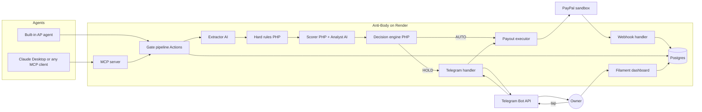

# Architecture Overview

> **TL;DR**
> - Anti-Body is one Laravel 13 application: a Filament 5 owner dashboard, a guard pipeline (hard rules, risk score, decision), a PayPal Payouts executor, webhook handlers, a Telegram approval bot and an MCP server for external agents.
> - Agents can only propose payments. Only Anti-Body moves money, and only through PayPal Payouts with idempotency keys.
> - Business logic lives in vertical slices under `app/Features/<Slice>/` (planned). Filament UI lives separately in `app/Filament/`.
> - **Implemented today:** Laravel 13.39.0 skeleton, Filament 5.11.0 panel `admin` at `/admin`, Pest 5.3.4, SQLite. **Everything else on this page is planned.**
> - One Render web service (Docker) runs web, queue worker and scheduler. One Render Postgres database holds all state (planned).

## 1. Implementation status

| Area | Status | Evidence |
|---|---|---|
| Laravel 13 skeleton, default migrations (users, cache, jobs) | Implemented | `bootstrap/app.php`, `database/migrations/` |
| Filament panel `admin` at `/admin` with login | Implemented | `app/Providers/Filament/AdminPanelProvider.php` |
| JSON error rendering for `api/*` or `expectsJson()` | Implemented | `bootstrap/app.php` `withExceptions()` |
| Pest test runner with `tests/Feature` bound to `Tests\TestCase` | Implemented | `tests/Pest.php`, `phpunit.xml` |
| Vertical slices in `app/Features/` | Planned | Directory does not exist yet |
| Domain tables (vendors, invoices, payments, ...) | Planned | See [data-model.md](./data-model.md) |
| Guard pipeline H1 to H10, S1 to S7 | Planned | See [guard-spec.md](./guard-spec.md) |
| PayPal Payouts, webhooks, reconcile | Planned | See [../integrations/paypal-payouts.md](../integrations/paypal-payouts.md) |
| AI extractor, analyst, built-in AP agent | Planned (laravel/ai not installed) | See [../ai/extractor.md](../ai/extractor.md) |
| MCP server `/mcp/anti-body` | Planned (laravel/mcp only transitive, laravel/sanctum not installed) | See [../api/mcp-tools.md](../api/mcp-tools.md) |
| Telegram approvals | Planned (Telegram channel package not installed) | See [../integrations/telegram.md](../integrations/telegram.md) |
| Docker image, Render deploy, CI | Planned | No `Dockerfile`, `render.yaml` or workflow in the repo |

## 2. Components

Source: PRD 12.1. The "Code home" column maps each component into the planned slices (see [slice-catalog.md](./slice-catalog.md)).

| Component | Tech | Responsibility | Code home (planned) | Status |
|---|---|---|---|---|
| Web app + owner dashboard | Laravel 13 + Filament 5 | UI, auth, vendors, policy, approvals, audit | `app/Filament/`, `app/Providers/Filament/AdminPanelProvider.php` | Panel implemented, resources planned |
| Gate pipeline (PRD "Gate service") | PHP Actions | Intake, extraction orchestration, rules, scoring, decisions | Invoice, Extraction, Guard, AgentGateway slices | Planned |
| AI layer | Laravel AI SDK (Anthropic) | Extractor agent, Analyst agent, built-in AP agent | `app/Features/Extraction/Ai/`, `app/Features/Guard/Ai/`, `app/Features/AgentGateway/Ai/` | Planned |
| MCP server | Laravel MCP | External agent interface | `app/Features/AgentGateway/Mcp/` | Planned |
| PayPal client | Laravel HTTP client | OAuth, Payouts, webhook verify, Transaction Search | `app/Features/Payment/` (client), Webhook and Baseline slices call it | Planned |
| Queue worker | Laravel queue, database driver | Extraction, scoring, payouts, reconcile, Telegram | Slice `Jobs/` folders | Driver configured, jobs planned |
| Scheduler | Laravel scheduler | Reconcile every 5 min, baseline sync nightly, HOLD expiry | `routes/console.php` | Planned |
| Telegram bot | Telegram Bot API via notification channel + webhook route | Approvals | `app/Features/Telegram/` | Planned |
| Database | Render Postgres (SQLite locally and in tests) | All state | `database/migrations/` | SQLite implemented, Postgres planned |
| Hosting | Render web service (Docker) | Runs web, worker and scheduler in one container | `anti-body-paypal-web` | Planned |

## 3. Component diagram

Source: PRD 12.2. All boxes inside "Anti-Body on Render" are planned except the Filament dashboard shell.

## 4. Core design rules

| Rule | Where enforced | Source |
|---|---|---|
| Agents can only propose. No tool approves, rejects, overrides, edits vendors, or accepts amount or payee arguments | AgentGateway slice tool schemas, Approval slice | PRD 9.4, FR-31 |
| Payout amount and payee come only from the DB (`approved_amount_minor`, registry `paypal_email`) | Payment slice `CreatePaymentAction` | FR-19 |
| AI never outputs the score or the decision. PHP sums points and decides | Guard slice | FR-13, FR-14, PRD 9.2 |
| Score is monotonic: signals only add points, floor 0, cap 100 | Guard slice | FR-14 |
| Hard-rule BLOCK is never overridable | Approval slice | FR-28, PRD 9.1 |
| One payout batch per invoice, `sender_batch_id = AB-{invoice_uuid}` | Payment slice | FR-18, PRD 16.3 |
| Every decision, approval, vendor change, payout call and webhook is audited in a hash chain | Audit slice | FR-35 |
| Fail closed: extraction failure or LLM outage forces HOLD | Extraction and Guard slices | FR-10, PRD 10.2 |

## 5. Tech stack: installed versus PRD plan

Installed versions come from `composer show --direct` and `package.json` on 2026-10-30. PRD versions come from PRD section 13.

| Component | PRD plan | Installed (2026-10-30) | Status |
|---|---|---|---|
| PHP | 8.5, at least 8.5.9 | 8.5.11 | Implemented |
| laravel/framework | v13.38.0 | 13.39.0 | Implemented |
| filament/filament | v5.10.3 | 5.11.0 | Implemented |
| livewire/livewire | v4 (via Filament) | 4.x via Filament | Implemented |
| pestphp/pest | v4 | 5.3.4 (pest-plugin-laravel 5.0.1) | Implemented |
| laravel/pint | 1.x | 1.32.1 | Implemented |
| laravel/boost | not in PRD | 2.10.4 (dev) | Implemented |
| laravel/mcp | v1.1.1 | 1.1.2, transitive via Boost only | Planned as a direct dependency |
| laravel/ai | v1.3.0 | not installed | Planned, needs approval |
| laravel/sanctum | 4.x | not installed | Planned, needs approval |
| larastan/larastan | 3.9.x, level 10 | not installed | Planned, needs approval |
| laravel-notification-channels/telegram | latest | not installed | Planned, needs approval |
| Tailwind CSS | not specified | 4 | Implemented |
| Vite | not specified | 8 | Implemented |
| Database | Render Postgres basic-256mb | SQLite (local), SQLite `:memory:` (tests) | Postgres planned |
| Queue, cache, session | database drivers | database drivers (`.env.example`) | Implemented as config |
| Hosting | Render web Starter (Docker) | none | Planned |
| CI | GitHub Actions | none | Planned |
| Extraction model | `claude-haiku-5-5` | n/a | UNVERIFIED, see OQ-12 in [../product/roadmap.md](../product/roadmap.md) |
| Analyst model | `claude-sonnet-5-5` | n/a | Model ID confirmed, integration planned |

## 6. PRD drift

The PRD stays the product source of truth. Where the PRD predates repository decisions, the repository rule wins and the PRD text is left unchanged (decision D1 of ABP-8).

| PRD text | Repository rule | Reason |
|---|---|---|
| `app/Domain/*`, `app/Ai/*`, `app/Mcp/*` | `app/Features/<Slice>/` with `Ai/` and `Mcp/` sub-folders | Vertical slice architecture, see [vertical-slice-architecture.md](./vertical-slice-architecture.md) |
| `GateService` | Actions: `ReceiveInvoiceAction`, `ExtractInvoiceAction`, `EvaluateInvoiceAction`, `ProposePaymentAction` | Business logic only in Actions |
| `AuditLogger` | Audit slice `RecordAuditEntryAction` | Same |
| `App\Mcp\Servers\AntiBodyServer` | `App\Features\AgentGateway\Mcp\Servers\AntiBodyServer` | Namespace mirrors path |
| Local Docker Compose + Postgres, `make demo` | SQLite + `composer run dev` today; Docker planned | Docker files not built yet |
| Pest v4, Laravel 13.38.0, Filament 5.10.3, laravel/mcp 1.1.1 | Installed versions in section 5 | Packages resolved after PRD date |
| Partial unique index `(vendor_id, invoice_number)` where status not `rejected` | Also excludes `blocked` | A conflicting duplicate must be storable as `blocked` (US-09), see [data-model.md](./data-model.md) |
