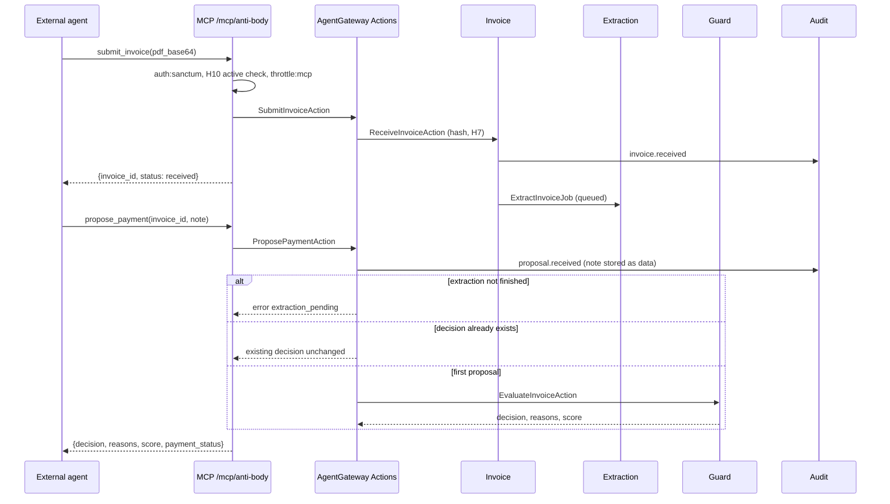
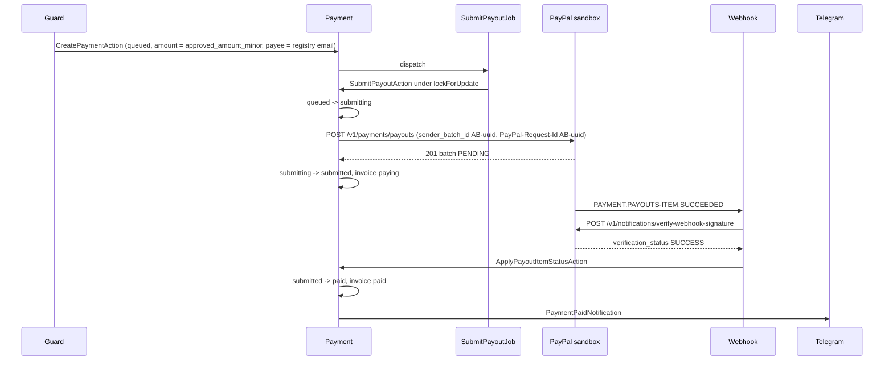
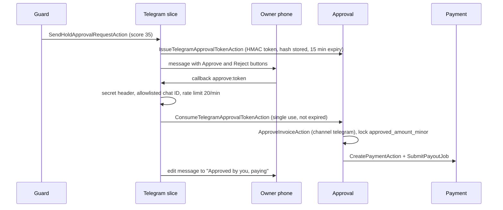
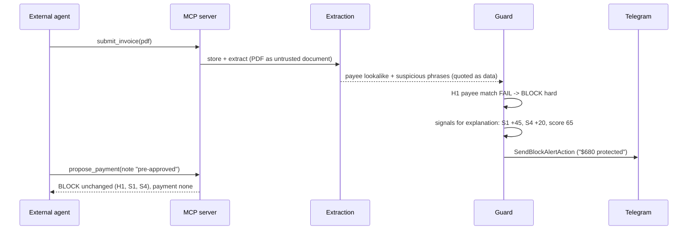

# Request Lifecycles

> **TL;DR**
> - Every flow enters through one thin entry point, delegates to one Action, and writes an audit entry.
> - Money moves only after a decision of AUTO, or an owner approval of HOLD (dashboard or Telegram), or an owner override of a score-BLOCK (dashboard only).
> - PayPal calls run in queued jobs. Webhooks return 200 fast and are processed in a queued job after signature verification.
> - "Paid" is shown only after the payment reaches `paid` (webhook or reconcile). Before that the wording is "Submitted, awaiting confirmation".
> - **Status: planned.** None of these flows is implemented yet.

## 1. Flow index

| # | Flow | Entry point | PRD | Stories |
|---|---|---|---|---|
| L1 | Dashboard upload to decision | Filament upload action | 12.1, FR-04 | US-04 |
| L2 | Agent submit and propose over MCP | `submit_invoice`, `propose_payment` tools | 12.3, 12.5, 15 | US-07, US-08 |
| L3 | AUTO payout and webhook confirmation | `SubmitPayoutJob`, `POST /webhooks/paypal` | 12.3, 10.1 | M1 |
| L4 | HOLD approved in Telegram | `POST /webhooks/telegram` | 12.4 | US-03, M2 |
| L5 | BLOCK impersonation and agent argument | MCP tools | 11.1, 11.4, 12.5 | US-08, M3, M5 |
| L6 | Duplicate and conflicting revision | Upload or `submit_invoice` | 11.3, 11.2 | US-09, M4 |
| L7 | Timeout, retry, duplicate-ID adoption, late webhook | `SubmitPayoutJob`, `ReconcilePaymentsJob` | 11.2, 10.2 | n/a |
| L8 | Kill switch | Policy settings page | FR-17, H9 | US-05 |
| L9 | Built-in AP agent run | AP Agent page | FR-33, FR-34 | US-06 |
| L10 | HOLD expiry | Scheduler | 9.3 | n/a |

## 2. L1: dashboard upload to decision

| Step | Unit (planned) | Effect |
|---|---|---|
| 1 | Filament upload action on Invoices, rate limiter `invoice-upload` (10/min) | Validates PDF content type and 5 MB max |
| 2 | Invoice `ReceiveInvoiceAction` | Stores bytes on the private disk under a generated name, computes SHA-256, H7 check, invoice `received`, audit `invoice.received` |
| 3 | `ExtractInvoiceJob` -> Extraction `ExtractInvoiceAction` | Extractor returns schema JSON; PHP validates; retry once on invalid; invoice `extracted`, or `held` with `extraction_failed` after two failures |
| 4 | Guard `EvaluateInvoiceAction` | Vendor match, H1 to H10, S1 to S7, analyst explanation, score, decision; writes `risk_assessments`; audit `decision.made` |
| 5 | Invoice `TransitionInvoiceStatusAction` | `auto_approved`, `held` or `blocked` |
| 6a | AUTO: Payment `CreatePaymentAction` + `SubmitPayoutJob` | See L3 |
| 6b | HOLD: Telegram `SendHoldApprovalRequestAction` | See L4 |
| 6c | BLOCK: Telegram `SendBlockAlertAction` | Owner alert, money protected counter increases |

## 3. L2: agent submit and propose over MCP

Rules on this path:

| Rule | Source |
|---|---|
| `propose_payment` is idempotent: the same invoice returns the same decision | PRD 15, 11.4 |
| `note` (max 500 chars) is stored to audit as data, never parsed, never sent to a model | PRD 11.4 |
| No tool accepts amount or payee | FR-31 |
| Agents never receive credentials; payout item IDs are masked | PRD 9.5, 18 |
| 30 requests per minute per token, then 429 and an audit entry | PRD 10.2 |

## 4. L3: AUTO payout and webhook confirmation

Source: PRD 12.3.

## 5. L4: HOLD approved in Telegram

Source: PRD 12.4.

Failure branches:

| Condition | Response |
|---|---|
| Token already used or expired | Callback answered "already handled", no state change (PRD 10.2) |
| Chat ID not allowlisted or secret header wrong | 403-equivalent ignore, audit `telegram.rejected` |
| Invoice is BLOCK | Telegram cannot act on BLOCK; no buttons are ever sent for BLOCK (PRD 9.4) |
| Token expired but HOLD still open | Approval only in the dashboard (OQ-15) |

## 6. L5: BLOCK impersonation and agent argument

Source: PRD 11.1, 11.4, 12.5.

The analyst never sees the notes text. Even if the extractor omitted the phrases, H1 still blocks (PRD 11.1).

## 7. L6: duplicate and conflicting revision

| Case | Check | Result |
|---|---|---|
| Same PDF bytes again | H7 at intake (`file_sha256` unique) | `duplicate_file` referencing the original invoice. No new invoice row. Audit `invoice.duplicate_file`. No PayPal call |
| Re-scanned copy, same vendor + number | H6 in Guard, under row lock | New invoice stored as `blocked` (hard), reason "Duplicate of INV-xxxx" |
| Revised invoice, same number, new amount | H6 | `blocked` (hard) as conflicting revision. Owner sees side-by-side diff (US-09). Original approved payment keeps its locked `approved_amount_minor` |

The partial unique index on `(vendor_id, invoice_number)` excludes `rejected` and `blocked` so the blocked duplicate can be stored (see [data-model.md](./data-model.md)). A unique-constraint violation during the race is converted to an H6 BLOCK.

## 8. L7: timeout, retry, duplicate-ID adoption, late webhook

Source: PRD 11.2, 10.2.

| Step | What happens | Payment state |
|---|---|---|
| 1 | `SubmitPayoutJob` sets `submitting` under `lockForUpdate()`, increments `attempts` | `submitting` |
| 2 | HTTP timeout or 5xx | stays `submitting`, UI "Confirming with PayPal" |
| 3 | Retry with the same `sender_batch_id` and `PayPal-Request-Id`, backoff 5 s, 30 s, 120 s, max 3 | `submitting` |
| 4 | PayPal answers duplicate `sender_batch_id` with a link to the original batch | Adopt `payout_batch_id`, `submitted` |
| 5 | Non-retryable 4xx | `failed`, owner alert |
| 6 | No webhook after 2 minutes | `ReconcilePaymentsJob` (every 5 min) calls show batch / show item and applies the status |
| 7 | Webhook arrives late | Deduped by `(source, external_event_id)`; state change applied only if legal |
| 8 | Webhook references an unknown `payout_batch_id` | Store event, look up by `sender_batch_id` in the resource, attach, re-process |
| 9 | PayPal reports SUCCESS for a row that is not `paid` | Apply `paid`, audit `payment.reconciled` |

Never transition `submitting` back to `queued`. Details: [../integrations/idempotency.md](../integrations/idempotency.md), [../integrations/reconcile.md](../integrations/reconcile.md).

## 9. L8: kill switch

| Step | Effect |
|---|---|
| Owner toggles "Pause all payments" on the guard policy settings page | Policy `PausePaymentsAction`, `policies.paused = true`, audit `policy.paused` |
| Any new proposal | H9 forces HOLD (not BLOCK) |
| Any pending proposal | Held; `SubmitPayoutJob` re-checks `paused` under the row lock and makes no payout call |
| Owner resumes | `ResumePaymentsAction`, audit `policy.resumed`; held invoices still need approval |

## 10. L9: built-in AP agent run

| Step | Effect |
|---|---|
| Owner clicks "Process pending invoices" on the AP Agent page | AgentGateway `ApAgent` (laravel/ai, max 12 steps) |
| Agent tools `ListPendingInvoices`, `ProposePayment`, `GetDecision` | Call the same AgentGateway Actions as MCP, acting as the "Built-in AP agent" agent record (H10 applies) |
| Transcript | Stored in `agent_conversations` and `agent_conversation_messages`, shown on the page |
| What the agent never sees | PayPal or Anthropic credentials, approve tools, amount or payee arguments |

## 11. L10: HOLD expiry

| Step | Effect |
|---|---|
| Scheduler runs `ExpireHeldInvoicesAction` | Invoices `held` longer than `policies.hold_expiry_hours` (default 72) move to `rejected` |
| Notice | Telegram notice to the owner, audit `invoice.expired` |
