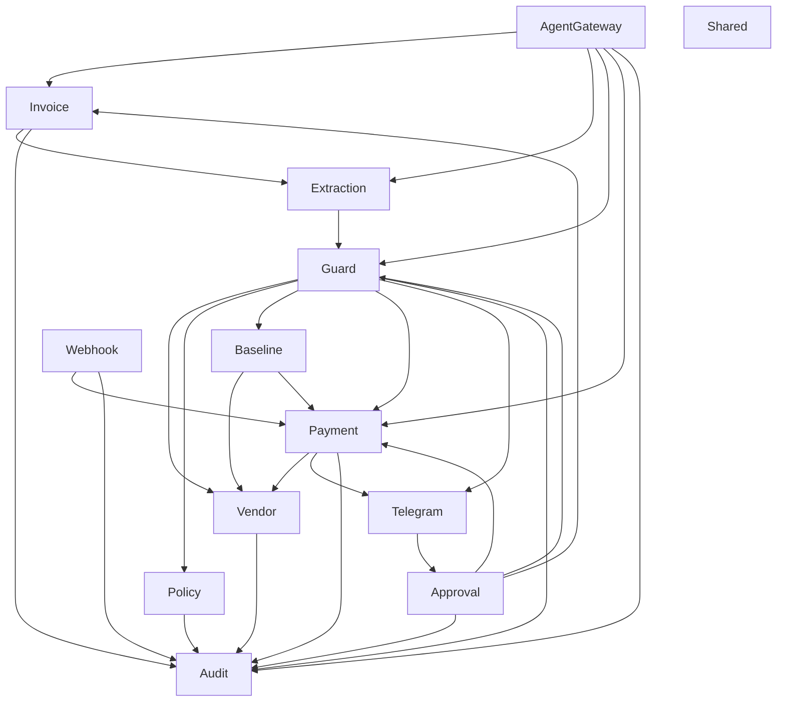

# Slice Catalog

> **TL;DR**
> - 13 slices are planned. Only Shared exists in code (security headers middleware, `RequiresAbility` attribute, tests). Creating a slice outside this list needs owner approval.
> - Dependency edges are enforced by `tests/Architecture/SliceIsolationTest.php` from `tests/Architecture/SliceMap.php`. Internal namespaces (`Http`, `Models`, `Policies`, `Providers`, `Listeners`, `Jobs`, `Mcp`, `Ai`, `Routes`, `Commands`) are never used across slices.
> - The PRD "Gate service" is split into Actions: Invoice `ReceiveInvoiceAction`, Extraction `ExtractInvoiceAction`, Guard `EvaluateInvoiceAction`, AgentGateway `ProposePaymentAction`.
> - The Guard slice is the only home of H1 to H10, S1 to S7 and the decision thresholds.
> - Only the Payment slice talks to the PayPal Payouts API. Only the Audit slice writes `audit_logs`.
> - All unit names below are planned names unless marked implemented. The code becomes authoritative once built.
> - Open decision OQ-18: which slice owns `antibody:demo-reset`, since Shared may not depend on any other slice (section 2).

## 1. Dependency graph

An arrow means "calls the public namespaces (Actions, Data, Enums, Events, Exceptions, Contracts) of". Models are internal to a slice: cross-slice access goes through Actions and Data, never through another slice's models. Every slice may use Shared; Shared depends on no slice. Every slice except Shared and Audit has an Audit edge in `tests/Architecture/SliceMap.php`; the graph draws only some of them.

## 2. Summary

| Slice | Owns tables | Build block | FR IDs | Status |
|---|---|---|---|---|
| Shared | none | B2 | cross-cutting | Partly implemented (ABP-9): `SecurityHeaders`, `RequiresAbility`, tests |
| Vendor | `vendors` | B3, B7 | FR-01, FR-02, FR-03 | Planned |
| Invoice | `invoices` | B3, B7 | FR-04, FR-05 (storage half), FR-06, FR-24 (invoice), FR-45 | Planned |
| Extraction | none (writes extracted fields on `invoices`) | B4 | FR-08, FR-09, FR-10 | Planned |
| Guard | `risk_assessments` | B5 | FR-11 to FR-17 | Planned |
| Approval | `approvals` | B7, B8 | FR-25, FR-28 | Planned |
| Payment | `payments` | B1, B3 | FR-18, FR-19, FR-20, FR-23, FR-24 (payment) | Planned |
| Webhook | `webhook_events` | B3 | FR-21, FR-22 | Planned |
| Telegram | none (writes `approvals.token_hash` through Approval) | B8 | FR-26, FR-27 | Planned |
| AgentGateway | `agents`, `personal_access_tokens`, `agent_conversations`, `agent_conversation_messages` | B6 | FR-05 (MCP half), FR-29 to FR-34 | Planned |
| Audit | `audit_logs` | B3, B7 | FR-35, FR-36 | Planned |
| Policy | `policies` | B5, B7 | FR-17, US-02 | Planned |
| Baseline | `vendor_stats`, `paypal_transactions` | B9 | FR-37, FR-38, FR-39, FR-43 | Planned |

Seed data (FR-40 to FR-42) lives in `database/seeders/` and `storage/demo/`, with the owner of `antibody:demo-reset` still open (OQ-18, decide in B9; see [../operations/demo-reset.md](../operations/demo-reset.md)). The command resets several slices, which suggests Shared, but Shared may not depend on any other slice under the architecture test (`SliceMap`), so it cannot call their Actions. Options for B9: a dedicated approved slice, a command in a slice that already depends on the others, or an approved exception in `SliceMap`. Until decided, no slice row lists the command. Dashboard widgets (FR-44) live in `app/Filament/Widgets/` and read through slice query Actions.

## 3. Slices in detail

### 3.1 Shared

| Field | Value |
|---|---|
| Responsibility | Cross-cutting code only. Nothing domain-specific |
| Implemented units | `Http/Middleware/SecurityHeaders.php` (`final readonly`, appended as global middleware in `bootstrap/app.php`; values in the file and `config/antibody.php`), `Authorization/RequiresAbility.php` (attribute read by the access matrix scanner in `tests/AccessMatrix`), `Tests/Feature` and `Tests/Unit` (runtime security tests and example tests) |
| Planned units | `Http/Controllers/Controller.php` (base; today the base controller is `app/Http/Controllers/Controller.php`), `Providers/SharedServiceProvider.php` (rate limiters `mcp`, `invoice-upload`, `telegram-callback`), `Enums/ActorType.php` (`Owner`, `Agent`, `System`, `PayPal`, `Telegram`), `Data/Money.php` (integer minor units + currency), `Support/IsoWeek.php` (UTC ISO week bounds) |
| Entry points | none |
| Depends on | nothing |
| Notes | Money and time helpers are described in the `money-and-time-handling` skill |

### 3.2 Vendor

| Field | Value |
|---|---|
| Responsibility | Verified payee registry. The only source of payout email addresses |
| Owns | `vendors` |
| Planned Actions | `CreateVendorAction`, `UpdateVendorAction` (non-payee fields), `ChangeVendorPayeeEmailAction` (typed confirmation + verification note, always audited, FR-02), `SuspendVendorAction`, `FindVendorByPayeeEmailAction`, `ListVendorEmailsAndDomainsAction` (input for S1) |
| Enums | `VendorStatus` (`Active`, `Suspended`) |
| Model traits | `VendorFormTrait`, `VendorTableTrait`, `VendorInfolistTrait` |
| Policies | `VendorPolicy` (owner only) |
| Filament | `app/Filament/Resources/Vendors/` |
| Entry points | Filament only. No MCP tool or agent can edit vendors (FR-31) |
| Depends on | Audit |

### 3.3 Invoice

| Field | Value |
|---|---|
| Responsibility | Intake of PDFs and text, private storage, SHA-256 (H7), invoice state machine |
| Owns | `invoices` |
| Planned Actions | `ReceiveInvoiceAction`, `TransitionInvoiceStatusAction` (enforces PRD 14.3, throws `IllegalInvoiceTransitionException`), `LockApprovedAmountAction`, `ExpireHeldInvoicesAction` (72 h HOLD expiry), `ListPendingInvoicesAction`, `GetInvoiceSummaryAction` |
| Jobs | `ExtractInvoiceJob` (delegates to Extraction) |
| Enums | `InvoiceStatus`, `InvoiceSource` (`DashboardUpload`, `McpSubmit`, `Seed`) |
| Routes | `Routes/web.php`: signed route for the owner-only PDF preview |
| Policies | `InvoicePolicy` |
| Filament | `app/Filament/Resources/Invoices/` (list, view, upload action), approval queue page |
| Depends on | Extraction, Audit |

### 3.4 Extraction

| Field | Value |
|---|---|
| Responsibility | Run the AI extractor on the PDF, schema-validate, normalize, retry once, fail closed to HOLD |
| Owns | Extracted columns on `invoices` (written through Invoice Actions) |
| Planned units | `Ai/InvoiceExtractor.php` (laravel/ai structured agent), `Actions/ExtractInvoiceAction`, `Data/ExtractedInvoiceData`, `Data/SuspiciousPhraseData`, `Enums/SuspiciousPhraseCategory` (`Urgency`, `AuthorityClaim`, `PaymentDetailChange`, `AiDirectedInstruction`, `Other`), `Exceptions/ExtractionFailedException` |
| Entry points | `ExtractInvoiceJob` |
| Depends on | Invoice, Guard (dispatches evaluation), Audit |
| Docs | [../ai/extractor.md](../ai/extractor.md) |

### 3.5 Guard

| Field | Value |
|---|---|
| Responsibility | Hard rules, risk signals, monotonic score, decision, analyst explanation. Single source of every threshold |
| Owns | `risk_assessments` |
| Planned units | `HardRules/PayeeMatchRule` (H1) to `HardRules/AgentValidRule` (H10), `Signals/LookalikePayeeSignal` (S1) to `Signals/WeeklyBudgetPressureSignal` (S7), `Actions/EvaluateInvoiceAction`, `Actions/ComputeRiskScoreAction`, `Actions/DecideOutcomeAction`, `Ai/RiskAnalyst.php`, `Data/SignalResultData`, `Data/GuardVerdictData`, `Enums/Decision` (`Auto`, `Hold`, `Block`), `Enums/BlockType` (`Hard`, `Score`), `Enums/HardRule`, `Enums/Signal` |
| Entry points | Called by AgentGateway `ProposePaymentAction` and by the dashboard upload flow |
| Depends on | Vendor, Policy, Baseline, Payment (sums for H5), Telegram (HOLD and BLOCK notices), Audit |
| Docs | [guard-spec.md](./guard-spec.md), [../ai/analyst.md](../ai/analyst.md) |

### 3.6 Approval

| Field | Value |
|---|---|
| Responsibility | Owner decisions on HOLD and score-BLOCK |
| Owns | `approvals` |
| Planned Actions | `ApproveInvoiceAction`, `RejectInvoiceAction`, `OverrideScoreBlockAction` (typed confirmation, dashboard only, refuses hard BLOCK), `IssueTelegramApprovalTokenAction`, `ConsumeTelegramApprovalTokenAction` |
| Enums | `ApprovalAction` (`Approve`, `Reject`, `OverrideBlock`), `ApprovalChannel` (`Dashboard`, `Telegram`) |
| Policies | `InvoicePolicy::approve`, `reject`, `overrideBlock` |
| Filament | Actions on the invoice view page and the approval queue |
| Depends on | Invoice, Guard (reads block type), Payment (creates payment), Audit |

### 3.7 Payment

| Field | Value |
|---|---|
| Responsibility | Payout executor, PayPal REST client, payment state machine, reconcile |
| Owns | `payments` |
| Planned units | `Actions/CreatePaymentAction` (amount from `approved_amount_minor`, payee from registry), `Actions/SubmitPayoutAction` (row lock, same `sender_batch_id` on retry, duplicate-ID adoption), `Actions/TransitionPaymentStatusAction`, `Actions/ApplyPayoutItemStatusAction`, `Actions/ReconcilePaymentsAction`, `Jobs/SubmitPayoutJob`, `Jobs/ReconcilePaymentsJob`, `PayPal/PayPalClient` (OAuth token cached until expiry minus 5 min, timeouts), `Enums/PaymentStatus`, `Exceptions/IllegalPaymentTransitionException`, `Exceptions/PayPalUnavailableException` |
| Commands | `SeedSandboxHistoryCommand` (`antibody:seed-sandbox-history`, FR-43) |
| Schedule | `ReconcilePaymentsJob` every 5 minutes |
| Depends on | Vendor, Invoice, Telegram (Paid and Failed notices), Audit |
| Docs | [../integrations/paypal-payouts.md](../integrations/paypal-payouts.md), [../integrations/idempotency.md](../integrations/idempotency.md) |

### 3.8 Webhook

| Field | Value |
|---|---|
| Responsibility | Receive PayPal webhooks, verify the signature, store, dedupe, map events to payment states |
| Owns | `webhook_events` |
| Planned units | `Http/Controllers/PayPalWebhookController`, `Actions/ReceivePayPalWebhookAction`, `Actions/VerifyPayPalWebhookSignatureAction`, `Jobs/ProcessPayPalWebhookJob`, `Enums/WebhookSource` (`PayPal`, `Telegram`), `Enums/PayPalEventType` |
| Routes | `Routes/api.php`: `POST /webhooks/paypal` |
| Depends on | Payment, Audit |
| Docs | [../api/paypal-webhooks.md](../api/paypal-webhooks.md) |

### 3.9 Telegram

| Field | Value |
|---|---|
| Responsibility | HOLD approval messages, BLOCK alerts, Paid notices, callback verification |
| Owns | none |
| Planned units | `Http/Controllers/TelegramWebhookController`, `Actions/SendHoldApprovalRequestAction`, `Actions/SendBlockAlertAction`, `Actions/HandleTelegramCallbackAction`, `Notifications/HoldApprovalNotification`, `Notifications/BlockAlertNotification`, `Notifications/PaymentPaidNotification` |
| Routes | `Routes/api.php`: `POST /webhooks/telegram` (path chosen by ABP-8; PRD does not name one) |
| Depends on | Approval, Audit |
| Docs | [../integrations/telegram.md](../integrations/telegram.md), [../api/telegram-webhook.md](../api/telegram-webhook.md) |

### 3.10 AgentGateway

| Field | Value |
|---|---|
| Responsibility | The only door for agents: MCP server, built-in AP agent, agent identity and tokens, H10 |
| Owns | `agents`, `personal_access_tokens` (Sanctum), `agent_conversations`, `agent_conversation_messages` (laravel/ai) |
| Planned units | `Mcp/Servers/AntiBodyServer`, `Mcp/Tools/ListPendingInvoicesTool`, `GetInvoiceTool`, `SubmitInvoiceTool`, `ProposePaymentTool`, `GetDecisionTool`, `PaymentStatusTool`, `Ai/ApAgent.php` with tools calling the same Actions, `Actions/ProposePaymentAction` (idempotent), `Actions/SubmitInvoiceAction`, `Actions/CreateAgentTokenAction`, `Actions/RevokeAgentAction`, `Http/Middleware/EnsureAgentIsActive` (H10), `Models/Agent` |
| Routes | `Routes/api.php`: `Mcp::web('/mcp/anti-body', AntiBodyServer::class)->middleware(['auth:sanctum', EnsureAgentIsActive::class, 'throttle:mcp'])`; local server `Mcp::local('anti-body', AntiBodyServer::class)` |
| Commands | `CreateAgentTokenCommand` (`antibody:agent-token "Judge agent"`) |
| Filament | `app/Filament/Resources/Agents/`, AP agent page `app/Filament/Pages/ApAgent.php` |
| Depends on | Invoice, Extraction, Guard, Payment (status read), Audit |
| Docs | [../api/mcp-tools.md](../api/mcp-tools.md), [../ai/ap-agent.md](../ai/ap-agent.md) |

### 3.11 Audit

| Field | Value |
|---|---|
| Responsibility | Append-only, hash-chained audit log. The only writer of `audit_logs` |
| Owns | `audit_logs` |
| Planned units | `Actions/RecordAuditEntryAction` (lock, read last hash, compute, insert), `Actions/VerifyAuditChainAction`, `Commands/VerifyAuditChainCommand` (`antibody:audit-verify`), `Support/CanonicalJson` |
| Filament | `app/Filament/Resources/AuditLogs/` (read-only, filter, verify chain button) |
| Depends on | Shared |
| Docs | [../security/audit-hash-chain.md](../security/audit-hash-chain.md) |

### 3.12 Policy

| Field | Value |
|---|---|
| Responsibility | Owner-editable guard policy: `auto_ceiling`, `max_per_payment`, `weekly_budget`, allowed currencies, pause (kill switch), HOLD expiry |
| Owns | `policies` (single row, id = 1) |
| Planned units | `Models/Policy`, `Actions/GetActivePolicyAction`, `Actions/UpdatePolicyAction` (typed confirmation for `auto_ceiling`, absolute cap $500.00), `Actions/PausePaymentsAction`, `Actions/ResumePaymentsAction` |
| Filament | Settings page `app/Filament/Pages/GuardPolicySettings.php` |
| Depends on | Audit |
| Naming note | The slice name "Policy" collides with Laravel's authorization `Policies/` folder. Authorization for this slice lives in `app/Features/Policy/Policies/PolicyPolicy.php`. Always say "guard policy" in prose to avoid confusion |

### 3.13 Baseline

| Field | Value |
|---|---|
| Responsibility | Learn what normal looks like per vendor: median, MAD, interval, typical items |
| Owns | `vendor_stats`, `paypal_transactions` |
| Planned units | `Actions/SyncTransactionHistoryAction` (Transaction Search, FR-37), `Actions/RefreshVendorStatsAction` (FR-38), `Jobs/SyncTransactionHistoryJob` (nightly), `Data/VendorStatsData` |
| Filament | Override fields on the vendor form (FR-39) |
| Depends on | Vendor, Payment (PayPal client), Audit |

## 4. Who may call whom

| Caller | May call | Must not call |
|---|---|---|
| MCP tools, AP agent tools | AgentGateway Actions only | Approval, Payment submit, Vendor writes, Policy writes |
| Filament resources and pages | One slice Action per user action, with `->authorize()` | Models directly for writes |
| Jobs | One Action each, after refreshing the model | Business logic inline |
| Webhook and Telegram controllers | One Action each after verification | Any Action before verification |
| Any slice | Audit `RecordAuditEntryAction` | `audit_logs` table directly |
