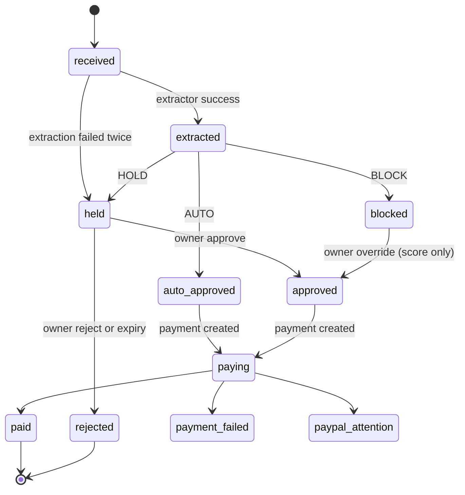
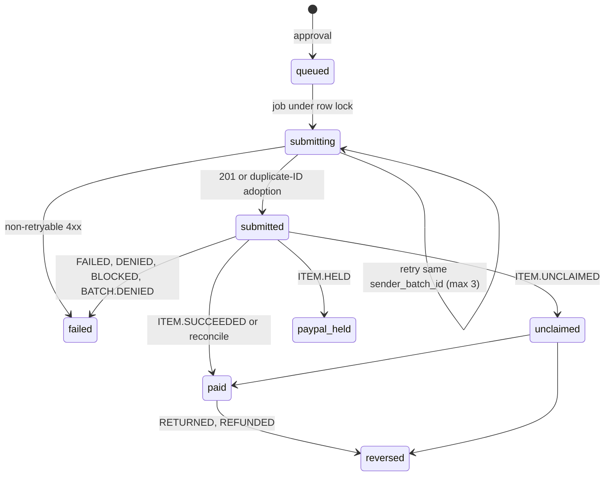

# State Machines

> **TL;DR**
> - Two state machines: invoice status (Invoice slice) and payment status (Payment slice). Both are enforced in PHP Actions under `lockForUpdate()`.
> - Illegal transitions throw `IllegalInvoiceTransitionException` or `IllegalPaymentTransitionException` and are audited (FR-24).
> - `blocked` with block type `hard` is terminal. `blocked` with block type `score` can move to `approved` only by owner override in the dashboard.
> - A payment never moves from `submitting` back to `queued`. Retries stay inside `submitting` with the same `sender_batch_id`.
> - **Status: planned.**

## 1. Invoice status

### 1.1 Values

| Enum case (planned `InvoiceStatus`) | Stored value | Meaning |
|---|---|---|
| `Received` | `received` | File stored and hashed |
| `Extracted` | `extracted` | Extractor output validated |
| `AutoApproved` | `auto_approved` | Decision AUTO |
| `Held` | `held` | Waiting for the owner (decision HOLD or extraction failed) |
| `Blocked` | `blocked` | Decision BLOCK (`risk_assessments.block_type` says `hard` or `score`) |
| `Approved` | `approved` | Owner approved HOLD or overrode score-BLOCK |
| `Rejected` | `rejected` | Owner rejected, or HOLD expired |
| `Paying` | `paying` | Payment row exists |
| `Paid` | `paid` | Payment `paid` |
| `PaymentFailed` | `payment_failed` | Payment `failed` or `reversed` |
| `PaypalAttention` | `paypal_attention` | Payment `unclaimed` or `paypal_held` |

### 1.2 Transitions (PRD 14.3)

| From | To | Trigger | Unit (planned) |
|---|---|---|---|
| (new) | `received` | Upload or `submit_invoice` | `ReceiveInvoiceAction` |
| `received` | `extracted` | Extractor success | `ExtractInvoiceAction` |
| `received` | `held` | Extraction failed twice | `ExtractInvoiceAction` |
| `extracted` | `auto_approved` | Decision AUTO | `EvaluateInvoiceAction` |
| `extracted` | `held` | Decision HOLD | `EvaluateInvoiceAction` |
| `extracted` | `blocked` | Decision BLOCK | `EvaluateInvoiceAction` |
| `held` | `approved` | Owner approve (dashboard or Telegram) | `ApproveInvoiceAction` |
| `held` | `rejected` | Owner reject or HOLD expiry | `RejectInvoiceAction`, `ExpireHeldInvoicesAction` |
| `blocked` (score) | `approved` | Owner override in dashboard, typed confirmation | `OverrideScoreBlockAction` |
| `blocked` (hard) | none | Terminal | n/a |
| `auto_approved`, `approved` | `paying` | Payment created | `CreatePaymentAction` |
| `paying` | `paid` | Payment `paid` | `ApplyPayoutItemStatusAction` |
| `paying` | `payment_failed` | Payment `failed` or `reversed` | `ApplyPayoutItemStatusAction` |
| `paying` | `paypal_attention` | Payment `unclaimed` or `paypal_held` | `ApplyPayoutItemStatusAction` |

`approved_amount_minor` is locked at the transition into `auto_approved` or `approved` and never changes afterwards (PRD 10.2).

Not specified by the PRD and therefore illegal until decided: `blocked` (score) to `rejected`, `paypal_attention` to `paid`, `payment_failed` to any state. PRD 9.4 says the owner can "reject anything"; whether rejecting a score-BLOCK writes `rejected` is an open item to confirm in B5.

### 1.3 Diagram

## 2. Payment status

### 2.1 Values

| Enum case (planned `PaymentStatus`) | Stored value | Meaning |
|---|---|---|
| `Queued` | `queued` | Created after approval, waiting for the job |
| `Submitting` | `submitting` | Job holds the row lock and is calling PayPal |
| `Submitted` | `submitted` | PayPal accepted the batch or duplicate-ID adoption |
| `Paid` | `paid` | Item succeeded |
| `Failed` | `failed` | Item or batch failed, denied, blocked, or non-retryable 4xx |
| `Unclaimed` | `unclaimed` | Recipient has no PayPal account yet |
| `PaypalHeld` | `paypal_held` | PayPal held the item |
| `Reversed` | `reversed` | Returned, refunded or canceled |

### 2.2 Transitions (PRD 14.3)

| From | To | Trigger |
|---|---|---|
| (new) | `queued` | Approval (AUTO, owner approve, owner override) |
| `queued` | `submitting` | `SubmitPayoutJob` picks up under row lock |
| `submitting` | `submitted` | 201 response or duplicate-ID adoption |
| `submitting` | `failed` | Non-retryable 4xx |
| `submitted` | `paid` | `PAYMENT.PAYOUTS-ITEM.SUCCEEDED` or reconcile SUCCESS |
| `submitted` | `failed` | ITEM.FAILED, ITEM.DENIED, ITEM.BLOCKED, BATCH.DENIED |
| `submitted` | `unclaimed` | ITEM.UNCLAIMED |
| `submitted` | `paypal_held` | ITEM.HELD |
| `paid` | `reversed` | ITEM.RETURNED, ITEM.REFUNDED |
| `unclaimed` | `paid` | Later item event |
| `unclaimed` | `reversed` | Later item event |

### 2.3 Webhook event to payment state (PRD 10.1)

| PayPal webhook event | Payment state |
|---|---|
| `PAYMENT.PAYOUTSBATCH.PROCESSING` | `submitted` |
| `PAYMENT.PAYOUTS-ITEM.SUCCEEDED` | `paid` |
| `PAYMENT.PAYOUTS-ITEM.UNCLAIMED` | `unclaimed` (owner notified) |
| `PAYMENT.PAYOUTS-ITEM.HELD` | `paypal_held` (owner notified) |
| `PAYMENT.PAYOUTS-ITEM.FAILED`, `DENIED`, `BLOCKED` | `failed` |
| `PAYMENT.PAYOUTS-ITEM.RETURNED`, `REFUNDED`, `CANCELED` | `reversed` |
| `PAYMENT.PAYOUTSBATCH.DENIED` | `failed` |
| `PAYMENT.PAYOUTSBATCH.SUCCESS` | no change (batch has no item data, item events decide) |

An event whose target state is not a legal transition from the current state is stored, marked processed with an `error`, and audited. It does not change the payment.

### 2.4 Diagram

## 3. Enforcement rules

| Rule | Implementation (planned) |
|---|---|
| One transition table per machine, defined once on the enum (`canTransitionTo(self $target): bool`) | `InvoiceStatus`, `PaymentStatus` |
| Every transition runs inside `DB::transaction()` with `lockForUpdate()` on the row | `TransitionInvoiceStatusAction`, `TransitionPaymentStatusAction` |
| Illegal transition throws a typed exception and writes audit `invoice.illegal_transition` or `payment.illegal_transition` | Slice `Exceptions/` + Audit |
| Jobs refresh the model before acting | `SubmitPayoutJob`, `ProcessPayPalWebhookJob` |
| Invoice status follows payment status, never the reverse | `ApplyPayoutItemStatusAction` updates both in one transaction |
| Kill switch re-checked under the payment row lock before the PayPal call | `SubmitPayoutAction` |

## 4. Required tests (planned)

| Test | Layer |
|---|---|
| Every legal transition in sections 1.2 and 2.2 succeeds | Unit |
| Every other pair throws and audits | Unit (dataset over all enum pairs) |
| `submitting` to `queued` is rejected | Unit |
| Hard-BLOCK override attempt is rejected | Feature |
| Out-of-order webhook (SUCCEEDED before PROCESSING) ends `paid` | Feature |
| Duplicate webhook is ignored after first processing | Feature |
