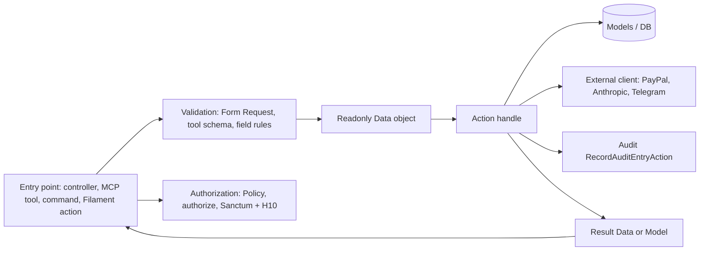

# Vertical Slice Architecture

> **TL;DR**
> - Every domain lives in `app/Features/<Slice>/` and contains only the sub-folders the slice needs. Cross-cutting code lives only in `app/Features/Shared/`.
> - Business logic lives only in Actions named `VerbNounAction` with one public `handle()` method. Entry points (controllers, MCP tools, commands, Filament actions) parse, authorize, delegate to one Action and respond.
> - Filament UI stays outside the slices in `app/Filament/`. Slices expose UI schema through model traits (see [filament-separation.md](./filament-separation.md)).
> - Wiring is automatic: slice service providers are discovered by `AppServiceProvider`, slice routes by the `then:` callback in `bootstrap/app.php`, slice tests by `phpunit.xml` testsuites and `tests/Pest.php`.
> - **Status: mixed.** Only `app/Features/Shared/` exists (ABP-9): security headers middleware, `RequiresAbility` attribute, tests, plus the test wiring and `tests/Architecture` enforcement. Provider and route auto-discovery are planned; the first slice that needs a wiring point adds it (feature prompt 4.1).
> - Boundaries are enforced by tests: `tests/Architecture/SliceMap.php` is the machine-readable slice map; Actions and Data are `final`; slice `Models`, `Http`, `Policies`, `Providers`, `Listeners`, `Jobs`, `Mcp`, `Ai`, `Routes` and `Commands` are internal to their slice.
> - AI agents load the path-scoped rules from [.ai/rules/index.md](../../.ai/rules/index.md) (implemented, 15 rules recorded through Boost on 2026-10-30) before editing any file.

## 1. Why vertical slices

| Goal | How slices deliver it |
|---|---|
| One place to change per feature | All code for a domain (model, actions, jobs, routes, tests) sits in one folder |
| Hard rules defined once (DRY) | H1 to H10, S1 to S7 and thresholds live only in the Guard slice |
| Small, reviewable diffs | A ticket usually touches one slice plus its Filament resource |
| Safe AI-assisted edits | Agents can be pointed at one slice with a clear boundary |

The decision record is [0001-vertical-slice-architecture.md](../decisions/0001-vertical-slice-architecture.md).

## 2. Planned slices

The slice list is fixed. A new slice needs owner approval.

| Slice | One-line responsibility |
|---|---|
| Shared | Cross-cutting only: security headers middleware (implemented), `RequiresAbility` attribute (implemented), base controller, shared enums, money and time helpers (planned). Depends on no other slice |
| Vendor | Verified payee registry (FR-01 to FR-03) |
| Invoice | Intake, file storage, SHA-256, invoice state machine (FR-04 to FR-06, FR-24) |
| Extraction | AI extractor, schema validation, retry (FR-08 to FR-10) |
| Guard | Hard rules H1 to H10, signals S1 to S7, score, decision, analyst (FR-11 to FR-17) |
| Approval | Dashboard and Telegram approvals, overrides (FR-25, FR-28) |
| Payment | Payout executor, PayPal client, reconcile, payment state machine (FR-18 to FR-20, FR-23) |
| Webhook | PayPal webhook intake, verification, dedupe, mapping (FR-21, FR-22) |
| Telegram | HOLD messages, BLOCK alerts, callback verification (FR-26, FR-27) |
| AgentGateway | MCP server, built-in AP agent, agent tokens (FR-29 to FR-34) |
| Audit | Append-only hash-chained audit log (FR-35, FR-36) |
| Policy | Guard policy settings: ceilings, budget, pause (US-02, FR-17) |
| Baseline | Transaction Search sync and vendor stats (FR-37 to FR-39) |

Details per slice: [slice-catalog.md](./slice-catalog.md).

**Mapping from PRD paths:** PRD `app/Domain/*` maps to the domain slices above. PRD `app/Ai/*` maps to `Ai/` sub-folders in Extraction (extractor), Guard (analyst) and AgentGateway (AP agent). PRD `app/Mcp/*` maps to `app/Features/AgentGateway/Mcp/`.

## 3. Allowed slice sub-folders

A slice creates only the sub-folders it needs. Namespace mirrors path (`App\Features\Invoice\Actions\ReceiveInvoiceAction` lives in `app/Features/Invoice/Actions/ReceiveInvoiceAction.php`).

| Sub-folder | Contents | Naming |
|---|---|---|
| `Actions/` | Business logic, one public `handle()` per class | `VerbNounAction` (`EvaluateInvoiceAction`) |
| `Data/` | Readonly DTOs built from validated input | `<Noun>Data` (`ExtractedInvoiceData`) |
| `Enums/` | String-backed enums, TitleCase cases, Filament `HasLabel` and `HasColor` when shown in UI | `<Noun>` (`InvoiceStatus`) |
| `Events/` | Domain events | Past tense (`InvoiceDecided`) |
| `Exceptions/` | Typed exceptions thrown by the slice | `<Problem>Exception` (`IllegalInvoiceTransitionException`) |
| `Http/Controllers/` | Thin controllers | `<Noun>Controller` |
| `Http/Requests/` | Form Requests | `<Verb><Noun>Request` |
| `Http/Resources/` | JSON API Resources | `<Noun>Resource` |
| `Jobs/` | Queued jobs that delegate to one Action | `<Verb><Noun>Job` (`SubmitPayoutJob`) |
| `Listeners/` | Event listeners that delegate to one Action | `<Verb><Noun>` |
| `Mcp/` | MCP server, tools (AgentGateway only) | `<Verb><Noun>Tool` |
| `Ai/` | Laravel AI SDK agents and their schemas | `<Role>` (`InvoiceExtractor`) |
| `Models/` | Eloquent models | Singular noun (`Invoice`) |
| `Models/Interfaces/` | Small role contracts | `<Role>Interface` or adjective |
| `Models/Traits/Forms/` | Filament form schema | `<Model>FormTrait::getForm()` |
| `Models/Traits/Tables/` | Filament table columns and filters | `<Model>TableTrait::getTableSchema()`, `getFilters()` |
| `Models/Traits/Infolists/` | Filament infolist entries | `<Model>InfolistTrait::getInfolist()` |
| `Notifications/` | Notifications (Telegram, mail) | `<Event>Notification` |
| `Policies/` | Laravel authorization policies | `<Model>Policy` |
| `Providers/` | Slice service provider | `<Slice>ServiceProvider` |
| `Routes/` | `web.php`, `api.php` | fixed file names |
| `Commands/` | Artisan commands (`antibody:*`) | `<Verb><Noun>Command` |
| `Tests/` | Pest tests for the slice | `<Unit>Test.php` |

Migrations, factories and seeders stay global in `database/migrations/`, `database/factories/` and `database/seeders/`.

## 4. Layer placement

Each responsibility has exactly one layer. Source: feature prompt 4.1.

| Responsibility | Lives in | Never in |
|---|---|---|
| Entry points | `Http/Controllers/` (thin), `Mcp/` tools, `Commands/`, Filament resources and actions in `app/Filament/` | n/a |
| Validation | Form Requests in `Http/Requests/`, MCP tool input schemas, Filament field rules, then readonly `Data/` objects | Actions trusting raw arrays |
| Authorization | `Policies/`, Filament resource authorization and `->authorize()` on every Filament action, Sanctum token plus H10 for agents | Hidden UI only |
| Business logic | `Actions/` only | Controllers, Filament resources, Livewire components, models, Blade |
| Persistence | `Models/`, `database/migrations/`, `database/factories/`, `database/seeders/` | Raw SQL with user input |
| Presentation | `app/Filament/Resources/<Plural>/` with `Pages/`, `Schemas/`, `Tables/`; schema definitions in model traits; reusable components in `app/Filament/Components/`; JSON output via `Http/Resources/` | Business rules in schemas |



## 5. Example slice tree (Invoice, planned)

```
app/Features/Invoice/
├── Actions/
│   ├── ReceiveInvoiceAction.php
│   ├── TransitionInvoiceStatusAction.php
│   └── ExpireHeldInvoicesAction.php
├── Data/
│   ├── IncomingInvoiceData.php
│   └── InvoiceSummaryData.php
├── Enums/
│   ├── InvoiceSource.php
│   └── InvoiceStatus.php
├── Events/
│   └── InvoiceReceived.php
├── Exceptions/
│   ├── DuplicateInvoiceFileException.php
│   ├── IllegalInvoiceTransitionException.php
│   └── InvoiceFileTooLargeException.php
├── Http/
│   └── Controllers/
│       └── InvoiceFileController.php
├── Jobs/
│   └── ExtractInvoiceJob.php
├── Models/
│   ├── Invoice.php
│   └── Traits/
│       ├── Forms/InvoiceFormTrait.php
│       ├── Infolists/InvoiceInfolistTrait.php
│       └── Tables/InvoiceTableTrait.php
├── Policies/
│   └── InvoicePolicy.php
├── Providers/
│   └── InvoiceServiceProvider.php
├── Routes/
│   └── web.php
└── Tests/
    ├── Feature/
    │   ├── ReceiveInvoiceActionTest.php
    │   └── InvoiceFileControllerTest.php
    └── Unit/
        └── TransitionInvoiceStatusActionTest.php
```

The matching Filament resource lives outside the slice:

```
app/Filament/Resources/Invoices/
├── InvoiceResource.php
├── Pages/
│   ├── ListInvoices.php
│   └── ViewInvoice.php
├── Schemas/
│   ├── InvoiceForm.php
│   └── InvoiceInfolist.php
└── Tables/
    └── InvoicesTable.php
```

## 6. Wiring

Rows marked Implemented exist in code. Every other wiring point is **planned** and added by the first slice that needs it. The code samples in 6.1 to 6.4 are illustrative (planned); the 6.2 sample also shows slice route loading, which does not exist yet, while its `SecurityHeaders` registration matches `bootstrap/app.php`.

| Wiring point | File | Mechanism | Status |
|---|---|---|---|
| Slice service providers | `app/Providers/AppServiceProvider.php` | Recursive scan of `app/Features` for files ending `ServiceProvider.php`, registered with `$this->app->register()` | Planned |
| Slice routes | `bootstrap/app.php` | `withRouting(then: ...)` loads every `Routes/web.php` with `web` middleware and every `Routes/api.php` with `api` middleware, no `api/v1` prefix | Planned |
| Factory resolution | `app/Providers/AppServiceProvider.php` | `Factory::guessFactoryNamesUsing()` maps `App\Features\X\Models\Foo` to `Database\Factories\FooFactory` | Planned |
| Model factory resolution in reverse | factory `$model` property | Each factory declares `protected $model = Foo::class;` | Planned |
| Slice tests | `phpunit.xml` and `tests/Pest.php` | One `<testsuite>` per slice (today `Shared`), each slice `Tests` folder excluded from `<source>`; Pest binds `Tests\TestCase` and `RefreshDatabase` to `../app/Features/*/Tests/Feature` by glob | Implemented for Shared (ABP-9) |
| Architecture enforcement | `tests/Architecture/` | Slice map, internal and public namespaces, class structure; a folder under `app/Features` missing from `tests/Architecture/SliceMap.php` fails the suite | Implemented (ABP-9) |
| Scheduler | `routes/console.php` | Reconcile every 5 min, baseline sync nightly, HOLD expiry | Planned |
| Rate limiters | Shared service provider | `RateLimiter::for('mcp')`, `invoice-upload`, `telegram-callback` | Planned |
| Security headers | `bootstrap/app.php` `withMiddleware()` | `App\Features\Shared\Http\Middleware\SecurityHeaders` appended as global middleware (`$middleware->append(...)`), so it covers web, api and panel responses | Implemented (ABP-9) |
| Guest redirects | `bootstrap/app.php` `redirectGuestsTo` | `null` (JSON 401) for `api` and `api/*`, otherwise the Filament admin login route | Implemented (ABP-9) |

### 6.1 Provider auto-discovery (illustrative, planned)

```php
<?php

declare(strict_types=1);

namespace App\Providers;

use Illuminate\Database\Eloquent\Factories\Factory;
use Illuminate\Support\ServiceProvider;
use Illuminate\Support\Str;
use RecursiveDirectoryIterator;
use RecursiveIteratorIterator;
use SplFileInfo;

class AppServiceProvider extends ServiceProvider
{
    #[\Override]
    public function register(): void
    {
        $this->registerFeatureProviders();
    }

    public function boot(): void
    {
        Factory::guessFactoryNamesUsing(
            fn (string $modelName): string => 'Database\\Factories\\'.Str::afterLast($modelName, '\\').'Factory',
        );
    }

    private function registerFeatureProviders(): void
    {
        $featuresPath = app_path('Features');

        if (! is_dir($featuresPath)) {
            return;
        }

        $files = new RecursiveIteratorIterator(new RecursiveDirectoryIterator($featuresPath));

        /** @var SplFileInfo $file */
        foreach ($files as $file) {
            if (! $file->isFile() || ! str_ends_with($file->getFilename(), 'ServiceProvider.php')) {
                continue;
            }

            $relativePath = Str::after($file->getPathname(), app_path().DIRECTORY_SEPARATOR);
            $className = 'App\\'.str_replace([DIRECTORY_SEPARATOR, '.php'], ['\\', ''], $relativePath);

            if (class_exists($className)) {
                $this->app->register($className);
            }
        }
    }
}
```

### 6.2 Route auto-discovery (illustrative, planned)

Slice `Routes/api.php` files get the `api` middleware group and no URL prefix, so the PRD paths stay exact: `POST /webhooks/paypal`, `POST /webhooks/telegram` and the MCP route `/mcp/anti-body`.

```php
<?php

declare(strict_types=1);

use Illuminate\Foundation\Application;
use Illuminate\Foundation\Configuration\Exceptions;
use Illuminate\Foundation\Configuration\Middleware;
use Illuminate\Http\Request;
use Illuminate\Support\Facades\Route;

return Application::configure(basePath: dirname(__DIR__))
    ->withRouting(
        web: __DIR__.'/../routes/web.php',
        commands: __DIR__.'/../routes/console.php',
        health: '/up',
        then: function (): void {
            foreach (glob(app_path('Features/*/Routes/web.php')) ?: [] as $webRoutes) {
                Route::middleware('web')->group($webRoutes);
            }

            foreach (glob(app_path('Features/*/Routes/api.php')) ?: [] as $apiRoutes) {
                Route::middleware('api')->group($apiRoutes);
            }
        },
    )
    ->withMiddleware(function (Middleware $middleware): void {
        $middleware->append(\App\Features\Shared\Http\Middleware\SecurityHeaders::class);
    })
    ->withExceptions(function (Exceptions $exceptions): void {
        $exceptions->shouldRenderJsonWhen(
            fn (Request $request): bool => $request->is('api/*') || $request->expectsJson(),
        );
    })->create();
```

Webhook routes in `api.php` are outside the `web` group, so CSRF does not apply. Every webhook route verifies its signature or secret before processing (see [../api/paypal-webhooks.md](../api/paypal-webhooks.md) and [../api/telegram-webhook.md](../api/telegram-webhook.md)).

### 6.3 Slice service provider (illustrative, planned)

```php
<?php

declare(strict_types=1);

namespace App\Features\Invoice\Providers;

use App\Features\Invoice\Actions\ReceiveInvoiceAction;
use App\Features\Invoice\Actions\TransitionInvoiceStatusAction;
use App\Features\Invoice\Commands\ExpireHeldInvoicesCommand;
use Illuminate\Support\ServiceProvider;

final class InvoiceServiceProvider extends ServiceProvider
{
    /** @var list<class-string> */
    private const array ACTIONS = [
        ReceiveInvoiceAction::class,
        TransitionInvoiceStatusAction::class,
    ];

    #[\Override]
    public function register(): void
    {
        foreach (self::ACTIONS as $actionClass) {
            $this->app->singleton($actionClass);
        }
    }

    public function boot(): void
    {
        if ($this->app->runningInConsole()) {
            $this->commands([ExpireHeldInvoicesCommand::class]);
        }
    }
}
```

### 6.4 Action and readonly Data (illustrative, planned)

```php
<?php

declare(strict_types=1);

namespace App\Features\Invoice\Data;

use App\Features\Invoice\Enums\InvoiceSource;

final readonly class IncomingInvoiceData
{
    public function __construct(
        public InvoiceSource $source,
        public string $fileContents,
        public ?string $originalFilename,
        public ?int $submittedByAgentId,
    ) {}
}
```

```php
<?php

declare(strict_types=1);

namespace App\Features\Invoice\Actions;

use App\Features\Audit\Actions\RecordAuditEntryAction;
use App\Features\Invoice\Data\IncomingInvoiceData;
use App\Features\Invoice\Enums\InvoiceStatus;
use App\Features\Invoice\Exceptions\DuplicateInvoiceFileException;
use App\Features\Invoice\Models\Invoice;
use Illuminate\Support\Facades\DB;
use Illuminate\Support\Str;

final class ReceiveInvoiceAction
{
    public function __construct(
        private readonly RecordAuditEntryAction $recordAuditEntry,
    ) {}

    public function handle(IncomingInvoiceData $incomingInvoice): Invoice
    {
        $fileSha256 = hash('sha256', $incomingInvoice->fileContents);
        $existingInvoice = Invoice::query()->where('file_sha256', $fileSha256)->first();

        if ($existingInvoice !== null) {
            throw new DuplicateInvoiceFileException($existingInvoice);
        }

        return DB::transaction(function () use ($incomingInvoice, $fileSha256): Invoice {
            $invoice = Invoice::query()->create([
                'source' => $incomingInvoice->source,
                'file_sha256' => $fileSha256,
                'file_path' => 'invoices/'.Str::uuid7()->toString().'.pdf',
                'status' => InvoiceStatus::Received,
                'submitted_by_agent_id' => $incomingInvoice->submittedByAgentId,
            ]);

            $this->recordAuditEntry->handle(action: 'invoice.received', subject: $invoice);

            return $invoice;
        });
    }
}
```

The real implementation also stores the bytes on the private disk, enforces the 5 MB and PDF content-type checks, and converts the unique-constraint race on `file_sha256` into `DuplicateInvoiceFileException`.

### 6.5 Slice tests (illustrative, planned)

All unit and feature tests live inside their slice, in `Tests/Feature` (database, HTTP) and `Tests/Unit` (no database). `phpunit.xml` gets one testsuite per slice named after the slice, plus the two cross-cutting suites. Status: implemented for Shared; the Invoice entry below is illustrative (planned):

```xml
<testsuites>
    <testsuite name="Shared">
        <directory>app/Features/Shared/Tests</directory>
    </testsuite>
    <testsuite name="Invoice">
        <directory>app/Features/Invoice/Tests</directory>
    </testsuite>
    <testsuite name="Architecture">
        <directory>tests/Architecture</directory>
    </testsuite>
    <testsuite name="AccessMatrix">
        <directory>tests/AccessMatrix</directory>
    </testsuite>
</testsuites>
```

Each slice `Tests` directory is also listed in `<source><exclude>` so tests are not counted as application code.

`tests/Pest.php` (implemented) binds the Laravel test case and `RefreshDatabase` by glob, so no per-slice edit is needed:

```php
pest()->extend(TestCase::class)
    ->use(RefreshDatabase::class)
    ->in('AccessMatrix', '../app/Features/*/Tests/Feature');
```

Root `tests/` keeps only `Architecture`, `AccessMatrix`, `Fixtures`, `Support`, `TestCase.php` and `Pest.php`. Details: [../development/testing-strategy.md](../development/testing-strategy.md).

A slice test (illustrative):

```php
<?php

declare(strict_types=1);

use App\Features\Invoice\Actions\ReceiveInvoiceAction;
use App\Features\Invoice\Data\IncomingInvoiceData;
use App\Features\Invoice\Enums\InvoiceSource;
use App\Features\Invoice\Exceptions\DuplicateInvoiceFileException;

it('blocks the same PDF bytes the second time (H7)', function (): void {
    $receiveInvoice = app(ReceiveInvoiceAction::class);
    $incomingInvoice = new IncomingInvoiceData(InvoiceSource::DashboardUpload, '%PDF-1.7 sample', 'a.pdf', null);

    $receiveInvoice->handle($incomingInvoice);

    expect(fn () => $receiveInvoice->handle($incomingInvoice))->toThrow(DuplicateInvoiceFileException::class);
});
```

## 7. Rules that apply inside every slice

| Rule | Source |
|---|---|
| `declare(strict_types=1)` in every PHP file | Feature prompt section 3 |
| Constructor property promotion, explicit parameter and return types, `#[\Override]` on overrides | Same |
| camelCase variables and properties | Same |
| Actions and Data classes are `final` (Data also `readonly`); concrete slice classes are `final`; an Action has exactly one public `handle()` | `tests/Architecture/StructureTest.php` |
| Another slice uses only the public namespaces (`Actions`, `Data`, `Enums`, `Events`, `Exceptions`, `Contracts`) of a slice, along an edge declared in `SliceMap`. Models are internal | `tests/Architecture/SliceIsolationTest.php` |
| Models use `#[Fillable]` and `#[Hidden]`; never `Model::unguard()`; never `$request->all()` into create or update | Same, section 5 A05 |
| IDs UUIDv7 via `HasUuids` except framework tables, `agents` and `audit_logs` | PRD 14, decision D9 |
| Money in integer minor units (`*_minor`); time in UTC | PRD 14 |
| Multi-step writes in `DB::transaction()`; `lockForUpdate()` on state transitions | Feature prompt 4.4 |
| Typed exceptions from the slice `Exceptions/` folder, converted to safe messages at the boundary | Feature prompt 4.3 |
| Inject dependencies through the constructor; no `app()` lookups inside Actions when a constructor dependency fits | Feature prompt 4.2 |
| Zero code comments except PHPDoc types and array shapes | Feature prompt section 9 |
| Return empty collections, never null | Feature prompt 4.3 |

## 8. Differences from the reference project

The slice layout was adapted from a prior private project. Anti-Body intentionally differs in these points (decision D2):

| Topic | Reference project | Anti-Body |
|---|---|---|
| Framework versions | Laravel 12, Filament 4, Livewire 3, PHP 8.4 | Laravel 13.39.0, Filament 5.11.0, Livewire 4, PHP 8.5.11 |
| Test framework | PHPUnit classes (`final class ...Test extends TestCase`, `#[Test]`) | Pest 5 closures (`it()`, `test()`), see [0005-pest-over-phpunit.md](../decisions/0005-pest-over-phpunit.md) |
| Variable naming | snake_case locals, parameters and promoted properties | camelCase everywhere |
| DTOs | spatie/laravel-data, mutable public properties | Readonly classes in `Data/`, no extra dependency, see [0006-readonly-dtos-over-spatie-laravel-data.md](../decisions/0006-readonly-dtos-over-spatie-laravel-data.md) |
| Mass assignment | Global `Model::unguard()`, no `$fillable` | `#[Fillable]` and `#[Hidden]` attributes on every model |
| Context flags on model traits | snake_case (`$is_admin`, `$is_agent`) | camelCase typed booleans (`bool $isOwnerView = false`) |
| Enum naming | `StatusEnum` with mixed case styles | `InvoiceStatus` with TitleCase cases only |
| Panels | Three panels with tenancy and a sandbox/live mode scope | One panel `admin` for the single owner, sandbox only |
| Controller, request and resource folders | Guideline says top-level, code nests some under `Http/` | Always `Http/Controllers/`, `Http/Requests/`, `Http/Resources/` |
| API route prefix | `api/v1/{mode}` with merchant token middleware | No prefix; PRD paths `/webhooks/*` and `/mcp/anti-body` |
| Action resolution | Some `app(...)` calls inside Actions | Constructor injection only |
| Policies | Shield-generated permission strings | Hand-written policies for the single owner role |
| Mocking | Mockery with phpstan ignores | Framework fakes first: `Http::fake()`, laravel/ai fakes, `Queue::fake()`, `Notification::fake()` |

Kept from the reference: `app/Features/<Slice>/` layout, `VerbNounAction::handle()`, slice service providers registering Actions as singletons, provider and route auto-discovery, model traits for Filament schema, resources split into `Pages/`, `Schemas/`, `Tables/`, slice `Tests/` registered per testsuite, global factories and migrations with a factory name resolver.
