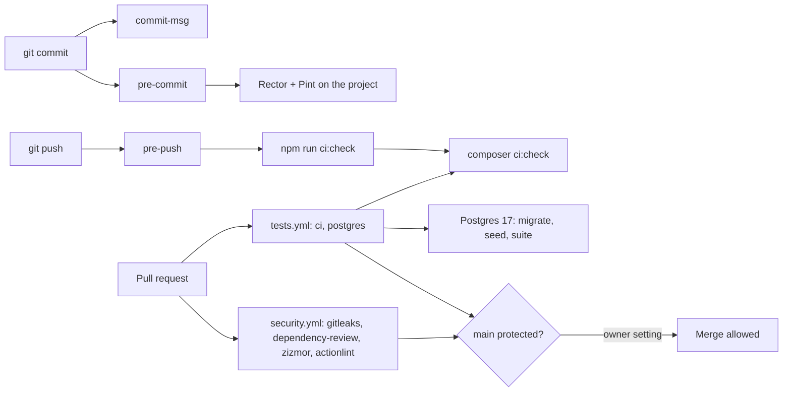

# ADR 0007: Local Git hooks and a single CI gate

> **TL;DR**
> - Decision: one gate, `composer ci:check`, defined once in `composer.json` scripts. Git hooks (Husky) run it before every push; GitHub Actions runs the same script on every pull request. CI is the backstop because hooks can be bypassed locally.
> - Added by ABP-9: Larastan at level max with strict rules, Rector, Pint with `declare_strict_types`, architecture tests, an access matrix, runtime security headers, a Postgres 17 CI job, gitleaks, dependency review, zizmor, actionlint and Dependabot.
> - The owner still has to protect `main` on GitHub (section "Owner steps on GitHub"). Code cannot do that.
> - Status: implemented on branch `task/ABP-9-install-security-checks`. Every check of the reference project is classified Applied, Adapted or Dropped in the applicability table.

## Status

Accepted, 2026-10-30. Implementation status: implemented. Dev dependencies larastan/larastan, phpstan/phpstan-strict-rules, rector/rector and husky were approved for ABP-9 only (installed versions are in [../development/local-setup.md](../development/local-setup.md#7-tooling-and-git-hooks)).

## Context

| Factor | Detail |
|---|---|
| Public repository | The repo is public (C7). A leaked key or a forged-looking commit is visible to everyone, so checks must run before code leaves the machine and again in CI |
| Solo owner plus AI agents | Agents follow written rules unevenly. A hook or a failing test is the only rule that cannot be forgotten |
| Money movement | The product moves money. Architecture rules (slice isolation, final Actions, no raw SQL, no `unguard`) must fail the build, not rely on review |
| Production database | Render Postgres is production ([0004-render-postgres.md](0004-render-postgres.md)). Tests default to SQLite `:memory:`, so a Postgres job is needed to catch dialect drift |
| Reference | A prior private project ("the reference project") ran a similar gate. Its ADR and testing doc were used as a checklist, and each item was classified below |
| Time | Hackathon deadline Nov 12, 2026. Tooling must be installed once and stay quiet |

## Decision

| Rule | Detail |
|---|---|
| Single gate | `composer ci:check` runs `composer check` (validate, Rector dry run, Pint test mode, Larastan, audits), then `npm run build`, then `composer test` (parallel Pest). The script list lives only in [`composer.json`](../../composer.json) |
| Local hooks | Husky 9 runs `.husky/commit-msg`, `.husky/pre-commit` and `.husky/pre-push` (POSIX `sh`). `npm run prepare` sets `core.hooksPath` to `.husky/_`; `composer setup` calls it. `.npmrc` keeps `ignore-scripts=true`, so hooks register only through `composer setup` or `npm run prepare` |
| Hook responsibilities | commit-msg: message format and no attribution trailers. pre-commit: partly staged file guard, `.env` guard, secret scan, Rector + Pint. pre-push: branch and ref guards, then `npm run ci:check`. The patterns and checks live only in the hook files |
| Remote gate | `.github/workflows/tests.yml` jobs `ci` (SQLite, `composer ci:check`) and `postgres` (Postgres 17 service, migrate, seed, full suite). `.github/workflows/security.yml` jobs `gitleaks`, `dependency-review` (pull requests only), `zizmor`, `actionlint` |
| Workflow hardening | Triggers are push to `main` and every `pull_request` (never `pull_request_target`). Top-level `permissions: contents: read`. `persist-credentials: false` on every checkout. Every `uses:` pinned to a full commit SHA with a version comment. `timeout-minutes` on every job. Concurrency cancels superseded runs except on `main` |
| Static analysis | `phpstan.neon` at level max, no baseline, no inline ignores. Each `ignoreErrors` or `excludePaths` entry carries a written reason |
| Runtime hardening | `app/Features/Shared/Http/Middleware/SecurityHeaders.php` (values and policies live only there and in [`config/antibody.php`](../../config/antibody.php)) |
| Architecture and access tests | `tests/Architecture` (structure, hygiene, slice isolation, raw SQL) and `tests/AccessMatrix` (protected surface coverage, guest refusal) run in the same Pest run, with fixture self-tests under `tests/Fixtures` |
| Test layout | All unit and feature tests live in `app/Features/<Slice>/Tests/Feature` and `Tests/Unit`, one testsuite per slice. Root `tests/` keeps only cross-cutting suites. See [../development/testing-strategy.md](../development/testing-strategy.md) |
| Never bypass | No `--no-verify`, no `HUSKY=0`. The hooks cannot stop that locally; CI refuses the same changes |

## Applicability table: reference project checks

| Check in the reference project | Result | Anti-Body treatment and why |
|---|---|---|
| `tests.yml` main job | Applied | Job `ci`: PHP 8.5, Node 22, Composer and npm caches keyed on lockfiles, `composer setup`, `composer ci:check` on SQLite |
| MySQL service job | Adapted | Job `postgres` uses Postgres 17 pinned by digest, because Render Postgres is production ([0004-render-postgres.md](0004-render-postgres.md)). `DatabaseDriverTest` fails if the driver differs from `ANTIBODY_EXPECTED_DB_DRIVER` and is skipped when the variable is unset |
| Dependabot | Applied | `.github/dependabot.yml`: github-actions, composer, npm; weekly; 5-day cooldown; one group per ecosystem |
| Pull request template | Adapted | `.github/pull_request_template.md` with the `type: [ABP-#] Imperative action` title hint and a security and money checklist |
| `commit-msg` hook | Adapted | Prefix is `[ABP-#]`, seven types, `Merge `, `Revert "`, `fixup! `, `squash! ` exempt. Co-author trailers and "Generated with" lines are rejected, also on exempt subjects |
| `pre-commit` hook | Adapted | ide-helper and `vp check` dropped (see below). Added: partly staged file guard, `.env` guard, secret scan of added lines. Runs Rector + Pint on the whole project, then re-stages only already staged paths |
| `pre-push` hook | Adapted | Added: refuse detached HEAD, refuse branches not matching `task/ABP-#-slug`, refuse any push to `main`, refuse non-branch refs and remote branch deletion. Then `npm run ci:check` |
| `phpstan.neon` | Applied | Level max, Larastan, Carbon, strict rules and Pest extensions, fixture `excludePaths` and an `arch()` chain ignore, each with a reason. The reference project's Eloquent forwarded-call and `TestResponse` ignores are not needed yet |
| `rector.php` | Adapted | `config/` added to paths; `database/migrations` and `tests/Fixtures/Architecture` skipped. Sets: PHP sets, dead code, code quality, coding style, type declarations |
| `pint.json` | Adapted | Laravel preset plus `declare_strict_types`; the three applied starter migrations are excluded by exact path |
| `phpunit.xml` | Adapted | One testsuite per slice (today `Shared`) plus `Architecture` and `AccessMatrix`, like the owner's other project, instead of global `Unit` and `Feature` suites |
| `Pest.php` bindings | Applied | `Tests\TestCase` + `RefreshDatabase` bound to `AccessMatrix` and `../app/Features/*/Tests/Feature` |
| Architecture tests (feature map, class rules, isolation, hygiene, raw SQL, structure) | Adapted | `SliceMap` is derived from [../architecture/slice-catalog.md](../architecture/slice-catalog.md); Actions expose `handle()` instead of `execute`; reserved-word aliases target Postgres instead of MySQL; a token scanner covers `eval`, raw SQL, `unguard` and debug calls. Rules for engines, controllers, events, listeners and providers are dropped until such classes exist |
| Access matrix | Adapted | Actors owner, agent, guest. Rows are empty today. Unnamed routes are reported. Agent rows stay planned until Sanctum is approved |
| Support helpers `CanonicalJson`, `Thrown` | Dropped | Not needed yet. `CanonicalJson` returns with the Audit slice ([../security/audit-hash-chain.md](../security/audit-hash-chain.md)) |
| `SecurityHeaders` middleware and test | Applied | Adds machine, panel (Filament and the Livewire 4 hashed update route) and page policies. Camera is fully disabled. No `ws:` in `connect-src` because there is no Reverb |
| Guest API response test | Applied | `GuestAccessTest` and the access matrix guest checks |
| Problem+JSON renderer test | Dropped | The project uses Laravel JSON errors and the MCP envelope ([../api/error-formats.md](../api/error-formats.md)). Leak and JSON 404 checks stay in `ErrorResponseTest` |
| Rate limiter test | Dropped | Limiters do not exist until the Shared provider is built (B6) |
| `X-Request-Id` middleware | Dropped | No consumer yet |
| ide-helper | Dropped | Owner decision. Larastan covers the Eloquent types |
| Vue, Inertia, Wayfinder, PWA, `vp`, `vue-tsc`, Vitest, Reverb | Dropped | Anti-Body has no such frontend or realtime stack |
| Deploy scripts, coverage minimums, mutation testing, nightly eval in the gate | Dropped | Out of scope for ABP-9. The nightly real-model eval stays planned in [../development/testing-strategy.md](../development/testing-strategy.md) |
| Audits in the gate | Added | `composer audit` and `npm audit --audit-level=high` run inside `composer check` |
| Secret and workflow scanning | Added | gitleaks with project rules in `.gitleaks.toml`, dependency review, zizmor and actionlint in `security.yml` |
| Rector skip decisions | Applied | No rule fights a convention so far. The only manual deviation: the trait uses on `User` are split so `SeparateMultiUseImportsRector` does not drop the `/** @use HasFactory<UserFactory> */` generic |

## Consequences

| Type | Consequence |
|---|---|
| Positive | One script is the gate. Local and CI cannot drift: `npm run ci:check` forwards to `composer ci:check` |
| Positive | Architecture, access and hygiene rules fail the build, so agents cannot silently break them |
| Positive | Full history gitleaks run (27 commits at install time) found no leaks after two project rules were tightened |
| Negative | Commits are slower: Rector and Pint run on the whole project, not only staged files |
| Negative | Windows: commit from PowerShell. The hooks reach PHP through `npm run`, which uses `cmd.exe`; `php` and `composer` are not on the Git Bash `PATH` in this setup |
| Negative | `HUSKY=0` and `--no-verify` cannot be prevented locally. CI plus branch protection is the backstop |
| Negative | The Postgres image digest in `tests.yml` is not updated by Dependabot's three ecosystems. Update it by hand when moving to a new Postgres 17 patch |
| Negative | Strict types now apply to every PHP file except the three applied starter migrations; PHPStan max required three starter config fixes (`config/app.php`, `config/database.php`, `config/filesystems.php`) |
| Known issue (BUG-01) | `App\Models\User` does not implement `Filament\Models\Contracts\FilamentUser`. Outside `local`, Filament answers 403 on every panel page, so the owner could log in but not use `/admin` in production. Not fixed in ABP-9 because it changes behavior. Tracked for B2 and B7 |
| Not used | CodeQL (no PHP support). Coverage gate and mutation testing are future options, see [../development/testing-strategy.md](../development/testing-strategy.md) |

## Review follow-ups (ABP-9 security audit and code review)

| Finding | Status |
|---|---|
| Pre-commit scan skipped added lines after a content line starting with `++ `, after a quoted non-ASCII path, or with `diff.noprefix` set | Fixed: `core.quotePath=false`, explicit `--src-prefix` and `--dst-prefix`, headers only between `diff --git` and the first `@@`, fail closed when git or awk fails |
| Private key pattern starting with `-----` was read by grep as an option | Fixed: `grep -E -e` |
| Global gitleaks allowlist hid every rule in `.env.example` and `tests/Fixtures/` | Fixed: the path allowlist now applies only to `antibody-secret-assignment` |
| Secret values starting with punctuation, `your-<real value>` and `'NAME' => 'value'` passed | Fixed: any first character except quote, space, `<`, `$`, `.` and backtick; exact placeholders only; quoted array form matched |
| Spaced `Co-authored-by :`, lowercase "generated with" and CRLF messages | Fixed in `.husky/commit-msg` |
| Pre-push gated the working tree, not the pushed commit | Fixed: a pushed SHA must equal HEAD |
| `composer setup` used `npm install` in CI | Fixed: `npm ci --ignore-scripts` |
| `ci` job overrode the in-memory test database | Fixed: no `DB_*` env on the `composer ci:check` step |
| Panel CSP matched any first segment starting with `livewire`; `SecurityHeaders` ran after earlier global middleware | Fixed: the segment must match `livewire-` plus hex; the middleware is prepended |
| Scanner blind spots (more raw SQL methods, unresolvable class files, nested horizontal folders, unexpanded middleware groups, deny-by-default routes, workflow `uses` parsing) | Fixed in the architecture, access matrix and tooling helpers |
| No trusted proxies, so HSTS and secure URLs are lost behind Render's TLS proxy; `SESSION_SECURE_COOKIE` unset | Deferred to B2 (Render deploy), tracked as BUG-02 |
| CSP enforcement needs the Filament font and avatar hosts checked and a reporting endpoint | Deferred until before `ANTIBODY_CSP_REPORT_ONLY=false` (B7 or P2) |

## Owner steps on GitHub

Code cannot configure these. Do them once on `EHIBE/anti-body-paypal`.

| # | Step |
|---|---|
| 1 | Protect `main` with a ruleset or branch protection: require pull requests; require status checks `ci`, `postgres`, `gitleaks`, `dependency-review`, `zizmor` (optionally `actionlint`); block force pushes; block deletion |
| 2 | Keep the dependency graph on. `dependency-review` needs it (on by default for public repositories) |
| 3 | gitleaks-action needs no license for a personal account. No secret has to be created for any workflow |

## Alternatives considered

| Alternative | Why rejected |
|---|---|
| CI only, no local hooks | Feedback arrives after the push, and a secret would already be public |
| lint-staged | Staged-file linting misses project-wide rules (Rector, Larastan, architecture tests) and adds a dependency |
| Stash-based partial staging | Stashing is forbidden for agents and risks losing work. The hook refuses partly staged files instead |
| CodeQL | No PHP support |
| `pre-commit` framework (Python) | Adds a Python toolchain to a PHP and Node repository |
| One workflow file | Separate `security.yml` keeps scanner permissions and required checks easy to reason about |
