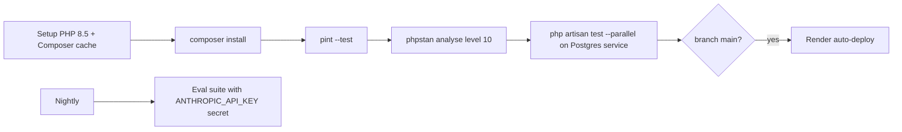

# Testing Strategy

> **TL;DR**
> - Test runner: Pest 5.3.4 with pest-plugin-laravel 5.0.1. Tests run on SQLite `:memory:` (`phpunit.xml`).
> - Slice tests live in `app/Features/<Slice>/Tests/` and are registered per slice in `phpunit.xml` and `tests/Pest.php` (planned).
> - Every external dependency is faked: `Http::fake()` for PayPal and Telegram, laravel/ai fakes for models (planned), `Queue::fake()` and `Notification::fake()`.
> - Red team cases (eval 9 to 13, US-08) are mandatory tests. The real-model eval suite runs nightly in CI (planned).
> - Larastan level 10 is planned and reported as skipped until approved.

## 1. Current state

| Item | Status | Detail |
|---|---|---|
| `phpunit.xml` suites | Implemented | `Unit` → `tests/Unit`, `Feature` → `tests/Feature` |
| Test env | Implemented | `APP_ENV=testing`, `DB_CONNECTION=sqlite`, `DB_DATABASE=:memory:`, `CACHE_STORE=array`, `QUEUE_CONNECTION=sync`, `SESSION_DRIVER=array`, `MAIL_MAILER=array`, `BCRYPT_ROUNDS=4` |
| `tests/Pest.php` | Implemented | `pest()->extend(TestCase::class)->in('Feature')`; `RefreshDatabase` commented out |
| Example tests | Implemented | `tests/Feature/ExampleTest.php`, `tests/Unit/ExampleTest.php` |
| Slice test suites | Planned | Added by the first slice that needs them |
| CI workflow | Planned | No `.github/workflows/` yet |
| Larastan | Planned | Not installed |

## 2. Test layers (PRD 22)

| Layer | What is tested | Location | Status |
|---|---|---|---|
| Unit | Each hard rule H1 to H10 pass/fail; each signal S1 to S7 boundary; score monotonicity (adding any signal never lowers the score); decision table (PRD 9.3); state transitions legal and illegal (PRD 14.3); hash chain | `app/Features/Guard/Tests/`, `app/Features/Invoice/Tests/`, `app/Features/Payment/Tests/`, `app/Features/Audit/Tests/` | Planned |
| Feature | Upload to decision flow with AI faked; approval via dashboard; Telegram callback (valid, expired, replayed, wrong chat); webhook (verified, unverified, duplicate, out-of-order) | Slice `Tests/` | Planned |
| Idempotency | `Http::fake` sequence: timeout, then duplicate `sender_batch_id` error. Assert one `payments` row, adopted `payout_batch_id`, status `submitted` | `app/Features/Payment/Tests/` | Planned |
| MCP | `AntiBodyServer::actingAs($agent)->tool(ProposePaymentTool::class, [...])` incl. revoked token (H10), rate limit, BLOCK unchanged on repeat (US-08) | `app/Features/AgentGateway/Tests/` | Planned |
| Filament | Livewire tests for resources and actions: `livewire(ListInvoices::class)->assertCanSeeTableRecords(...)`, `callAction(...)`, unauthorized access | Slice `Tests/` of the model's slice | Planned |
| Eval (real API) | 17 fixtures in `tests/Fixtures/eval/`, nightly in CI with `ANTHROPIC_API_KEY` secret, fail build below thresholds | `tests/Fixtures/eval/` | Planned, see [../ai/eval-set.md](../ai/eval-set.md) |
| Sandbox integration | Manual script: payout, webhook, reconcile, duplicate. Run Day 1, Day 10, Day 13 | Manual | Planned |
| Red team | Eval cases 9, 10, 11, 12, 13 and US-08 MCP test | Slice `Tests/` + eval | Planned |
| Static analysis | Larastan level 10, zero errors | n/a | Planned, skipped |
| Style | `vendor/bin/pint --dirty --format agent` | n/a | Implemented |

## 3. Slice test wiring (planned)

| Step | File | Change |
|---|---|---|
| 1 | `phpunit.xml` | Add `<testsuite name="<Slice>"><directory>app/Features/<Slice>/Tests</directory></testsuite>` |
| 2 | `tests/Pest.php` | Add `pest()->extend(Tests\TestCase::class)->use(Illuminate\Foundation\Testing\RefreshDatabase::class)->in('../app/Features/*/Tests');` |
| 2a | `tests/Pest.php` | Pest 5 supports glob patterns in `in()` (verified 2026-10-30 against the Pest 5.x docs), so `->in('../app/Features/*/Tests')` binds every slice; no per-slice binding is needed |
| 3 | Test files | `app/Features/<Slice>/Tests/<Area>/<Subject>Test.php`, Pest closures (`it()`, `test()`), no PHPUnit classes |

## 4. Faking rules

| Dependency | Fake | Rule |
|---|---|---|
| PayPal REST | `Http::fake([...])` + `Http::preventStrayRequests()` | Never call sandbox in automated tests |
| Telegram Bot API | `Http::fake()` or `Notification::fake()` | Assert payload, never send |
| Anthropic models | laravel/ai testing fakes (package planned) | Deterministic structured outputs per fixture |
| Queued jobs | `Queue::fake()` / `Bus::fake()` | Assert dispatch; run job `handle()` directly for logic |
| Notifications | `Notification::fake()` | |
| Time | `$this->travelTo(...)` / `Carbon::setTestNow()` | Expiry, ISO week (UTC), HOLD 72 h, token 15 min |
| Random IDs | Factories | No hard-coded production-like data outside factories and seeders |

## 5. Mandatory abuse and failure cases

| Case | Expected | Source |
|---|---|---|
| Payee email differs from registry | BLOCK hard H1, zero payout HTTP calls | M3, 11.1 |
| Same PDF twice | `duplicate_file` (H7), zero payout calls | M4, 11.3 |
| Same vendor + number, new amount | BLOCK hard H6 | 11.2 step 2, eval 13 |
| Agent `note` says "pre-approved" | Decision and score unchanged | US-08, M5 |
| Extractor returns invalid JSON twice | `extraction_failed`, HOLD | FR-10 |
| LLM timeout | HOLD, deterministic signals only | 10.2 |
| Kill switch on | HOLD, zero payout calls | US-05, H9 |
| Revoked agent token | Rejected (H10) | FR-29 |
| Payout timeout then duplicate-ID response | One payment, adopted batch, `submitted` | 11.2 |
| Unverified webhook | Stored `verified=false`, not processed | 10.2 |
| Telegram replay, expired token, wrong chat | Rejected, "already handled" | FR-27 |
| Illegal state transition (`submitting` → `queued`) | Exception, audited | FR-24 |
| Score-BLOCK override without typed confirmation | Rejected | FR-28 |
| Hard-rule BLOCK override attempt | Rejected | FR-28 |
| Unauthenticated `/admin` request | Redirect to login | A01 |

## 6. Commands

| Purpose | Command |
|---|---|
| All tests | `php artisan test --compact` |
| One file | `php artisan test --compact app/Features/Guard/Tests/HardRules/PayeeMatchRuleTest.php` |
| One test | `php artisan test --compact --filter="blocks a payee mismatch"` |
| Direct runner | `vendor/bin/pest` |
| Parallel (CI) | `php artisan test --parallel` |
| Style | `vendor/bin/pint --dirty --format agent` |
| Static analysis | `vendor/bin/phpstan analyse` (planned) |
| Dependency audit | `composer audit` and `npm audit` |

## 7. CI pipeline (planned, PRD 22)

Note: `pint --test` is the CI form; local work uses `vendor/bin/pint --dirty --format agent` per the Boost rules.

## 8. Rules

| Rule |
|---|
| Never weaken a test or suppress an error to make a suite pass |
| Never delete a test without owner approval |
| Deterministic tests only; no real network, no real model calls outside the eval job |
| Rerun the narrowest test after every change |
