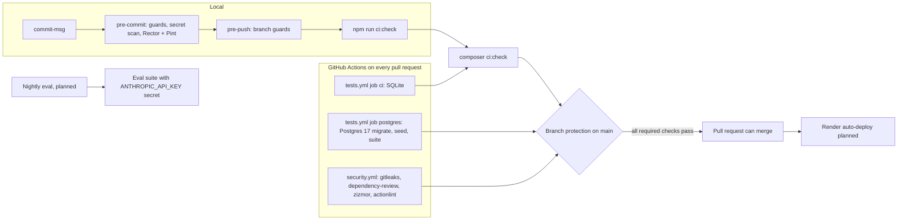

# Testing Strategy

> **TL;DR**
> - Test runner: Pest 5.3.4 with pest-plugin-laravel 5.0.1 and paratest (parallel). Tests run on SQLite `:memory:` (`phpunit.xml`); the CI `postgres` job runs the whole suite on Postgres 17.
> - All unit and feature tests live inside their slice: `app/Features/<Slice>/Tests/Feature` and `Tests/Unit`, one testsuite per slice named after the slice. Root `tests/` keeps only cross-cutting suites: `Architecture` and `AccessMatrix`.
> - One gate, `composer ci:check`, defined in `composer.json`. Git hooks run it before every push; GitHub Actions runs it on every pull request. Larastan runs at level max with strict rules and no baseline.
> - Every external dependency is faked: `Http::fake()` for PayPal and Telegram, laravel/ai fakes for models (planned), `Queue::fake()` and `Notification::fake()`.
> - Red team cases (eval 9 to 13, US-08) are mandatory tests. The real-model eval suite runs nightly in CI (planned).

## 1. Current state

| Item | Status | Detail |
|---|---|---|
| `phpunit.xml` suites | Implemented | `Shared` (`app/Features/Shared/Tests`), `Architecture` (`tests/Architecture`), `AccessMatrix` (`tests/AccessMatrix`). Each slice Tests directory is excluded from `<source>` |
| Test env | Implemented | `APP_ENV=testing`, `DB_CONNECTION=sqlite`, `DB_DATABASE=:memory:`, `CACHE_STORE=array`, `QUEUE_CONNECTION=sync`, `SESSION_DRIVER=array`, `MAIL_MAILER=array`, `BCRYPT_ROUNDS=4` |
| `tests/Pest.php` | Implemented | Binds `Tests\TestCase` and `RefreshDatabase` to `AccessMatrix` and `../app/Features/*/Tests/Feature`. `Architecture` and `Unit` tests run without a database |
| Shared slice feature tests | Implemented | `app/Features/Shared/Tests/Feature`: `SecurityHeadersTest`, `GuestAccessTest`, `ErrorResponseTest`, `CsrfProtectionTest`, `PanelLoginTest`, `ApplicationDebugTest`, `DatabaseDriverTest`, `ExampleTest`. Unit: `Tests/Unit/ExampleTest.php` |
| Architecture suite | Implemented | `tests/Architecture` (section 3) |
| Access matrix suite | Implemented, rows empty | `tests/AccessMatrix` (section 3) |
| Tooling self-tests | Implemented (ABP-9) | `app/Features/Shared/Tests/Feature/Tooling/`: `WorkflowSecurityTest`, `DependabotConfigTest`, `GateScriptsTest`, `ToolConfigTest`, `HookFilesTest`, `CommitMsgHookTest`, `PreCommitHookTest`, `PrePushHookTest`, `RepositorySecretScanTest`, with helpers in `tests/Support/` (`Shell`, `Repo`, `Tree`, `WorkflowAudit`, `SecretScan`, `HookSandbox`). Hooks run through `sh -e` in temporary git repositories with a fake `npm`; on Windows the sandbox adds Git `usr/bin` to PATH as git does for hooks. 296 tests, about 3 minutes in parallel on Windows |
| Other slice test suites | Planned | Added by the first slice that needs them (section 4) |
| CI workflows | Implemented | `.github/workflows/tests.yml` (`ci`, `postgres`) and `.github/workflows/security.yml` (section 8) |
| Larastan | Implemented | larastan/larastan v3.13.2 on phpstan/phpstan 2.3.4, level max, strict rules, `phpstan.neon` |
| Rector | Implemented | rector/rector 2.8.3, `rector.php`, dry run in the gate |
| Coverage gate | Not used | See section 10 |
| Mutation testing | Not used | See section 10 |

## 2. Test layers (PRD 22)

| Layer | What is tested | Location | Status |
|---|---|---|---|
| Unit | Each hard rule H1 to H10 pass/fail; each signal S1 to S7 boundary; score monotonicity (adding any signal never lowers the score); decision table (PRD 9.3); state transitions legal and illegal (PRD 14.3); hash chain | `app/Features/Guard/Tests/Unit`, `app/Features/Invoice/Tests/Unit`, `app/Features/Payment/Tests/Unit`, `app/Features/Audit/Tests/Unit` | Planned |
| Feature | Upload to decision flow with AI faked; approval via dashboard; Telegram callback (valid, expired, replayed, wrong chat); webhook (verified, unverified, duplicate, out-of-order) | `app/Features/<Slice>/Tests/Feature` | Planned (Shared slice runtime security tests implemented) |
| Idempotency | `Http::fake` sequence: timeout, then duplicate `sender_batch_id` error. Assert one `payments` row, adopted `payout_batch_id`, status `submitted` | `app/Features/Payment/Tests/Feature` | Planned |
| MCP | `AntiBodyServer::actingAs($agent)->tool(ProposePaymentTool::class, [...])` incl. revoked token (H10), rate limit, BLOCK unchanged on repeat (US-08) | `app/Features/AgentGateway/Tests/Feature` | Planned |
| Filament | Livewire tests for resources and actions: `livewire(ListInvoices::class)->assertCanSeeTableRecords(...)`, `callAction(...)`, unauthorized access | `Tests/Feature` of the model's slice | Planned |
| Architecture | Slice isolation, class structure, hygiene, raw SQL | `tests/Architecture` | Implemented |
| Access matrix | Every protected route or `#[RequiresAbility]` class has a matrix row; guests are refused | `tests/AccessMatrix` | Implemented (no protected surface yet, rows empty) |
| Runtime security | Security headers, guest access, error leaks, CSRF, login responses, debug default, database driver | `app/Features/Shared/Tests/Feature` | Implemented |
| Eval (real API) | 17 fixtures in `tests/Fixtures/eval/`, nightly in CI with `ANTHROPIC_API_KEY` secret, fail build below thresholds | `tests/Fixtures/eval/` | Planned, see [../ai/eval-set.md](../ai/eval-set.md) |
| Sandbox integration | Manual script: payout, webhook, reconcile, duplicate. Run Day 1, Day 10, Day 13 | Manual | Planned |
| Red team | Eval cases 9, 10, 11, 12, 13 and US-08 MCP test | Slice `Tests/Feature` + eval | Planned |
| Static analysis | Larastan level max with strict rules, zero errors, no baseline | `composer types:check` | Implemented |
| Style | Pint with `pint.json` (Laravel preset, `declare_strict_types`) | `composer lint:check` (CI form), `vendor/bin/pint --dirty --format agent` (local) | Implemented |
| Refactor drift | Rector dry run must report no change | `composer refactor:check` | Implemented |

## 3. Cross-cutting suites (implemented)

| Suite | Directory | What it enforces |
|---|---|---|
| Architecture | `tests/Architecture` | Structure (Actions `final`, name ends in `Action`, exactly one public `handle()`; Data `final readonly`; enums string-backed; concrete slice classes `final`; no PHP in `app/Services`, `app/Repositories`, `app/Actions`, `app/Jobs`, `app/Policies`; `app/Http/Controllers` holds only `Controller.php`; `app/Models` holds only `User.php`). Hygiene (strict types on `App`, no debug calls, no `env()` outside config, no shell or `eval` calls, no `unserialize`, no `Model::unguard()`). Raw SQL (token scanner with an empty allowlist; Postgres reserved-word aliases). Slice isolation (see below) |
| AccessMatrix | `tests/AccessMatrix` | Coverage of every `#[RequiresAbility]` class and authenticated route by a matrix row; unknown actors; unique keys; agents never granted approve, reject, override, vendor, amount or payee; guests get 401 or the `/admin/login` redirect on every authenticated route; unnamed routes are reported as `unnamed: METHOD uri`; `filament.` and `livewire.` routes are covered by panel tests |
| Fixtures | `tests/Fixtures` | Planted violations and clean counterparts that prove each scanner reports a violation and accepts clean code. `tests/Fixtures/Architecture` is excluded from Larastan and Rector |

Exact rule lists live in the test and helper files, not here: [`tests/Architecture/HygieneTest.php`](../../tests/Architecture/HygieneTest.php), [`tests/Architecture/StructureTest.php`](../../tests/Architecture/StructureTest.php), [`tests/Architecture/SliceIsolationTest.php`](../../tests/Architecture/SliceIsolationTest.php), [`tests/Architecture/RawSqlTest.php`](../../tests/Architecture/RawSqlTest.php), [`tests/Architecture/ForbiddenCalls.php`](../../tests/Architecture/ForbiddenCalls.php).

Slice isolation reads the dependency map only from [`tests/Architecture/SliceMap.php`](../../tests/Architecture/SliceMap.php), which mirrors [../architecture/slice-catalog.md](../architecture/slice-catalog.md):

| Namespace group | Rule |
|---|---|
| Internal (`Http`, `Models`, `Policies`, `Providers`, `Listeners`, `Jobs`, `Mcp`, `Ai`, `Routes`, `Commands`) | Never used from another slice |
| Public (`Actions`, `Data`, `Enums`, `Events`, `Exceptions`, `Contracts`) | Usable from another slice only along an edge declared in `SliceMap` |
| Shared | Depends on no other slice; every slice may use Shared |
| Map | Equals the 13 planned slices; every folder under `app/Features` must be mapped |

The access matrix `rows()` are empty because no protected surface exists yet. Agent rows stay planned until laravel/sanctum is approved.

## 4. Slice test wiring (implemented for Shared)

| Step | File | Change |
|---|---|---|
| 1 | `phpunit.xml` | Add `<testsuite name="<Slice>"><directory>app/Features/<Slice>/Tests</directory></testsuite>` and `<exclude><directory>app/Features/<Slice>/Tests</directory></exclude>` inside `<source>` |
| 2 | `tests/Pest.php` | Nothing to add. The binding `->in('AccessMatrix', '../app/Features/*/Tests/Feature')` already covers every slice `Tests/Feature` folder by glob |
| 3 | Test files | `app/Features/<Slice>/Tests/Feature/<Subject>Test.php` (database, HTTP) or `Tests/Unit/<Subject>Test.php` (no database), Pest closures (`it()`, `test()`), no PHPUnit classes |
| 4 | Check | Implemented (ABP-9): `ToolConfigTest` fails when a slice `Tests` folder is not registered in `phpunit.xml` |

## 5. Faking rules

| Dependency | Fake | Rule |
|---|---|---|
| PayPal REST | `Http::fake([...])` + `Http::preventStrayRequests()` | Never call sandbox in automated tests |
| Telegram Bot API | `Http::fake()` or `Notification::fake()` | Assert payload, never send |
| Anthropic models | laravel/ai testing fakes (package planned) | Deterministic structured outputs per fixture |
| Queued jobs | `Queue::fake()` / `Bus::fake()` | Assert dispatch; run job `handle()` directly for logic |
| Notifications | `Notification::fake()` | |
| Time | `$this->travelTo(...)` / `Carbon::setTestNow()` | Expiry, ISO week (UTC), HOLD 72 h, token 15 min |
| Random IDs | Factories | No hard-coded production-like data outside factories and seeders |

## 6. Mandatory abuse and failure cases

| Case | Expected | Source |
|---|---|---|
| Payee email differs from registry | BLOCK hard H1, zero payout HTTP calls | M3, 11.1 |
| Same PDF twice | `duplicate_file` (H7), zero payout calls | M4, 11.3 |
| Same vendor + number, new amount | BLOCK hard H6 | 11.2 step 2, eval 13 |
| Agent `note` says "pre-approved" | Decision and score unchanged | US-08, M5 |
| Extractor returns invalid JSON twice | `extraction_failed`, HOLD | FR-10 |
| LLM timeout | HOLD, deterministic signals only | 10.2 |
| Kill switch on | HOLD, zero payout calls | US-05, H9 |
| Revoked agent token | Rejected (H10) | FR-29 |
| Payout timeout then duplicate-ID response | One payment, adopted batch, `submitted` | 11.2 |
| Unverified webhook | Stored `verified=false`, not processed | 10.2 |
| Telegram replay, expired token, wrong chat | Rejected, "already handled" | FR-27 |
| Illegal state transition (`submitting` → `queued`) | Exception, audited | FR-24 |
| Score-BLOCK override without typed confirmation | Rejected | FR-28 |
| Hard-rule BLOCK override attempt | Rejected | FR-28 |
| Unauthenticated `/admin` request | Redirect to login (implemented: `GuestAccessTest`, access matrix) | A01 |
| Unauthenticated `api/*` request | JSON 401 (implemented: `GuestAccessTest`) | A01 |
| Unknown email versus wrong password at login | Identical error (implemented: `PanelLoginTest`) | A07 |
| Missing CSRF token on a web POST | 419 (implemented: `CsrfProtectionTest`) | A07 |
| Server error with debug off | 500 with no message, class or path (implemented: `ErrorResponseTest`) | A02, A10 |

## 7. Commands

| Purpose | Command |
|---|---|
| All tests | `php artisan test --compact` |
| One file | `php artisan test --compact app/Features/Shared/Tests/Feature/SecurityHeadersTest.php` |
| One suite | `php artisan test --compact --testsuite=Architecture` |
| One test | `php artisan test --compact --filter="name of the test"` |
| Direct runner | `vendor/bin/pest` |
| Parallel (gate form) | `composer test` (clears config, then `php artisan test --parallel`) |
| Style, local | `vendor/bin/pint --dirty --format agent` |
| Style, CI form | `composer lint:check` |
| Static analysis | `composer types:check` |
| Refactor dry run | `composer refactor:check` |
| Dependency audit | `composer audit:check` (`composer audit` and `npm audit --audit-level=high`) |
| Whole gate | `composer ci:check` |

The list of steps inside each script lives only in [`composer.json`](../../composer.json).

## 8. Local hooks and CI pipeline

Decision record: [../decisions/0007-local-hooks-and-single-ci-gate.md](../decisions/0007-local-hooks-and-single-ci-gate.md).

| Job | File | What it runs |
|---|---|---|
| `ci` | `.github/workflows/tests.yml` | PHP 8.5, Node 22, caches, `composer setup`, `composer ci:check` on SQLite |
| `postgres` | `.github/workflows/tests.yml` | Postgres 17 service (pinned by digest, `pg_isready` health check), `pdo_pgsql`, `php artisan db:show`, `migrate:fresh --seed --force`, `php artisan test --compact`. `DB_CONNECTION=pgsql` and `ANTIBODY_EXPECTED_DB_DRIVER=pgsql` override the SQLite values in `phpunit.xml`, because a phpunit `<env>` entry does not overwrite an existing environment variable. `DatabaseDriverTest` fails when the driver differs and is skipped when the variable is unset |
| `gitleaks` | `.github/workflows/security.yml` | Full history scan with `.gitleaks.toml` (default rules plus project rules) |
| `dependency-review` | `.github/workflows/security.yml` | Pull requests only; fails on severity high. Needs the GitHub dependency graph |
| `zizmor` | `.github/workflows/security.yml` | Static audit of the workflow files |
| `actionlint` | `.github/workflows/security.yml` | Lint of the workflow files |

Both workflows trigger on push to `main` and on every pull request, run with read-only `contents` permission, never use `pull_request_target`, disable credential persistence on checkout and pin every action to a full commit SHA. CodeQL is not used because it has no PHP support. `.github/dependabot.yml` updates github-actions, composer and npm weekly.

Nightly eval: **Status: planned** (B9).

## 9. Owner steps on GitHub

These settings cannot be set from code. Until they are done, CI results are advisory.

| # | Step |
|---|---|
| 1 | Protect `main` (ruleset or branch protection): require pull requests; require status checks `ci`, `postgres`, `gitleaks`, `dependency-review`, `zizmor` (optionally `actionlint`); block force pushes and deletions |
| 2 | Keep the dependency graph on (needed by `dependency-review`; on by default for public repositories) |
| 3 | gitleaks-action needs no license for a personal account |

## 10. Future options (not used now)

| Option | Note |
|---|---|
| Coverage gate | `pest --coverage --min=<n>` once there is enough domain code to make a minimum meaningful. Needs a coverage driver in CI |
| Mutation testing | pest-plugin-mutate is installed transitively with Pest but unused. Consider for the Guard slice after B5 |

## 11. Known issues

| ID | Issue | Impact | Tracked for |
|---|---|---|---|
| BUG-01 | `App\Models\User` does not implement `Filament\Models\Contracts\FilamentUser` | Outside the `local` environment Filament answers 403 on every panel page, so the owner could log in but not use `/admin` in production. Not covered by a test because the behavior was not changed in ABP-9 | B2, B7 (BUG-01) |

## 12. Rules

| Rule |
|---|
| Never weaken a test or suppress an error to make a suite pass |
| No PHPStan baseline and no inline `@phpstan-ignore`. A config `ignoreErrors` or `excludePaths` entry needs an identifier or path and a written reason, and is removed when the cause goes away |
| Never delete a test without owner approval |
| Deterministic tests only; no real network, no real model calls outside the eval job |
| Rerun the narrowest test after every change |
| Never bypass the hooks (`--no-verify`, `HUSKY=0`) |
