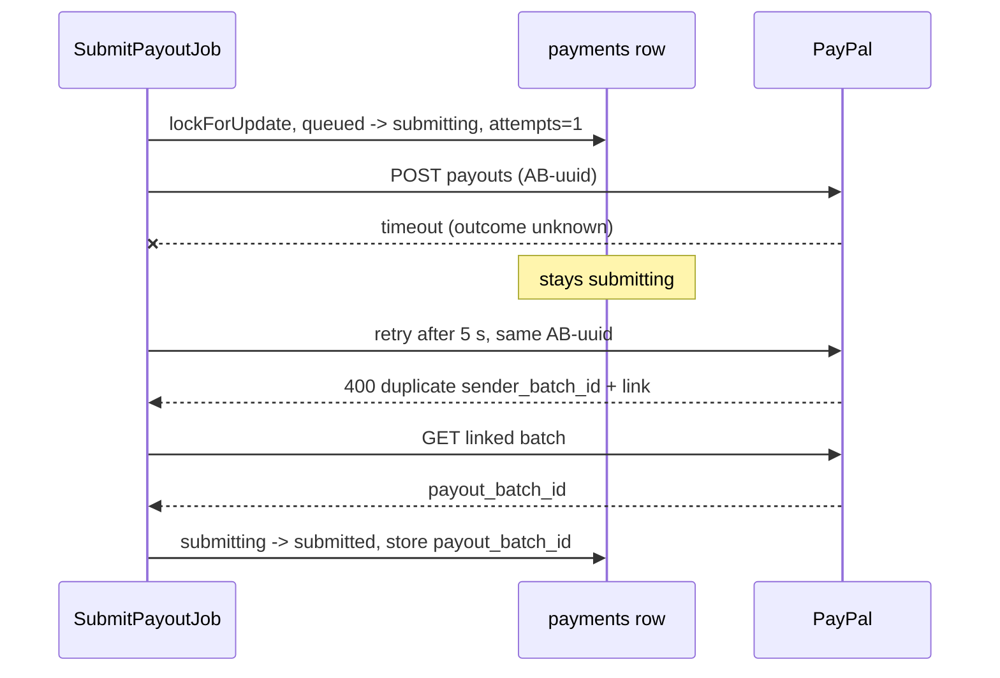

# Payment Idempotency

> **TL;DR**
> - Product goal P1: no payment leaves unless it matches a verified vendor, an extracted invoice and the approved amount, **exactly once**.
> - Five layers: H7 file hash, H6 vendor plus invoice number, unique `payments.invoice_id`, row lock on `queued` to `submitting`, and PayPal `sender_batch_id` + `PayPal-Request-Id` = `AB-{invoice_uuid}`.
> - Retries never mint a new ID. A duplicate-ID error from PayPal is treated as proof the first call succeeded.
> - `propose_payment` is idempotent: the same invoice returns the same decision (US-08, PRD 11.4).
> - **Status: planned.** None of these constraints exist in migrations yet (B3).

## 1. Layers

| # | Layer | Mechanism | Prevents | Status |
|---|---|---|---|---|
| L1 | File identity | `invoices.file_sha256` unique (H7). Duplicate bytes return `duplicate_file` with the original invoice ID, no new row, audited (decision D4) | Same PDF forwarded twice | planned |
| L2 | Business identity | Partial unique index `(vendor_id, invoice_number) WHERE status NOT IN ('rejected','blocked')` plus PHP check under row lock (H6). Constraint violation maps to H6 BLOCK | Re-scanned duplicate, conflicting revision | planned |
| L3 | One payment per invoice | `payments.invoice_id` unique | Two payment rows for one invoice | planned |
| L4 | One submitter | `lockForUpdate()` on the payment row in `DB::transaction()` for `queued` to `submitting` (FR-20) | Two workers posting the same payout | planned |
| L5 | One PayPal batch | `payments.sender_batch_id` unique, value `AB-{invoice_uuid}`, same value in `PayPal-Request-Id` header. PayPal rejects a reused `sender_batch_id` within 30 days and links the original batch | Retry after timeout creating a second batch | planned |
| L6 | One decision | `ProposePaymentAction` returns the stored `risk_assessments` decision for an already-decided invoice | Agent re-proposing to get a different outcome | planned |
| L7 | One webhook effect | `webhook_events (source, external_event_id)` unique | Duplicate webhook double-applying a state | planned |
| L8 | One Telegram tap | `approvals.token_hash` unique, single-use, 15 min expiry | Replayed approval tap | planned |

## 2. Identifier rules

| Identifier | Format | Created | Changes on retry |
|---|---|---|---|
| `sender_batch_id` | `AB-{invoice_uuid}` (UUIDv7, 39 chars, fits `varchar(64)`) | When the payment row is created at approval | Never |
| `PayPal-Request-Id` | Same as `sender_batch_id` | Same | Never |
| `sender_item_id` | Same as `sender_batch_id` | Same | Never |
| `payout_batch_id` | PayPal value | From 201 response or duplicate-ID adoption | Set once |

## 3. Retry under uncertainty (PRD 11.2)

Rule: never transition `submitting` back to `queued` (PRD 14.3). Retries happen inside `submitting`.

## 4. Concurrency notes

| Concern | Handling |
|---|---|
| SQLite has no row-level locks | `lockForUpdate()` is ignored on SQLite; SQLite serializes writers at database level. Postgres (Render) honors it. Tests assert behavior through status checks, not lock SQL |
| Two approvals at once (dashboard and Telegram) | Invoice row locked during `held` to `approved`. Second actor sees `approved` and gets "already handled" |
| Queued job acting on stale model | Job re-reads the payment with `lockForUpdate()` before acting |

## 5. Tests (planned, PRD 22)

| Test | Assertion |
|---|---|
| `Http::fake` timeout then duplicate-ID | One payment row, adopted batch ID, status `submitted`, one batch ID ever sent |
| Same PDF twice | Second call returns `duplicate_file`, invoice count unchanged |
| Same vendor + number, different bytes | H6 BLOCK |
| `propose_payment` called twice with different notes | Same decision, same score, note stored in audit only |
| Duplicate webhook event | Second event ignored, one state change |
| Replayed Telegram callback | "already handled", no second approval row |
