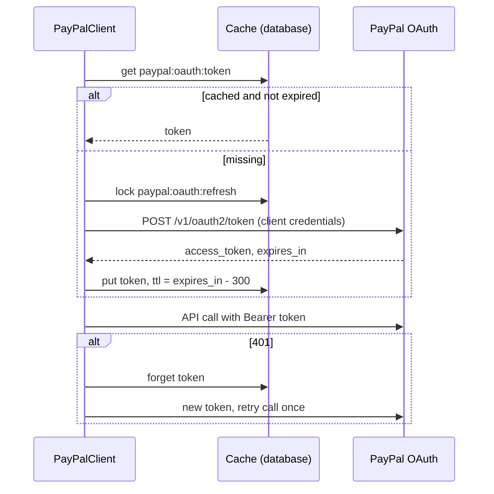

# PayPal OAuth Token Handling

> **TL;DR**
> - Grant type: client credentials, `POST /v1/oauth2/token` with HTTP Basic `PAYPAL_CLIENT_ID:PAYPAL_CLIENT_SECRET`.
> - Token cached in the database cache store until `expires_in` minus 5 minutes, and never longer than 8 h (PRD 12.6).
> - A `401` from any PayPal call forgets the cached token, fetches a new one, and retries the original call exactly once.
> - The token and the client secret never appear in logs, errors, MCP responses or audit data.
> - **Status: planned.** `PayPalClient` in the Payment slice is not built yet (B1, B3).

## 1. Token request

| Item | Value |
|---|---|
| Method and URL | `POST https://api-m.sandbox.paypal.com/v1/oauth2/token` |
| Auth | HTTP Basic, username `PAYPAL_CLIENT_ID`, password `PAYPAL_CLIENT_SECRET` |
| Body | `grant_type=client_credentials` (form encoded) |
| Timeout | Connect 5 s, request 10 s |
| Response used | `access_token`, `expires_in` (seconds), `scope` (logged as scope names only, never the token) |

## 2. Caching rule

| Rule | Value |
|---|---|
| Cache store | `database` (CACHE_STORE), the project has no Redis (ADR [0003](../decisions/0003-database-drivers-over-redis.md)) |
| Cache key | `paypal:oauth:token` |
| TTL | `min(expires_in - 300, 28800)` seconds |
| Invalidation | TTL expiry, or explicit `forget` on `401` |
| Concurrency | `Cache::lock('paypal:oauth:refresh', 10)` so only one worker refreshes at a time; others wait and re-read |
| Encryption at rest | Cache value is stored with `Crypt::encryptString()` because the database cache table is readable by anyone with DB access (planned) |

## 3. Failure handling

| Failure | Behavior |
|---|---|
| `401` on token endpoint | Credentials wrong. No retry. Payment stays in its state, owner alert "PayPal credentials rejected", audit `paypal.auth_failed` |
| `401` on an API call | Forget cache, refresh, retry once with the same idempotency IDs |
| Second `401` after refresh | Stop, treat as non-retryable for this attempt, alert owner |
| Timeout or `5xx` on token endpoint | Counts toward the circuit breaker ([paypal-payouts.md](./paypal-payouts.md) section 7) |

## 4. Secret handling

| Secret | Lives in | Never in |
|---|---|---|
| `PAYPAL_CLIENT_ID`, `PAYPAL_CLIENT_SECRET` | Render env vars, local `.env` (git-ignored), read through `config/services.php` (planned) | Repo, agents, logs, MCP responses |
| Access token | Cache only, max 8 h | Logs, exceptions, audit data |

See [../security/secrets.md](../security/secrets.md) for rotation and the never-log list.

## 5. Tests (planned)

| Test | Assertion |
|---|---|
| Token cached | Two API calls produce one token request (`Http::fake`, `Http::assertSentCount`) |
| TTL | Cached TTL equals `expires_in - 300` |
| 401 retry | API `401` then `201` produces exactly one refresh and one retry |
| No secret logging | Log fake contains no client secret or token string |
