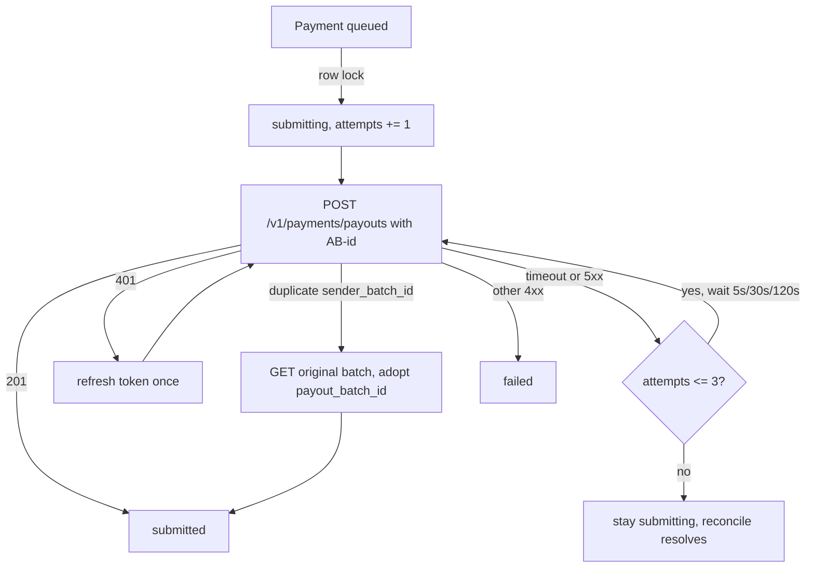

# PayPal Payouts Integration

> **TL;DR**
> - Anti-Body pays a vendor with exactly one Payouts batch per invoice: `POST /v1/payments/payouts` on `https://api-m.sandbox.paypal.com` (FR-18).
> - Amount comes only from `invoices.approved_amount_minor`, payee only from `vendors.paypal_email` (FR-19). Agents never supply either.
> - `sender_batch_id` and the `PayPal-Request-Id` header are both `AB-{invoice_uuid}` and are stored before the call (see [idempotency.md](./idempotency.md)).
> - Timeouts and 5xx keep the payment in `submitting` and retry with the same IDs at 5 s, 30 s, 120 s (max 3). A duplicate-ID error means the first call succeeded: adopt that batch.
> - **Status: planned.** No Payment slice code exists yet (build block B3).

## 1. Scope

| Item | Value |
|---|---|
| PRD requirements | FR-18, FR-19, FR-20, FR-22, FR-23, FR-24 |
| Hackathon compliance | C1 (PayPal developer platform in sandbox) |
| Owning slice (planned) | `app/Features/Payment/` |
| Planned units | `CreatePaymentAction`, `SubmitPayoutAction`, `SubmitPayoutJob`, `PayPalClient`, `ReconcilePaymentsAction` |
| Environment | Sandbox only. Live mode is Roadmap item 8 |
| Currency | `USD` only (PRD 4.3 non-goal: multi-currency) |

## 2. APIs used (PRD 16.1)

| API | Method and path | Purpose | Status |
|---|---|---|---|
| OAuth 2.0 | `POST /v1/oauth2/token` | Access token (see [paypal-oauth.md](./paypal-oauth.md)) | planned |
| Payouts create | `POST /v1/payments/payouts` | Pay one vendor by email, one batch per invoice | planned |
| Payouts batch read | `GET /v1/payments/payouts/{payout_batch_id}` | Reconcile, duplicate-ID adoption | planned |
| Payouts item read | `GET /v1/payments/payouts-item/{payout_item_id}` | Reconcile per item | planned |
| Webhook verify | `POST /v1/notifications/verify-webhook-signature` | Verify every event (see [../api/paypal-webhooks.md](../api/paypal-webhooks.md)) | planned |
| Webhook management | `POST /v1/notifications/webhooks` (or developer dashboard) | Register listener | planned |
| Transaction Search | `GET /v1/reporting/transactions` | Baseline history, Should (FR-37) | planned |

Base URL (sandbox): `https://api-m.sandbox.paypal.com`. The base URL is read from config (`config('services.paypal.base_url')`, planned), never built from user input.

## 3. Preconditions checked before any Payouts call

| # | Precondition | Enforced by (planned) | On failure |
|---|---|---|---|
| 1 | Invoice status is `auto_approved` or `approved` | Invoice state machine ([state-machines.md](../architecture/state-machines.md)) | Illegal transition exception, audited, no call |
| 2 | `approved_amount_minor` is set and greater than 0 | `CreatePaymentAction` | No payment row created |
| 3 | Vendor is `active` and `paypal_email` is set | `CreatePaymentAction` re-reads registry | No call, invoice held for owner |
| 4 | Kill switch (H9) is off | `SubmitPayoutJob` re-checks `policies.paused` | Payment stays `queued` until resume |
| 5 | Payment row exists with `sender_batch_id` saved | `payments.sender_batch_id` unique | Cannot submit without stored ID |
| 6 | Row lock acquired and status moved `queued` to `submitting` | `lockForUpdate()` inside `DB::transaction()` (FR-20) | Second worker sees `submitting` and exits |
| 7 | Circuit breaker closed | `PayPalClient` | Payment stays `queued`, banner "PayPal unreachable, payments queued" |

## 4. Request shape

Headers:

| Header | Value |
|---|---|
| `Authorization` | `Bearer {access_token}` from the OAuth cache |
| `Content-Type` | `application/json` |
| `PayPal-Request-Id` | `AB-{invoice_uuid}` (same value as `sender_batch_id`) |

Body (illustrative, values are fictional sandbox data):

```json
{
  "sender_batch_header": {
    "sender_batch_id": "AB-01930a6e-7c2f-7d11-9a3e-2f5b8c1d0e44",
    "email_subject": "Payment from Kahon Goods",
    "email_message": "Payment for invoice INV-2201"
  },
  "items": [
    {
      "recipient_type": "EMAIL",
      "amount": { "value": "420.00", "currency": "USD" },
      "receiver": "printhub-vendor@sandbox.example",
      "note": "Invoice INV-2201",
      "sender_item_id": "AB-01930a6e-7c2f-7d11-9a3e-2f5b8c1d0e44"
    }
  ]
}
```

| Field | Source | Rule |
|---|---|---|
| `sender_batch_id` | `payments.sender_batch_id` | `AB-{invoice_uuid}`, saved before the call |
| `items` | Exactly 1 item | One invoice equals one batch equals one item |
| `recipient_type` | Constant | `EMAIL` |
| `amount.value` | `payments.amount_minor` (= `invoices.approved_amount_minor`) | Decimal string with 2 places, built by integer division: `intdiv(minor, 100)` + `.` + zero-padded `minor % 100`. Never float math |
| `amount.currency` | `payments.currency` | `USD` only |
| `receiver` | `payments.payee_email`, copied from `vendors.paypal_email` at submit time | Never from invoice text, agent input, or model output |
| `note` | Invoice number from `invoices.invoice_number` | Plain text, max 64 chars, no free-text invoice content |
| `sender_item_id` | `payments.sender_batch_id` | Lets reconcile and webhooks map back to the payment |

Agent `note` text from `propose_payment` is never sent to PayPal. It stays in the audit log only (PRD 11.4).

## 5. Response handling

| PayPal response | Meaning | Payment transition | Audit action |
|---|---|---|---|
| `201 Created` with `batch_header.payout_batch_id`, `batch_status` `PENDING` or `PROCESSING` | Batch accepted | `submitting` to `submitted`, store `payout_batch_id`, `submitted_at` | `payout.submitted` |
| `400` with duplicate `sender_batch_id` error and link to original batch | The first attempt already succeeded | `GET` the linked batch, store its `payout_batch_id`, `submitting` to `submitted` | `payout.duplicate_adopted` |
| `401` | Token expired or revoked | Refresh token once, retry once with same IDs | `payout.token_refreshed` |
| `408`, `429`, `5xx`, connect timeout, read timeout | Outcome unknown | Stay `submitting`, schedule retry (section 6) | `payout.retry_scheduled` |
| Other `4xx` (validation, permission, insufficient funds at batch level) | Non-retryable | `submitting` to `failed`, store `last_error` (sanitized) | `payout.failed` |

Item-level outcomes (`SUCCEEDED`, `UNCLAIMED`, `HELD`, `FAILED`, `RETURNED`) arrive later by webhook or reconcile. "Paid" is shown to owner and agent only in payment state `paid` (PRD 11.2 step 7).

## 6. Timeouts and retries

| Setting | Value | Note |
|---|---|---|
| Connect timeout | 5 s | Laravel HTTP client `connectTimeout(5)` |
| Request timeout | 20 s | Laravel HTTP client `timeout(20)` |
| Retry attempts | Max 3 after the first attempt | Counted in `payments.attempts` |
| Backoff | 5 s, 30 s, 120 s | Queued job `release()` delays, not sleeping workers |
| Retry identity | Same `sender_batch_id` and same `PayPal-Request-Id` | Never generate a new ID for a retry |
| Retryable conditions | Timeout, connect error, `408`, `429`, `5xx` | PayPal documents 5xx retry with same `sender_batch_id` as safe |
| After the last retry fails | Payment stays `submitting` | Reconcile job resolves it ([reconcile.md](./reconcile.md)). Never back to `queued` |



## 7. Circuit breaker

| Item | Value |
|---|---|
| Trigger | 5 consecutive connect errors or 5xx responses across PayPal calls (planned threshold) |
| Open duration | 10 minutes (PRD 10.2) |
| Behavior while open | New approvals stay `approved` with payment `queued`; no Payouts call is made |
| UI | Banner "PayPal unreachable, payments queued" |
| Storage | Database cache store key `paypal:circuit` with TTL 600 s |
| Close | First successful call after TTL expiry |

## 8. Edge cases (PRD 10.2)

| Case | Handling |
|---|---|
| Timeout on submit | Stay `submitting`, retry with same IDs, adopt on duplicate-ID error |
| Late webhook | Reconcile after 2 min in `submitted` |
| Webhook before batch response saved | Webhook handler looks up by `sender_batch_id` in the resource and attaches |
| Insufficient sandbox balance | Item `FAILED` or `DENIED`, payment `failed`, Telegram alert, owner tops up |
| Recipient has no PayPal account | Item `UNCLAIMED`, payment `unclaimed`, owner notified. Auto-cancel after 30 days is Roadmap item 7 |
| Amount changed after approval | Payout always uses `approved_amount_minor` locked at approval. Revised invoice is H6 BLOCK |
| Double payment ever observed | Logged as incident. Payouts cannot be pulled back by API once claimed; owner requests return from vendor ([../operations/incident-handling.md](../operations/incident-handling.md)) |

## 9. Day-1 spike plan (PRD 16.5, build block B1)

**Status: planned.** No spike result is recorded in the repo as of 2026-10-30.

| Step | Pass criteria |
|---|---|
| 1. OAuth token from sandbox app | 200 with `access_token` |
| 2. Payout $5.00 to the BoxPro sandbox email with `sender_batch_id=SPIKE-1` | 201, batch `PENDING` or `SUCCESS` |
| 3. Repeat same `sender_batch_id` | Rejected as duplicate with link to original |
| 4. Webhook received through tunnel | `PAYMENT.PAYOUTS-ITEM.SUCCEEDED` arrives |
| 5. Verify signature | `SUCCESS` |
| 6. Show payout item | `transaction_status = SUCCESS` |
| 7. Request Transaction Search permission | Toggle saved (data may lag) |

**Go:** steps 1 to 5 pass.

| No-go trigger | Fallback |
|---|---|
| Payouts not enabled on sandbox app | Ask in PayPal Discord the same day. Build against recorded responses with `Http::fake()` meanwhile |
| Payouts permanently unavailable to this account | Switch executor to Orders v2 with vaulted payment token (merchant-initiated). Same gate, different executor class. Needs owner confirmation |
| Webhooks not arriving | Reconcile polling becomes primary, webhooks become bonus |

Related risks: R1 (Payouts not enabled), OQ-02 (PH developer account Payouts access), OQ-11 (UNCLAIMED behavior).

## 10. Transaction Search baseline (FR-37, Should)

| Item | Value |
|---|---|
| Endpoint | `GET /v1/reporting/transactions` |
| Planned unit | Baseline slice `SyncTransactionHistoryAction`, nightly via scheduler plus on demand |
| Target table | `paypal_transactions`, PK `(transaction_id, event_code, transaction_initiation_date)` |
| Data delay | Up to 3 h after a transaction |
| Permission lag | Enabling Transaction Search on a new app can take up to 9 h to apply to tokens. Enable on Day 1 |
| Fallback | Baseline from seeded local history (R2). FR-38 vendor stats work without Transaction Search |
| Seeding | `php artisan antibody:seed-sandbox-history` sends 5 to 10 sandbox payouts (FR-43, Should, planned) |

## 11. Tests (planned, PRD 22)

| Test | Assertion |
|---|---|
| Timeout then duplicate-ID error (`Http::fake` sequence) | One payment row, adopted `payout_batch_id`, status `submitted` |
| Amount and payee source | Request body `amount.value` equals approved amount, `receiver` equals registry email, even when agent note contains another email |
| Row lock | Two concurrent submits produce one HTTP call |
| Non-retryable 4xx | Status `failed`, `last_error` set, no retry |
| Kill switch on | No HTTP call |
| Minor units conversion | `42000` becomes `"420.00"`, `5` becomes `"0.05"` |
