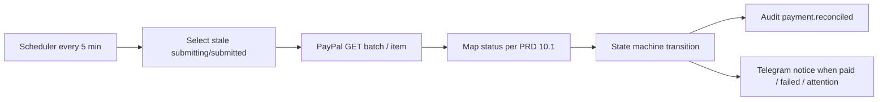

# Payment Reconciliation

> **TL;DR**
> - Every 5 minutes the scheduler runs reconcile for payments in `submitting` or `submitted` whose last change is older than 2 minutes (FR-23).
> - Reconcile reads PayPal (`GET` batch or item) and applies the same status mapping as webhooks (PRD 10.1).
> - Reconcile fixes "paid at PayPal but not in DB" and is the primary path when webhooks fail (16.5 fallback).
> - Every reconcile change is audited as `payment.reconciled`.
> - **Status: planned.** No scheduler entry exists in `routes/console.php` yet.

## 1. Schedule and selection

| Item | Value |
|---|---|
| Schedule | `routes/console.php`: `Schedule::job(new ReconcilePaymentsJob)->everyFiveMinutes()->withoutOverlapping()` (planned) |
| Runner | Render container runs `schedule:work` under supervisord ([../operations/deployment-render.md](../operations/deployment-render.md)) |
| Selection | `payments.status IN ('submitting','submitted')` AND `updated_at < now() - 2 minutes` |
| Also selected | `unclaimed` and `paypal_held` payments, every run, to catch later item events |
| Batch size | 50 per run, ordered by `updated_at` ascending, paginated with `chunkById` |
| Owning unit | Payment slice `ReconcilePaymentsAction` |

## 2. Resolution rules

| Payment state | PayPal lookup | Result | Action |
|---|---|---|---|
| `submitting`, no `payout_batch_id` | Retry submit with same `sender_batch_id`; duplicate-ID error links original | Batch found | Adopt `payout_batch_id`, move to `submitted` |
| `submitting`, retries exhausted, no batch at PayPal (404 on duplicate check path) | Submit once more with same ID | Batch created or adopted | `submitted` |
| `submitted` | `GET /v1/payments/payouts/{payout_batch_id}` then item | Item `SUCCESS` | `paid`, set `paid_at`, invoice `paid`, Telegram "Paid" |
| `submitted` | same | Item `UNCLAIMED` | `unclaimed`, owner notified, invoice `paypal_attention` |
| `submitted` | same | Item `ONHOLD` / held | `paypal_held`, owner notified, invoice `paypal_attention` |
| `submitted` | same | Item `FAILED`, `DENIED`, `BLOCKED` | `failed`, invoice `payment_failed` |
| `submitted` | same | Item `RETURNED`, `REFUNDED`, `REVERSED` | `reversed` if previously `paid` or `unclaimed`, invoice `payment_failed` |
| `submitted` | same | Item `PENDING` | No change |
| `unclaimed` | Item read | `SUCCESS` or `RETURNED` | `paid` or `reversed` |

Transitions go through the same state machine as webhooks, so an illegal transition throws and is audited ([../architecture/state-machines.md](../architecture/state-machines.md)).

## 3. Interaction with webhooks

| Situation | Winner |
|---|---|
| Webhook arrives first | Webhook applies state; reconcile sees no change needed |
| Reconcile applies `paid` first, webhook arrives later | Webhook is stored, verified, deduped; transition `paid` to `paid` is a no-op, not an error |
| Webhook references unknown `payout_batch_id` (race) | Webhook handler looks up by `sender_batch_id`; reconcile also attaches on next run |

## 4. Failure handling

| Failure | Behavior |
|---|---|
| PayPal 5xx or timeout during reconcile | Skip that payment this run, counts toward circuit breaker |
| Circuit breaker open | Reconcile run exits early |
| Payment stuck in `submitting` over 30 min | Owner alert "Payment needs attention" ([../operations/runbook.md](../operations/runbook.md)) |

## 5. Tests (planned)

| Test | Assertion |
|---|---|
| Stale `submitted`, PayPal says SUCCESS | `paid`, audit `payment.reconciled` |
| Fresh `submitted` (under 2 min) | Not selected |
| Partial failure (paid at PayPal, DB not paid) | `paid` applied |
| Reconcile then duplicate webhook | One `paid` transition |
