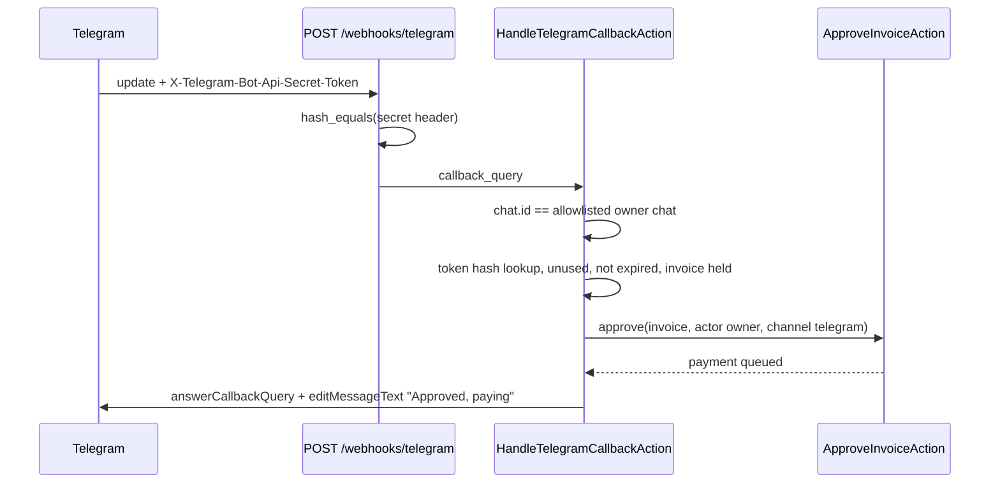

# Telegram Integration

> **TL;DR**
> - Telegram is an approval channel for HOLD only. It can approve or reject HOLD, and can never override any BLOCK or edit vendors or policy (PRD 9.4).
> - Every callback must pass four checks: webhook secret header, allowlisted chat ID, HMAC single-use token, 15 minute expiry (FR-27).
> - BLOCK alerts have no buttons. "Paid" is sent only after payment state `paid`.
> - Package `laravel-notification-channels/telegram` is planned and **not installed** (needs approval).
> - **Status: planned** (build block B8). Dashboard approvals work without Telegram (R5).

## 1. Bot setup (planned)

| Step | Action | Result |
|---|---|---|
| 1 | Message `@BotFather`, run `/newbot`, choose a name such as "Anti-Body Demo Bot" | Bot token |
| 2 | Store token as `TELEGRAM_BOT_TOKEN` in `.env` / Render env | Never committed |
| 3 | Generate webhook secret: 32+ random chars from `[A-Za-z0-9_-]` (`Str::random(48)` style), store as `TELEGRAM_WEBHOOK_SECRET` | Used in the header check |
| 4 | Owner sends `/start` to the bot | Chat exists |
| 5 | Discover chat ID: call `getUpdates` once before setting the webhook, read `message.chat.id` | Store as `TELEGRAM_OWNER_CHAT_ID` and in `users.telegram_chat_id` |
| 6 | Register webhook: `POST https://api.telegram.org/bot{token}/setWebhook` with `url=https://{host}/webhooks/telegram`, `secret_token={TELEGRAM_WEBHOOK_SECRET}`, `allowed_updates=["callback_query","message"]`, `drop_pending_updates=true` | Telegram now sends `X-Telegram-Bot-Api-Secret-Token` on every update |

OQ-05: the PRD marks the header name as UNVERIFIED. Telegram Bot API documents `secret_token` on `setWebhook` and the header `X-Telegram-Bot-Api-Secret-Token`; confirm against the live Bot API docs during B8.

## 2. Messages

HOLD approval request (PRD 19.3, illustrative):

```
⚠️ Anti-Body: approval needed
PrintHub · INV-2207 · $640.00
Risk 35 · HOLD
• 45% above usual amount
• Above auto-approve limit ($500)
[ Approve ]  [ Reject ]
Expires in 15 min
```

BLOCK alert (no buttons):

```
🛑 Anti-Body blocked a payment
"BoxPro Supplies" · $680.00
Payee does not match BoxPro's verified email
Lookalike domain · pressure language
$680 protected. Review in dashboard.
```

| Message | Trigger | Buttons | Follow-up edit |
|---|---|---|---|
| Approval request | Decision HOLD (not kill switch H9 bulk holds, which send one summary) | Approve, Reject | "✅ Approved by you · paying", then "Paid" on payment `paid` |
| Block alert | Decision BLOCK | None | None |
| Paid notice | Payment `paid` | None | n/a |
| Failure / attention | Payment `failed`, `unclaimed`, `paypal_held`; unverified webhook; HOLD auto-rejected after 72 h | None | n/a |

Message text uses only typed fields (vendor name from registry, invoice number, amount from minor units, reason labels). Free-text invoice content is never sent (see [../ai/injection-isolation.md](../ai/injection-isolation.md)). Messages use plain text or MarkdownV2 with every dynamic value escaped.

## 3. Inline keyboard and callback token

| Item | Value |
|---|---|
| Buttons | `inline_keyboard: [[{text: "Approve", callback_data: "a:{token}"}, {text: "Reject", callback_data: "r:{token}"}]]` |
| Token | `Str::random(32)` (planned), sent only inside `callback_data` (max 64 bytes) |
| Stored | `approvals.token_hash = hash_hmac('sha256', token, ANTIBODY_TOKEN_HMAC_KEY)`, unique; `token_expires_at = now + 15 min` |
| Compared with | `hash_equals()` |
| Single use | `approvals.decided_at` set on first use inside a transaction with row lock |
| Expiry | 15 min. After expiry the owner approves in the dashboard only (OQ-15; HOLD itself lives 72 h) |

## 4. Callback handling



| Check | Fail response |
|---|---|
| Secret header missing or wrong | HTTP 403, no processing, security log `telegram.secret_mismatch` |
| Chat ID not allowlisted | HTTP 200 (Telegram must not retry), ignored, audit `telegram.chat_denied` |
| Token unknown, used or expired | `answerCallbackQuery` "Already handled or expired", no state change |
| Invoice not `held` (for example BLOCK) | `answerCallbackQuery` "Only held payments can be approved here" |
| Rate limit exceeded (20/min) | HTTP 429 |

Full endpoint contract: [../api/telegram-webhook.md](../api/telegram-webhook.md).

## 5. Outbound calls

| Call | Endpoint | Timeout | Retry |
|---|---|---|---|
| Send message | `sendMessage` | 5 s connect, 10 s total | Queued notification, 3 tries; Telegram send is not money-moving so retry is safe |
| Edit message | `editMessageText` | same | same |
| Answer callback | `answerCallbackQuery` | same | No retry (expires quickly) |

The bot token is part of the URL path, so outbound request URLs must never be logged.

## 6. Tests (planned, PRD 22)

| Test | Assertion |
|---|---|
| Valid callback | One approval row, payment queued, message edited |
| Expired token | No approval, "already handled or expired" |
| Replayed token | Second tap no-op |
| Wrong chat ID | Ignored, audited |
| Missing secret header | 403 |
| Approve on BLOCK invoice | Rejected |
