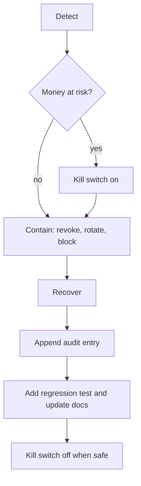

# Incident Handling

> **TL;DR**
> - First move for any money incident: turn on the kill switch (H9). No payout call is made while paused.
> - The system fails closed: LLM outage forces HOLD, PayPal outage keeps approvals `approved`/`queued`, unverified webhooks are stored and never processed.
> - Every incident ends with an audit entry and a note in the owner's incident log.
> - Status: planned. The controls referenced here are built in B3 to B8.

## 1. Severity

| Severity | Definition | Example |
|---|---|---|
| SEV1 | Money moved wrongly or a secret that can move money leaked | Double payment, leaked PayPal secret |
| SEV2 | Control bypass attempt or integrity failure, no money moved | Webhook flood, broken hash chain, leaked agent token |
| SEV3 | Degraded availability, fails closed | PayPal or LLM outage |

## 2. Playbooks

| Incident | Sev | Detection | Immediate action | Recovery | Audit |
|---|---|---|---|---|---|
| Double payment | SEV1 | Reconcile finds two PayPal items for one vendor + invoice, owner report, PayPal history | Kill switch on. Confirm with PayPal batch details that two batches exist (should be impossible: one `payments` row per invoice, unique `sender_batch_id`) | Owner requests return from the vendor (Payouts cannot be pulled back once claimed, PRD 11.2 step 8). Fix root cause, add regression test | `incident.double_payment` with both batch IDs (masked in agent responses) |
| Unverified webhook flood | SEV2 | Many `webhook_events` rows with `verified=false`, owner alert | Confirm rate limiting on `/webhooks/paypal`; events are not processed, so no state changes | Block source at Render level if needed; verify `PAYPAL_WEBHOOK_ID` is correct | `webhook.unverified` per event, summary entry |
| PayPal outage | SEV3 | Repeated 5xx or connect errors; circuit breaker opens for 10 min | Automatic: new approvals stay `approved`, payments stay `queued`; banner "PayPal unreachable, payments queued" | Breaker closes, queue resumes; `submitting` rows retry with the same `sender_batch_id`; reconcile resolves | `paypal.circuit_open`, `paypal.circuit_closed` |
| LLM outage | SEV3 | Anthropic timeout or 5xx | Automatic: extraction HOLD with `extraction_failed`; scoring uses deterministic signals only and forces HOLD | Re-run extraction from the invoice page after recovery | `extraction.failed`, `decision.made` (HOLD) |
| Leaked agent token | SEV2 | Token seen in logs, repo, screenshot; unusual `last_seen_at` | Revoke in Filament Agents (H10 rejects further calls) | Issue a new token with `antibody:agent-token`; agents can only propose, so no direct money risk | `agent.revoked`, `agent.token_issued` |
| Leaked PayPal secret | SEV1 | Secret in repo, logs or screenshot | Kill switch on. Rotate secret in developer.paypal.com, update Render env, `php artisan optimize`, `queue:restart`, clear cached OAuth token | Review sandbox payouts not linked to a `payments` row; if the secret was pushed to the public repo, rotate even after history rewrite | `secret.rotated` (no secret value) |
| Leaked Anthropic key | SEV2 | Key in repo or logs | Revoke in Anthropic console, update env | Check usage for unexpected spend | `secret.rotated` |
| Leaked Telegram bot token or webhook secret | SEV2 | Token in repo or logs | Revoke via BotFather, set new token and `secret_token`, re-run `setWebhook` | Outstanding approval tokens are single-use HMAC tokens and still require the allowlisted chat | `secret.rotated` |
| Hash chain broken | SEV2 | `antibody:audit-verify` reports first broken row | Kill switch on (integrity unknown). Export `audit_logs` | Identify the change (DB access, migration, manual edit). Do not "fix" rows; append `audit.chain_break_detected` with the broken row id and start investigating | `audit.chain_break_detected` |
| Telegram replay | SEV3 | Callback with used or expired token | Automatic reject, answer "already handled" | None | `telegram.callback_rejected` |
| Agent flood | SEV3 | 429s on MCP limiter (30/min per token) | Automatic 429 | Revoke the agent if abusive | `agent.rate_limited` |

## 3. Incident flow

## 4. Rules

| # | Rule |
|---|---|
| 1 | Never edit or delete `audit_logs` rows outside `antibody:demo-reset` |
| 2 | Never paste secrets, tokens or full payout IDs into tickets, chat or docs |
| 3 | Never move a payment from `submitting` back to `queued` to "retry" |
| 4 | Never send a manual PayPal payout for an invoice that has a `payments` row |
| 5 | Prefer the kill switch over deleting data |
