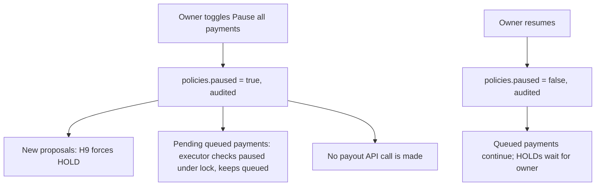

# Runbook

> **TL;DR**
> - Implemented now: Laravel queue, scheduler and failed-job commands on the database queue driver.
> - Planned: `antibody:*` commands (`demo-reset`, `agent-token`, `audit-verify`, `seed-sandbox-history`), the reconcile job every 5 minutes, baseline sync nightly, HOLD expiry, and the kill switch (H9, FR-17).
> - Production runs the worker and scheduler inside the single Render container under supervisord.
> - Every owner-facing safety action (pause, token revoke, override) is audited.

## 1. Processes

| Process | Local command | Render (planned) | Status |
|---|---|---|---|
| Web | `php artisan serve` or `composer run dev` | nginx + php-fpm | Implemented locally |
| Queue worker | `php artisan queue:listen --tries=1` (dev) / `php artisan queue:work --tries=3` | supervisord program `queue:work` | Implemented (database driver) |
| Scheduler | `php artisan schedule:work` | supervisord program `schedule:work` | Implemented command, no scheduled tasks yet |
| Vite | `npm run dev` | built assets | Implemented |

## 2. Planned scheduled tasks (`routes/console.php`)

| Task | Frequency | FR | Status |
|---|---|---|---|
| Reconcile payments in `submitting` or `submitted` older than 2 min | Every 5 minutes | FR-23 | Planned |
| Baseline sync from Transaction Search | Nightly | FR-37 | Planned (Should) |
| HOLD expiry: auto-reject HOLD older than 72 h with Telegram notice | Every 15 minutes (planned cadence) | PRD 9.3 | Planned |
| Refresh vendor stats | Nightly and on demand | FR-38 | Planned |

## 3. Procedures

| Procedure | Command or action | Status |
|---|---|---|
| Restart workers after deploy or config change | `php artisan queue:restart` | Implemented |
| List failed jobs | `php artisan queue:failed` | Implemented |
| Retry one failed job | `php artisan queue:retry <uuid>` | Implemented. Never retry a payout job manually unless the payment is still `submitting`; the job reuses the same `sender_batch_id` |
| Flush failed jobs | `php artisan queue:flush` | Implemented. Only after review |
| See schedule | `php artisan schedule:list` | Implemented |
| Run reconcile now | `php artisan antibody:reconcile` (planned name) or Filament "Reconcile now" action | Planned |
| Verify audit chain | `php artisan antibody:audit-verify` or Filament Audit log "Verify chain" | Planned (FR-36) |
| Create agent token | `php artisan antibody:agent-token "Judge agent"` (prints once) | Planned |
| Revoke agent token | Filament Agents resource, "Revoke" (sets `agents.active=false`, deletes tokens) | Planned (H10) |
| Rotate PayPal secret | Regenerate in developer.paypal.com, update `PAYPAL_CLIENT_SECRET` on Render, `php artisan optimize`, `queue:restart`, clear cached OAuth token (`php artisan cache:forget` on the PayPal token key) | Planned |
| Rotate Telegram secret | Update `TELEGRAM_WEBHOOK_SECRET`, call `setWebhook` again with the new `secret_token` | Planned |
| Rotate `ANTIBODY_TOKEN_HMAC_KEY` | Update env; outstanding approval tokens become invalid (owner uses dashboard) | Planned |
| Kill switch on | Filament Policy page, toggle "Pause all payments" (`policies.paused=true`) | Planned (US-05, H9) |
| Kill switch off | Same toggle; held proposals stay HOLD until the owner acts | Planned |
| Demo reset | See [demo-reset.md](demo-reset.md) | Planned |
| Tail logs | `php artisan pail` (local) / Render logs | Implemented locally |

## 4. Kill switch behavior (H9)

Note: `submitting` payments are already at PayPal and are not recalled; they continue to reconcile.

## 5. Health checks

| Check | How | Healthy |
|---|---|---|
| App up | `GET /up` | 200 |
| Queue draining | `jobs` table row count trending to 0 | Under 50 rows |
| Failed jobs | `php artisan queue:failed` | Empty or reviewed |
| Stale payments | Payments in `submitting`/`submitted` older than 10 min | 0 after reconcile |
| Unverified webhooks | `webhook_events` where `verified=false` today | 0 (else see incident handling) |
| Audit chain | `antibody:audit-verify` | "Chain valid" |
