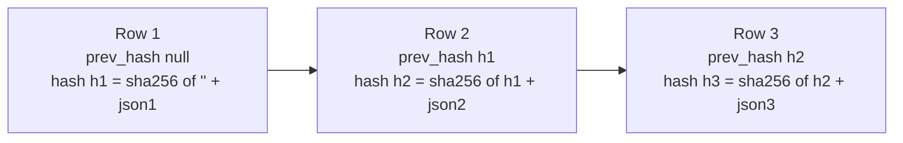

# Audit Hash Chain

> **TL;DR**
> - Every decision, approval, vendor change, policy change, payout call and webhook writes one `audit_logs` row (FR-35).
> - `hash = sha256(prev_hash . canonical_json(row))`. The first row uses an empty string for `prev_hash` in the hash input and stores `prev_hash = null`.
> - Writes go only through the Audit slice `RecordAuditEntryAction`, serialized by `Cache::lock('audit-chain')`.
> - `php artisan antibody:audit-verify` and the dashboard "verify chain" button (FR-36) recompute the chain and report the first broken row.
> - **Status: planned.** No `audit_logs` migration or Audit slice exists yet.

## 1. Table (PRD 14.1)

| Column | Type | Null | Notes |
|---|---|---|---|
| id | bigint | no | PK (decision D9) |
| actor_type | enum `owner`, `agent`, `system`, `paypal`, `telegram` | no | |
| actor_id | varchar(64) | yes | |
| action | varchar(64) | no | for example `decision.made`, `payout.submitted` |
| subject_type, subject_id | varchar | yes | |
| data | jsonb | no | Structured context, never secrets |
| prev_hash | char(64) | yes | null on first row |
| hash | char(64) | no | unique index (planned) |
| created_at | timestamp | no | UTC, set by the Action, not the DB default |

## 2. Algorithm (decision D8, OQ-17)

| Step | Rule |
|---|---|
| 1 | Build the row payload with fields `actor_type`, `actor_id`, `action`, `subject_type`, `subject_id`, `data`, `prev_hash`, `created_at` (exclude `id` and `hash`) |
| 2 | `created_at` formatted as ISO 8601 UTC with microseconds, for example `2026-10-30T04:12:09.123456Z` |
| 3 | Canonical JSON: sort keys recursively (objects only, list order kept), encode with `JSON_UNESCAPED_SLASHES \| JSON_UNESCAPED_UNICODE \| JSON_THROW_ON_ERROR`, no whitespace |
| 4 | `hash = hash('sha256', (prev_hash ?? '') . canonical_json)` |
| 5 | Insert row with `prev_hash` = previous row `hash` (null for first) |

Numbers in `data` are integers or strings only (money in minor units), so float formatting never changes a hash.

## 3. Concurrency

| Concern | Control |
|---|---|
| Two writers read the same last hash | `Cache::lock('audit-chain', 10)->block(5)` around read-last-row plus insert, inside `DB::transaction()` |
| Lock store | Database cache (`cache_locks` table) |
| Lock timeout | Throw a typed `AuditChainLockException`; caller transaction rolls back (fail closed, no unaudited money movement) |
| Audit inside business transactions | The audit write is part of the same transaction as the state change, so a rolled-back state change leaves no audit row |

## 4. Immutability

| Control | Status | Detail |
|---|---|---|
| App writes only via `RecordAuditEntryAction` | planned | No other code creates `AuditLog` rows; model has no update path in the UI |
| Model guards | planned | `AuditLog` model throws on `updating` and `deleting` events |
| Filament resource read-only | planned | No create, edit or delete actions |
| Postgres trigger rejects `UPDATE` and `DELETE` on `audit_logs` | planned, Should | Created in a Postgres-only migration branch (`DB::getDriverName() === 'pgsql'`) |
| DB role without `UPDATE`/`DELETE` on `audit_logs` | planned, Should (PRD 14.2) | Render role configuration |
| Demo reset | planned | `antibody:demo-reset` truncates audit and starts a new chain; the reset itself is the first row of the new chain (`audit.chain_reset`) |

## 5. Verification

| Entry point | Behavior |
|---|---|
| `php artisan antibody:audit-verify` | Streams rows by `id` with `lazyById()`, recomputes each hash, checks `prev_hash` linkage. Exit 0 and "Chain verified: N entries" on success; exit 1 and the first broken `id` on failure |
| Dashboard "Verify chain" (FR-36, Should) | Calls `VerifyAuditChainAction`, shows a success or failure notification |
| Demo (PRD 20, 2:00 to 2:20) | Shows "audit log hash chain verified" |

## 6. Audited actions (planned catalogue)

| Action | Actor |
|---|---|
| `invoice.received`, `invoice.duplicate_file` | owner, agent |
| `extraction.completed`, `extraction.failed` | system |
| `decision.made` | system |
| `agent.note_recorded` | agent |
| `approval.approved`, `approval.rejected`, `approval.override_block`, `approval.expired` | owner, telegram, system |
| `vendor.created`, `vendor.payee_changed`, `vendor.status_changed` | owner |
| `policy.updated`, `policy.paused`, `policy.resumed` | owner |
| `payout.submitted`, `payout.retry_scheduled`, `payout.duplicate_adopted`, `payout.failed` | system |
| `payment.paid`, `payment.reconciled`, `payment.state_changed` | paypal, system |
| `webhook.received`, `webhook.unverified` | paypal, telegram |
| `state.illegal_transition` | system |
| `audit.chain_reset` | system |

## 7. Tests (planned)

| Test | Assertion |
|---|---|
| Hash of known row | Matches fixed expected SHA-256 |
| Key order independence | Same data with different key order gives same hash |
| Tampered `data` | `antibody:audit-verify` fails at that row |
| Deleted middle row | Verify fails at the next row |
| Update attempt via model | Throws |
