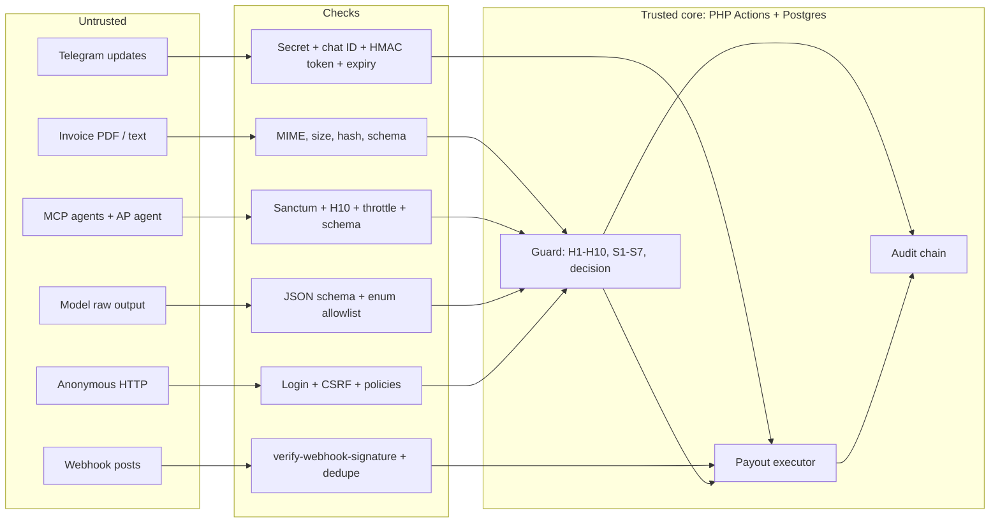

# Trust Boundaries

> **TL;DR**
> - Five boundaries: invoice content, agent calls, model output, Telegram, PayPal webhooks (PRD 12.6).
> - Data becomes trusted only after PHP validation (schema, signature, token checks). Nothing crosses back into the decision path as free text.
> - Credentials live only in env vars or hashed in the database. Agents and models never see any credential.
> - **Status: planned.** Boundaries are design targets; validation code is not built.

## 1. Boundary table (PRD 12.6)

| ID | Boundary | Trusted side | Untrusted side | Crossing check (planned) |
|---|---|---|---|---|
| TB-1 | Invoice content | PHP after schema validation | PDF bytes, all text inside | Real MIME `application/pdf`, 5 MB max, SHA-256, extractor schema validation, retry once, else HOLD |
| TB-2 | Agent calls | Gate Actions (`ProposePaymentAction` and peers) | Every MCP argument, every agent note | Sanctum token, H10 active agent, `throttle:mcp`, input schema, UUID format, note max 500 stored as data |
| TB-3 | Model output | PHP after schema validation | Raw model text | JSON schema validation; enums allowlisted (`normal`, `unusual`, `implausible`); lengths capped (200, 400) |
| TB-4 | Telegram | Verified callback from allowlisted chat | Any other update | Secret header `hash_equals`, chat ID allowlist, HMAC token hash, single use, 15 min expiry |
| TB-5 | PayPal webhooks | Verified events | Unverified posts | `verify-webhook-signature` returns `SUCCESS`, dedupe by event ID |
| TB-6 | Owner browser | Authenticated Filament session | Anonymous requests | Panel auth, CSRF (`PreventRequestForgery`), policies, `->authorize()` on actions |

## 2. What crosses each boundary

| Boundary | Allowed through | Never allowed through |
|---|---|---|
| TB-1 to analyst | Typed fields: line items (name, qty, unit price), signal list with points, phrase categories, vendor stats | Invoice notes, terms, raw phrase text, any free text |
| TB-2 to guard | `invoice_id` (UUID), optional `note` stored to audit | Amount, payee, approval flags, policy values |
| TB-3 to decision | S3 band (`normal`/`unusual`/`implausible` mapped to 0/8/15 by PHP), owner explanation text (display only) | Score, decision, points outside S3 bands |
| Outbound to agents | Decision, reason codes and labels, score, payment status, masked payout item ID | Credentials, raw PayPal IDs, owner explanation of other invoices, PDFs |
| Outbound to Telegram | Vendor name (registry), invoice number, amount, reason labels | Free-text invoice content, tokens in logs |

## 3. Credential locations (PRD 12.6)

| Secret | Lives in | Never in |
|---|---|---|
| PayPal client ID and secret | Render env vars, local `.env` | Repo, agents, logs, MCP responses |
| PayPal access token | App cache, 8 h max | Logs |
| Anthropic API key | Render env vars, local `.env` | Repo, logs |
| Telegram bot token and webhook secret | Render env vars, local `.env` | Repo, logs |
| `ANTIBODY_TOKEN_HMAC_KEY` | Render env vars, local `.env` | Repo, logs |
| Agent MCP tokens | Hashed in `personal_access_tokens` | Plaintext anywhere after creation |
| Telegram approval tokens | Hashed in `approvals.token_hash` | Plaintext after the message is sent |

Details and rotation: [secrets.md](./secrets.md).

## 4. Fail-closed rules

| Condition | Result |
|---|---|
| Extraction invalid twice or model provider down | Invoice `held` with `extraction_failed` |
| Analyst unavailable | Deterministic signals only, decision forced to at least HOLD |
| Webhook verification call fails or returns `FAILURE` | Stored with `verified=false`, not processed, owner alerted |
| Any check throws | No access granted, no state change, error logged with context, safe message to caller |
